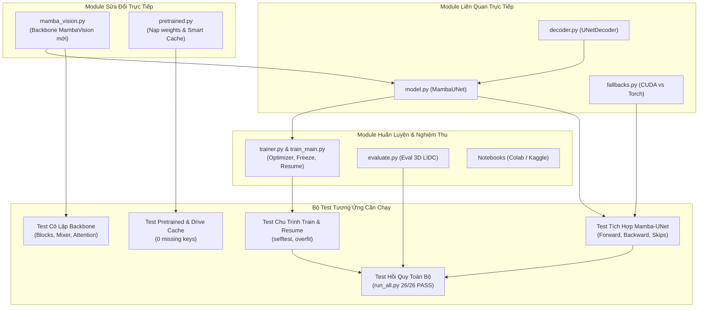
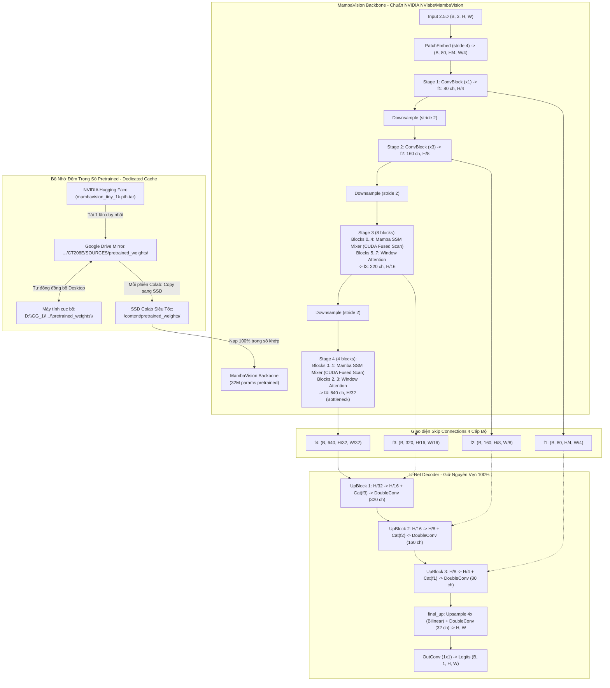
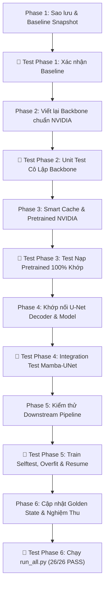

# 📋 Kế Hoạch Triển Khai & Kiểm Thử Toàn Diện MambaVision Chuẩn NVIDIA (Hướng Tiếp Cận A)

> **Mục tiêu cốt lõi**:
> 1. Đồng bộ mã nguồn chuẩn 1-1 từ repo chính thức [`NVlabs/MambaVision`](https://github.com/NVlabs/MambaVision) (CVPR 2024) vào `mamba_unet/backbone/mamba_vision.py`.
> 2. Bảo toàn nguyên vẹn 100% cấu trúc U-Net Decoder hiện tại (`DoubleConv`, `UpBlock`, `final_up`).
> 3. Tận dụng 100% hệ thống 2 bánh xe CUDA (`mamba_ssm` + `causal_conv1d`) đã cấu hình trên Google Colab.
> 4. Xây dựng **Ma trận kiểm thử đa tầng (Multi-tier Testing Strategy)**: Kiểm thử từng module cô lập $\to$ Kiểm thử tích hợp U-Net $\to$ Kiểm thử nạp Pretrained $\to$ Kiểm thử toàn chu trình Huấn luyện & Đánh giá $\to$ Kiểm thử hồi quy toàn hệ thống (Regression Test).
> 5. Thiết lập thư mục riêng biệt **`pretrained_weights/`** trên Google Drive mirror để tự động cache/nạp model MambaVision siêu tốc mà không cần tải lại nhiều lần.

---

## 1. Ma Trận Các Module Bị Ảnh Hưởng & Phạm Vi Kiểm Thử

---

## 2. Kiến Trúc Cắm Rút Tổng Thể (Plug-in Architecture)

---

## 3. Lộ Trình Triển Khai Kèm Pha Kiểm Thử Tương Ứng (Phased Roadmap with Test Phases)

---

### 🔹 GIAI ĐOẠN 1: Sao Lưu An Toàn & Chuẩn Bị
- **Mã nguồn thực hiện**:
  1. Tạo thư mục `pretrained_weights/` trong dự án và đưa vào `.gitignore`.
  2. Tạo bản sao lưu an toàn `tests/golden/mamba_unet_keys_legacy_v1.json` cho tập khóa cũ.
- **🧪 TEST PHASE 1 (Kiểm thử an toàn trước khi sửa)**:
  - Chạy `python tests/run_all.py` ghi nhận trạng thái nền hiện tại.
  - Xác nhận git branch sạch sẽ để sẵn sàng rollback nếu có sự cố.

---

### 🔹 GIAI ĐOẠN 2: Tái Cấu Trúc MambaVision Backbone Chuẩn NVIDIA
- **Mã nguồn thực hiện (`mamba_unet/backbone/mamba_vision.py`)**:
  1. Thay thế class `Block` cũ (nhồi nhét cả 3 thành phần) bằng `MambaVisionLayer` chuẩn NVIDIA:
     - 1 token mixer trên mỗi block: `MambaVisionMixer` (State Space Model) HOẶC `WindowAttention`.
     - Phân bổ chuẩn trong Stage 3 (5 mamba + 3 attention) và Stage 4 (2 mamba + 2 attention).
     - 2 cổng LayerScale tham số học được: `self.g_1`, `self.g_2`.
  2. Cố định hàm `forward_features(x)` xuất 4 multi-scale feature maps `[f1, f2, f3, f4]` sạch sẽ.
- **🧪 TEST PHASE 2 (Unit Test Cô Lập Từng Khối của Backbone)**:
  1. **Test từng khối riêng rẽ**:
     - Test `PatchEmbed`: Input `(2, 3, 64, 64)` $\to$ Output `(2, 80, 16, 16)`.
     - Test `ConvBlock`: Giữ nguyên kích thước và số kênh qua Depthwise Separable Conv.
     - Test `MambaVisionMixer`: Quét xuôi + ngược, gradient hữu hạn (cả `fp32` và `fp16`).
     - Test `WindowAttention`: Window partition, attention map softmax, relative position bias, window reverse.
     - Test `MambaVisionLayer`: Hoạt động chuẩn xác khi gán `mixer_type="mamba"` và `mixer_type="attention"`.
  2. **Test 4 biến thể kiến trúc**:
     - Khởi tạo và kiểm tra shape đầu ra của `mamba_vision_T`, `mamba_vision_T2`, `mamba_vision_S`, `mamba_vision_B`.
  3. **Lệnh thực thi kiểm thử**:
     `python -m mamba_unet.backbone.mamba_vision` (phải báo `✅ Selftest thành công!`).

---

### 🔹 GIAI ĐOẠN 3: Nâng Cấp Nạp Pretrained Với Cơ Chế Smart Cache
- **Mã nguồn thực hiện (`mamba_unet/backbone/pretrained.py`)**:
  1. Xây dựng logic Smart Cache:
     - Dò tìm file `mambavision_tiny_1k.pth.tar` trong thư mục Google Drive mirror `pretrained_weights/`.
     - Nếu có: Copy sang SSD `/content/pretrained_weights/` và nạp tức thì.
     - Nếu chưa: Tải từ Hugging Face Hub của NVIDIA về SSD và tự động lưu 1 bản sao vào Google Drive để đồng bộ về máy tính.
  2. Nạp trọng số chính thức của NVIDIA:
     - Bóc tách tiền tố `module.` và bỏ qua classifier `head.`.
     - Nạp vào Backbone với yêu cầu nghiêm ngặt: **0 missing keys, 0 unexpected keys**.
- **🧪 TEST PHASE 3 (Kiểm thử nạp Pretrained Weights)**:
  1. **Test kiểm tra khớp 100% khóa**:
     - Nạp file `mambavision_tiny_1k.pth.tar` vào `mamba_vision_T`.
     - Khẳng định: Toàn bộ 100% trọng số của Stem, Stage 1, Stage 2, Stage 3, Stage 4 đều được nạp đầy đủ.
  2. **Test cơ chế Smart Cache**:
     - Giả lập trường hợp file đã có trong thư mục $\to$ Xác nhận không gọi download.
     - Giả lập trường hợp file chưa có $\to$ Xác nhận tự động tải và tạo bản copy.
  3. **Lệnh thực thi kiểm thử**:
     `python -m mamba_unet.backbone.pretrained` (phải báo `✅ Nạp 100% khớp, 0 missing keys`).

---

### 🔹 GIAI ĐOẠN 4: Khớp Nối Với U-Net Decoder & Model Integration
- **Mã nguồn thực hiện (`mamba_unet/model.py`)**:
  1. Nối 4 feature maps $[f_1, f_2, f_3, f_4]$ từ MambaVision mới vào `UNetDecoder` (giữ nguyên vẹn 3 `UpBlock` + `final_up`).
  2. Đảm bảo giao diện: `MambaUNet(in_channels=3, num_classes=1, backbone="mamba_vision_T", pretrained=True)`.
- **🧪 TEST PHASE 4 (Kiểm thử tích hợp U-Net + MambaVision)**:
  1. **Test Forward Pass**:
     - Input ngẫu nhiên `(2, 3, 128, 128)` $\to$ Output Logits `(2, 1, 128, 128)`.
  2. **Test Backward Pass & Dòng Gradient (Gradient Flow)**:
     - Tính Loss $\to$ gọi `loss.backward()`.
     - Kiểm tra toàn bộ tham số của Decoder và Backbone đều có `.grad` hữu hạn (không bị `None`, không bị `NaN`/`Inf`).
  3. **Test chuyển đổi Backend**:
     - Kiểm tra khi `DUNEAI_MAMBA_BACKEND=torch` (PyTorch fallback).
     - Kiểm tra khi `DUNEAI_MAMBA_BACKEND=cuda` (CUDA kernel).
     - So sánh đầu ra giữa 2 backend (độ lệch số học tối đa $\le 10^{-4}$).
  4. **Lệnh thực thi kiểm thử**:
     `python -m mamba_unet.model` và `python tests/test_scan_fallback.py`.

---

### 🔹 GIAI ĐOẠN 5: Kiểm Thử Toàn Bộ Các Module Downstream Phụ Thuộc
- **Mã nguồn thực hiện (`mamba_unet/trainer.py`, `mamba_unet/train_main.py`, `mamba_unet/evaluate.py`)**:
  Đảm bảo các module huấn luyện và đánh giá thích ứng mượt mà với mô hình mới.
- **🧪 TEST PHASE 5 (Kiểm thử Downstream Pipeline)**:
  1. **Test Lịch Đóng Băng Backbone (Freeze Backbone Schedule)**:
     - Kiểm tra trong các epoch đóng băng: `backbone.parameters().requires_grad == False` (không tính đạo hàm cho backbone).
     - Kiểm tra sau khi hết epoch đóng băng: Backbone tự động mở băng và nhận learning rate nhân với `backbone_lr_mult`.
  2. **Test Lưu Checkpoint Đầy Đủ**:
     - Kiểm tra sau khi train sinh đủ 3 file: `last_model.pth`, `best_model.pth`, và `best_weights_fp16.pth` (chuẩn half-precision).
     - Kiểm tra file cấu hình phiên chạy: `run_config.json` đủ các trường siêu tham số.
  3. **Test Tự Động Resume (`--resume auto`)**:
     - Giả lập ngắt đột ngột (KeyboardInterrupt) tại epoch 2 $\to$ Lưu checkpoint an toàn.
     - Gọi `resume auto` $\to$ Mô hình nạp lại `last_model.pth` và tiếp tục chạy mượt mà từ epoch 3.
  4. **Test Khả Năng Học Overfit**:
     - Huấn luyện trên batch siêu nhỏ (4 mẫu) trong 5 epochs $\to$ Val Dice phải tăng nhanh (chứng minh mô hình có khả năng học thực sự).
  5. **Test Đánh Giá 3D Bệnh Nhân (`evaluate.py`)**:
     - Chạy kiểm thử hàm gom lát cắt thành thể tích 3D và tính Dice 3D theo bệnh nhân.
  6. **Lệnh thực thi kiểm thử**:
     `python -m mamba_unet.train_main selftest` và `python -m mamba_unet.evaluate selftest`.

---

### 🔹 GIAI ĐOẠN 6: Cập Nhật Golden State Dict & Nghiệm Thu Toàn Hệ Thống
- **Mã nguồn thực hiện**:
  1. Xuất file golden keys chuẩn mới: `tests/golden/mamba_unet_keys.json` (ghi nhận danh sách khóa và shape của MambaVision mới).
  2. Tạo snapshot số học: `mamba_unet_tiny_state.pth` và `mamba_unet_tiny_out.pt`.
  3. Cập nhật `export_codebase.py` và `codebase_summary.txt`.
- **🧪 TEST PHASE 6 (Kiểm thử hồi quy toàn diện - Final Regression Test Suite)**:
  1. **Test Tính Bất Biến Khóa Golden**:
     - `python tests/test_state_dict_invariance.py` (Khớp 100% khóa và tensor đầu ra).
  2. **Test Tính Độc Lập Kiến Trúc Tuyệt Đối (R1 & R11)**:
     - `python tests/test_independence.py` (Đảm bảo `mamba_unet` không dính bất kỳ import nào từ `unet_base`).
  3. **Test Tính Hợp Chuẩn Notebooks**:
     - `python scripts/make_notebooks.py --check` (Đảm bảo 6/6 notebooks đạt chuẩn `nbformat v4`).
  4. **Nghiệm Thu Toàn Dự Án**:
     - `python tests/run_all.py` (Bắt buộc toàn bộ **26/26 bài kiểm thử** đều đạt `PASS`).
     - Commit Git sạch sẽ với thông điệp chuẩn mực.
