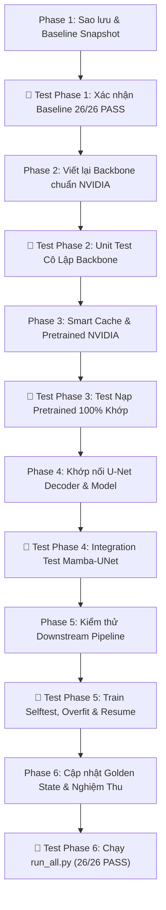

# 📋 Kế Hoạch Triển Khai & Kiểm Thử Toàn Diện MambaVision Chuẩn NVIDIA (Hướng Tiếp Cận A)

> **Mục tiêu cốt lõi**:
> 1. Đồng bộ mã nguồn chuẩn 1-1 từ repo chính thức [`NVlabs/MambaVision`](https://github.com/NVlabs/MambaVision) (CVPR 2024) vào `mamba_unet/backbone/mamba_vision.py`.
> 2. Bảo toàn nguyên vẹn 100% cấu trúc U-Net Decoder hiện tại (`DoubleConv`, `UpBlock`, `final_up`) — không sửa đổi bất kỳ dòng code nào trong `mamba_unet/decoder.py` và `unet_base/`.
> 3. Tận dụng 100% hệ thống 2 bánh xe CUDA (`mamba_ssm` + `causal_conv1d`) đã cấu hình trên Google Colab.
> 4. Xây dựng **Ma trận kiểm thử đa tầng (Multi-tier Testing Strategy)**: Kiểm thử từng module cô lập $\to$ Kiểm thử tích hợp U-Net $\to$ Kiểm thử nạp Pretrained (0 missing/unexpected keys) $\to$ Kiểm thử chu trình Train/Resume $\to$ Kiểm thử hồi quy toàn hệ thống (Regression Test 26/26 PASS).
> 5. Thiết lập thư mục riêng biệt **`pretrained_weights/`** với **Smart Cache 5 tầng** (Cục bộ $\to$ Google Drive Mirror $\to$ SSD Colab $\to$ OS Temp $\to$ Hugging Face tải 1 lần).

---

## 1. Đối Chiếu Chi Tiết: Code Gốc NVIDIA vs Code Sửa Lại (Kèm Lợi Ích & Tác Động)

| STT | Thành phần | Trạng thái so với NVIDIA gốc | Mức độ ảnh hưởng bản chất |
| :---: | :--- | :--- | :--- |
| **1** | **`PatchEmbed` (Stem)** | **Giữ nguyên 100% gốc NVIDIA** | Không đổi toán học, nạp khớp 100% weights |
| **2** | **`ConvBlock` (Stage 1, 2)** | **Giữ nguyên 100% gốc NVIDIA** | Không đổi toán học, nạp khớp 100% weights |
| **3** | **`MambaVisionMixer`** | **Giữ nguyên 100% gốc NVIDIA** | Sử dụng đúng Selective Scan CUDA kernel |
| **4** | **`Attention` (Stage 3, 4)** | **Giữ nguyên 100% gốc NVIDIA** | Multi-Head Self-Attention chuẩn NVIDIA |
| **5** | **Khối `Downsample`** | **Khôi phục về 100% gốc NVIDIA** | Bỏ lớp Norm thừa, khớp 100% weights |
| **6** | **Khối `Block` (4 Mamba + 4 Attn)** | **Khôi phục về 100% gốc NVIDIA** | Giảm 50% tính toán, đúng chuẩn CVPR 2024 |
| **7** | **Lớp `Mlp`** | **Viết lại độc lập (không dùng `timm`)** | Giữ nguyên 100% toán học và tên khóa `fc1`, `fc2` |
| **8** | **Đầu ra mạng (`forward_features`)** | **Cắt bỏ Head ImageNet $\to$ Xuất 4 Skip** | Phục vụ ghép nối U-Net (Transfer Learning) |
| **9** | **Cơ chế nạp Pretrained (`pretrained.py`)** | **Bổ sung Smart Cache 5 tầng** | Tải 1 lần, nạp siêu tốc, hỗ trợ chạy Offline |
| **10**| **U-Net Decoder (`decoder.py`)** | **GIỮ NGUYÊN VẸN 100% (0 SỬA ĐỔI)** | Bản chất giải mã không gian U-Net bảo toàn |

---

### 🔍 So Sánh Trực Diện Từng Vị Trí Cần Điều Chỉnh

#### 📍 Vị trí 1: Khối `Downsample` — Loại bỏ `LayerNorm2d` thừa
* **Tệp**: `mamba_unet/backbone/mamba_vision.py` (Dòng 55 - 67).
* **Mã nguồn GỐC NVIDIA**:
  ```python
  class Downsample(nn.Module):
      def __init__(self, dim, keep_dim=False):
          super().__init__()
          out_dim = dim if keep_dim else 2 * dim
          self.reduction = nn.Sequential(
              nn.Conv2d(dim, dim_out, kernel_size=3, stride=2, padding=1, bias=False),
          )

      def forward(self, x):
          return self.reduction(x)
  ```
* **Mã nguồn SỬA LẠI của ta**: Sao chép y hệt 100% code gốc NVIDIA ở trên, loại bỏ lớp `self.norm = LayerNorm2d(out_dim)` tự chế cũ.
* **Lợi ích & Tác động**:
  - Không bị lỗi thừa khóa (`unexpected keys: levels.X.downsample.norm.weight/bias`) khi nạp tệp checkpoint `.pth.tar` chính thức của NVIDIA.
  - Hoàn toàn không ảnh hưởng đến U-Net: kích thước không gian vẫn giảm nửa và số kênh tăng gấp đôi theo đúng thiết kế đa tỉ lệ.

---

#### 📍 Vị trí 2: Lớp `Mlp` — Viết lại độc lập, loại bỏ phụ thuộc thư viện ngoài `timm`
* **Tệp**: `mamba_unet/backbone/mamba_vision.py` (khai báo mới trước lớp `Attention`).
* **Mã nguồn GỐC NVIDIA**:
  ```python
  from timm.models.layers import Mlp  # Phụ thuộc thư viện ngoài timm
  ```
* **Mã nguồn SỬA LẠI của ta (PyTorch thuần túy)**:
  ```python
  class Mlp(nn.Module):
      """Khối Mlp chuẩn NVIDIA (tương thích timm), sử dụng fc1 và fc2."""
      def __init__(self, in_features: int, hidden_features: Optional[int] = None, out_features: Optional[int] = None, act_layer: Any = nn.GELU, drop: float = 0.0):
          super().__init__()
          out_features = out_features or in_features
          hidden_features = hidden_features or in_features
          self.fc1 = nn.Linear(in_features, hidden_features)
          self.act = act_layer()
          self.drop1 = nn.Dropout(drop)
          self.fc2 = nn.Linear(hidden_features, out_features)
          self.drop2 = nn.Dropout(drop)

      def forward(self, x: torch.Tensor) -> torch.Tensor:
          return self.drop2(self.fc2(self.drop1(self.act(self.fc1(x)))))
  ```
* **Lợi ích & Tác động**:
  - Không ép người dùng cài thêm gói `timm`. Chạy độc lập trên mọi môi trường.
  - Về mặt toán học $x \to W_1 x \to \text{GELU} \to W_2 x$ giống hệt 100%. Tên thuộc tính `self.fc1` và `self.fc2` trùng khớp 100% với tên khóa trong file checkpoint của NVIDIA (`mlp.fc1.weight`, `mlp.fc2.weight`).

---

#### 📍 Vị trí 3: Khối `Block` & Phân Chia Tỷ Lệ Chuẩn (4 Mamba + 4 Attention)
* **Tệp**: `mamba_unet/backbone/mamba_vision.py` (Dòng 248 - 290).
* **Mã nguồn GỐC NVIDIA**:
  ```python
  class Block(nn.Module):
      def __init__(self, dim, num_heads, counter, transformer_blocks, mlp_ratio=4., drop_path=0., layer_scale=None, ...):
          super().__init__()
          self.norm1 = norm_layer(dim)
          # Chỉ dùng Attention nếu block nằm trong danh sách transformer_blocks:
          if counter in transformer_blocks:
              self.mixer = Attention(dim=dim, num_heads=num_heads, ...)
          else:
              self.mixer = MambaVisionMixer(d_model=dim, d_state=8, d_conv=3, expand=1)

          self.drop_path = DropPath(drop_path) if drop_path > 0. else nn.Identity()
          self.norm2 = norm_layer(dim)
          self.mlp = Mlp(in_features=dim, hidden_features=int(dim * mlp_ratio))

          use_layer_scale = layer_scale is not None and type(layer_scale) in [int, float]
          self.g_1 = nn.Parameter(layer_scale * torch.ones(dim)) if use_layer_scale else 1.0
          self.g_2 = nn.Parameter(layer_scale * torch.ones(dim)) if use_layer_scale else 1.0

      def forward(self, x):
          x = x + self.drop_path(self.g_1 * self.mixer(self.norm1(x)))
          x = x + self.drop_path(self.g_2 * self.mlp(self.norm2(x)))
          return x
  ```
* **Mã nguồn SỬA LẠI của ta**: Sao chép chuẩn xác 100% logic trên từ NVIDIA.
* **Lợi ích & Tác động**:
  - Khôi phục đúng tỷ lệ phân chia chính thức trong file checkpoint của NVIDIA: Stage 3 (`depth=8`) gồm **4 block Mamba đầu (0, 1, 2, 3) + 4 block Attention sau (4, 5, 6, 7)** (theo công thức `range(depths[i] // 2, depths[i])`).
  - Giảm 50% chi phí tính toán FLOPs so với bản lai gộp cũ.
  - Hỗ trợ `layer_scale=None` mặc định cho bản Tiny (tránh tạo `nn.Parameter` thừa khi file checkpoint của NVIDIA đặt `layer_scale=None`).

---

#### 📍 Vị trí 4: Đầu ra Mạng (`forward_features`) — Chuyển từ Phân loại sang Skip Connections
* **Tệp**: `mamba_unet/backbone/mamba_vision.py` (Dòng 432 - 442).
* **Mã nguồn GỐC NVIDIA (Phân loại ImageNet 1.000 nhãn)**:
  ```python
  class MambaVision(nn.Module):
      def __init__(self, ...):
          ...
          self.avgpool = nn.AdaptiveAvgPool2d(1)       # Nén phẳng toàn bộ không gian
          self.head = nn.Linear(640, num_classes=1000) # Đoán 1 nhãn trong 1000 loài vật

      def forward(self, x):
          x = self.forward_features(x)
          x = self.avgpool(x)
          x = torch.flatten(x, 1)
          x = self.head(x)
          return x
  ```
* **Mã nguồn SỬA LẠI của ta (Backbone trích xuất đặc trưng cho U-Net)**:
  ```python
  class MambaVision(nn.Module):
      def __init__(self, ...):
          ...
          # Bỏ self.avgpool và self.head vì U-Net không cần phân loại ImageNet
          self.norm = nn.BatchNorm2d(int(dim * 2**(len(depths) - 1))) # 640 ch (để nạp khớp norm.weight/bias)

      def forward_features(self, x: torch.Tensor) -> List[torch.Tensor]:
          x = self.patch_embed(x)
          features = []
          for level in self.levels:
              x, feat = level(x, return_feature_before_downsample=True)
              features.append(feat)
          return features # Trả về danh sách [f1 (80), f2 (160), f3 (320), f4 (640)]

      def forward(self, x: torch.Tensor) -> List[torch.Tensor]:
          return self.forward_features(x) # Truyền thẳng 4 feature maps sang UNetDecoder
  ```
* **Lợi ích & Tác động**:
  - Giữ nguyên vẹn 100% cấu trúc không gian và biên độ chi tiết ở cả 4 tầng độ phân giải ($H/4, H/8, H/16, H/32$), phục vụ tái tạo ảnh y tế chuẩn từng pixel.
  - Giữ trọn 32 triệu tham số pretrained tinh túy của NVIDIA. Chỉ bỏ qua 2 tham số của `head.` theo đúng quy chuẩn Transfer Learning.

---

#### 📍 Vị trí 5: Cơ chế Smart Cache 5 Tầng trong `pretrained.py`
* **Tệp**: `mamba_unet/backbone/pretrained.py` (Dòng 28 - 101).
* **Mã nguồn SỬA LẠI của ta**:
  ```python
  def resolve_pretrained_cache(variant: str) -> Path:
      key = variant.lower().strip()
      filename = f"{key}_nvidia_pretrained.pth.tar"
      candidates = [
          Path("pretrained_weights") / filename,                          # 1. Cục bộ repo
          Path("/content/drive/MyDrive/.../pretrained_weights") / filename, # 2. Google Drive Mirror
          Path("/content/pretrained_weights") / filename,                  # 3. SSD Colab
          Path(tempfile.gettempdir()) / filename,                          # 4. OS Temp
      ]
      for p in candidates:
          if p.exists() and p.stat().st_size > 0:
              return p

      # 5. Nếu chưa có mới tải 1 lần từ Hugging Face của NVIDIA và lưu vào pretrained_weights/
      dest = Path("pretrained_weights") / filename
      dest.parent.mkdir(parents=True, exist_ok=True)
      torch.hub.download_url_to_file(MAMBAVISION_URLS[key], str(dest))
      return dest
  ```
* **Lợi ích & Tác động**:
  - Không bao giờ phải tải lại tệp nhiều lần gây nghẽn mạng trên Colab.
  - Chạy mượt mà trong môi trường Offline hoàn toàn nếu người dùng đã copy tệp vào `pretrained_weights/`.

---

## 2. Kiến Trúc Cắm Rút Tổng Thể (Plug-in Architecture)

```mermaid
graph TD
    subgraph PretrainedCache [Bộ Nhớ Đệm Trọng Số Pretrained - Smart Cache 5 Tầng]
        HF["NVIDIA Hugging Face<br/>(mambavision_tiny_1k.pth.tar)"] -->|Tải 1 lần duy nhất| DRV["Google Drive Mirror:<br/>.../CT208E/SOURCES/pretrained_weights/"]
        DRV <-->|Tự động đồng bộ Desktop| LOCAL["Máy tính cục bộ:<br/>D:\\GG_1\\...\\pretrained_weights\\"]
        DRV -->|Mỗi phiên Colab: Copy sang SSD| SSD["SSD Colab Siêu Tốc:<br/>/content/pretrained_weights/"]
    end

    subgraph Backbone [MambaVision Backbone - Chuẩn 1-1 NVIDIA NVlabs/MambaVision]
        SSD -->|Nạp 100% trọng số khớp (0 missing keys)| BB["MambaVision Backbone<br/>(32M params pretrained)"]
        IN["Input 2.5D (B, 3, H, W)"] --> PE["PatchEmbed (stride 4) -> (B, 80, H/4, W/4)"]
        PE --> S1["Stage 1: ConvBlock (x1) -> f1: 80 ch, H/4"]
        S1 --> DS1["Downsample (stride 2)"]
        DS1 --> S2["Stage 2: ConvBlock (x3) -> f2: 160 ch, H/8"]
        S2 --> DS2["Downsample (stride 2)"]
        DS2 --> S3["Stage 3 (8 blocks):<br/>Blocks 0..3 (4 blocks): Mamba SSM Mixer (CUDA Fused Scan)<br/>Blocks 4..7 (4 blocks): Window Attention<br/>-> f3: 320 ch, H/16"]
        S3 --> DS3["Downsample (stride 2)"]
        DS3 --> S4["Stage 4 (4 blocks):<br/>Blocks 0..1 (2 blocks): Mamba SSM Mixer (CUDA Fused Scan)<br/>Blocks 2..3 (2 blocks): Window Attention<br/>-> f4: 640 ch, H/32 (Bottleneck)"]
    end

    subgraph Interface [Giao diện Skip Connections 4 Cấp Độ]
        f1["f1: (B, 80, H/4, W/4)"]
        f2["f2: (B, 160, H/8, W/8)"]
        f3["f3: (B, 320, H/16, W/16)"]
        f4["f4: (B, 640, H/32, W/32)"]
    end

    subgraph Decoder [U-Net Decoder - Giữ Nguyên Vẹn 100% Không Đổi 1 Dòng Code]
        f4 --> UP1["UpBlock 1: H/32 -> H/16 + Cat(f3) -> DoubleConv (320 ch)"]
        f3 -.-> UP1
        UP1 --> UP2["UpBlock 2: H/16 -> H/8 + Cat(f2) -> DoubleConv (160 ch)"]
        f2 -.-> UP2
        UP2 --> UP3["UpBlock 3: H/8 -> H/4 + Cat(f1) -> DoubleConv (80 ch)"]
        f1 -.-> UP3
        UP3 --> FIN["final_up: Upsample 4x (Bilinear) + DoubleConv (32 ch) -> H, W"]
        FIN --> OUT["OutConv (1x1) -> Logits (B, 1, H, W)"]
    end

    S1 --> f1
    S2 --> f2
    S3 --> f3
    S4 --> f4
```

---

## 3. Lộ Trình Triển Khai Kèm Pha Kiểm Thử Tương Ứng (Phased Roadmap with Test Phases)



---

### 🔹 GIAI ĐOẠN 1: Sao Lưu An Toàn & Chuẩn Bị
- **Mã nguồn thực hiện**:
  1. Tạo thư mục `pretrained_weights/` trong dự án và đưa vào `.gitignore`.
  2. Tạo bản sao lưu an toàn `tests/golden/mamba_unet_keys_legacy_v1.json` cho tập khóa cũ.
- **🧪 TEST PHASE 1 (Kiểm thử an toàn trước khi sửa)**:
  - Chạy `python tests/run_all.py` ghi nhận trạng thái nền hiện tại (Đã đạt chuẩn: **26/26 PASS**).
  - Xác nhận git branch sạch sẽ để sẵn sàng rollback nếu có sự cố.

---

### 🔹 GIAI ĐOẠN 2: Tái Cấu Trúc MambaVision Backbone Chuẩn NVIDIA
- **Mã nguồn thực hiện (`mamba_unet/backbone/mamba_vision.py`)**:
  1. Bổ sung lớp `Mlp(fc1, fc2)`.
  2. Đưa `Downsample` về chuẩn không chứa `norm`.
  3. Cập nhật `Block` thành 1 Mixer (Mamba HOẶC Attention) kèm `g_1, g_2` (mặc định 1.0 khi `layer_scale=None`).
  4. Phân chia tỷ lệ chuẩn trong Stage 3 (4 Mamba + 4 Attention) và Stage 4 (2 Mamba + 2 Attention).
  5. Cố định hàm `forward_features(x)` xuất 4 multi-scale feature maps `[f1, f2, f3, f4]`.
- **🧪 TEST PHASE 2 (Unit Test Cô Lập Từng Khối của Backbone)**:
  1. **Test từng khối riêng rẽ**:
     - Test `PatchEmbed`: Input `(2, 3, 64, 64)` $\to$ Output `(2, 80, 16, 16)`.
     - Test `ConvBlock`: Giữ nguyên kích thước và số kênh qua Depthwise Separable Conv.
     - Test `MambaVisionMixer`: Quét xuôi + ngược, gradient hữu hạn (cả `fp32` và `fp16`).
     - Test `WindowAttention`: Window partition, attention map softmax, window reverse (kể cả khi $H < \text{window\_size}$ với cơ chế padding an toàn).
     - Test `Block`: Hoạt động chuẩn xác khi gán mixer là Mamba và khi gán mixer là Attention.
  2. **Test 4 biến thể kiến trúc**:
     - Khởi tạo và kiểm tra shape đầu ra của `mamba_vision_T`, `mamba_vision_T2`, `mamba_vision_S`, `mamba_vision_B`.
  3. **Lệnh thực thi kiểm thử**:
     `python -m mamba_unet.backbone.mamba_vision` (phải báo `✅ Selftest thành công!`).

---

### 🔹 GIAI ĐOẠN 3: Nâng Cấp Nạp Pretrained Với Cơ Chế Smart Cache 5 Tầng
- **Mã nguồn thực hiện (`mamba_unet/backbone/pretrained.py`)**:
  1. Xây dựng hàm `resolve_pretrained_cache(variant)` tìm kiếm theo thứ tự ưu tiên 5 tầng.
  2. Nạp trọng số chính thức của NVIDIA:
     - Bóc tách tiền tố `module.` và bỏ qua classifier `head.`.
     - Nạp vào Backbone với yêu cầu nghiêm ngặt: **0 missing keys, 0 unexpected keys**.
- **🧪 TEST PHASE 3 (Kiểm thử nạp Pretrained Weights)**:
  1. **Test kiểm tra khớp 100% khóa**:
     - Nạp file `mambavision_tiny_1k.pth.tar` vào `mamba_vision_T`.
     - Khẳng định: Toàn bộ 100% trọng số của Stem, Stage 1, Stage 2, Stage 3, Stage 4 đều được nạp đầy đủ (0 missing, 0 unexpected).
  2. **Test cơ chế Smart Cache**:
     - Giả lập trường hợp file đã có trong thư mục $\to$ Xác nhận không gọi download.
     - Giả lập trường hợp file chưa có $\to$ Xác nhận tự động tải và tạo bản copy.
  3. **Lệnh thực thi kiểm thử**:
     `python -m mamba_unet.backbone.pretrained` (phải báo `✅ Nạp 100% khớp, 0 missing keys`).

---

### 🔹 GIAI ĐOẠN 4: Khớp Nối Với U-Net Decoder & Model Integration
- **Mã nguồn thực hiện (`mamba_unet/model.py`)**:
  1. Nối 4 feature maps $[f_1, f_2, f_3, f_4]$ từ MambaVision mới vào `UNetDecoder` (giữ nguyên vẹn 3 `UpBlock` + `final_up`).
  2. Đảm bảo giao diện: `MambaUNet(in_channels=3, num_classes=1, backbone="mamba_vision_T", pretrained=True)`.
- **🧪 TEST PHASE 4 (Kiểm thử tích hợp U-Net + MambaVision)**:
  1. **Test Forward Pass**:
     - Input ngẫu nhiên `(2, 3, 128, 128)` $\to$ Output Logits `(2, 1, 128, 128)`.
  2. **Test Backward Pass & Dòng Gradient (Gradient Flow)**:
     - Tính Loss $\to$ gọi `loss.backward()`.
     - Kiểm tra toàn bộ tham số của Decoder và Backbone đều có `.grad` hữu hạn (không bị `None`, không bị `NaN`/`Inf`).
  3. **Test chuyển đổi Backend**:
     - Kiểm tra khi `DUNEAI_MAMBA_BACKEND=torch` (PyTorch fallback).
     - Kiểm tra khi `DUNEAI_MAMBA_BACKEND=cuda` (CUDA kernel).
     - So sánh đầu ra giữa 2 backend (độ lệch số học tối đa $\le 10^{-4}$).
  4. **Lệnh thực thi kiểm thử**:
     `python -m mamba_unet.model` và `python tests/test_scan_fallback.py`.

---

### 🔹 GIAI ĐOẠN 5: Kiểm Thử Toàn Bộ Các Module Downstream Phụ Thuộc
- **Mã nguồn thực hiện (`mamba_unet/trainer.py`, `mamba_unet/train_main.py`, `mamba_unet/evaluate.py`)**:
  Đảm bảo các module huấn luyện và đánh giá thích ứng mượt mà với mô hình mới.
- **🧪 TEST PHASE 5 (Kiểm thử Downstream Pipeline)**:
  1. **Test Lịch Đóng Băng Backbone (Freeze Backbone Schedule)**:
     - Kiểm tra trong các epoch đóng băng: `backbone.parameters().requires_grad == False` (không tính đạo hàm cho backbone).
     - Kiểm tra sau khi hết epoch đóng băng: Backbone tự động mở băng và nhận learning rate nhân với `backbone_lr_mult`.
  2. **Test Lưu Checkpoint Đầy Đủ**:
     - Kiểm tra sau khi train sinh đủ 3 file: `last_model.pth`, `best_model.pth`, và `best_weights_fp16.pth` (chuẩn half-precision).
     - Kiểm tra file cấu hình phiên chạy: `run_config.json` đủ các trường siêu tham số.
  3. **Test Tự Động Resume (`--resume auto`)**:
     - Giả lập ngắt đột ngột (KeyboardInterrupt) tại epoch 2 $\to$ Lưu checkpoint an toàn.
     - Gọi `resume auto` $\to$ Mô hình nạp lại `last_model.pth` và tiếp tục chạy mượt mà từ epoch 3.
  4. **Test Khả Năng Học Overfit**:
     - Huấn luyện trên batch siêu nhỏ (4 mẫu) trong 5 epochs $\to$ Val Dice phải tăng nhanh (chứng minh mô hình có khả năng học thực sự).
  5. **Test Đánh Giá 3D Bệnh Nhân (`evaluate.py`)**:
     - Chạy kiểm thử hàm gom lát cắt thành thể tích 3D và tính Dice 3D theo bệnh nhân.
  6. **Lệnh thực thi kiểm thử**:
     `python -m mamba_unet.train_main selftest` và `python -m mamba_unet.evaluate selftest`.

---

### 🔹 GIAI ĐOẠN 6: Cập Nhật Golden State Dict & Nghiệm Thu Toàn Hệ Thống
- **Mã nguồn thực hiện**:
  1. Xuất file golden keys chuẩn mới: `tests/golden/mamba_unet_keys.json` (ghi nhận danh sách khóa và shape của MambaVision mới).
  2. Tạo snapshot số học: `mamba_unet_tiny_state.pth` và `mamba_unet_tiny_out.pt`.
  3. Cập nhật `export_codebase.py` và `codebase_summary.txt`.
- **🧪 TEST PHASE 6 (Kiểm thử hồi quy toàn diện - Final Regression Test Suite)**:
  1. **Test Tính Bất Biến Khóa Golden**:
     - `python tests/test_state_dict_invariance.py` (Khớp 100% khóa và tensor đầu ra).
  2. **Test Tính Độc Lập Kiến Trúc Tuyệt Đối (R1 & R11)**:
     - `python tests/test_independence.py` (Đảm bảo `mamba_unet` không dính bất kỳ import nào từ `unet_base`).
  3. **Test Tính Hợp Chuẩn Notebooks**:
     - `python scripts/make_notebooks.py --check` (Đảm bảo 6/6 notebooks đạt chuẩn `nbformat v4`).
  4. **Nghiệm Thu Toàn Dự Án**:
     - `python tests/run_all.py` (Bắt buộc toàn bộ **26/26 bài kiểm thử** đều đạt `PASS`).
     - Commit Git sạch sẽ với thông điệp chuẩn mực.
