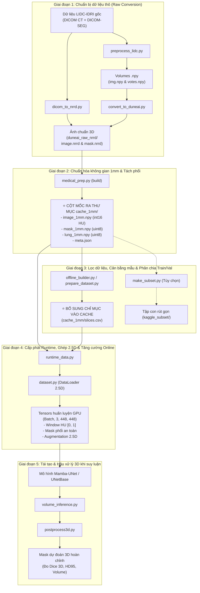

# QUY TRÌNH XỬ LÝ VÀ CHUYỂN ĐỔI DỮ LIỆU (END-TO-END DATA PIPELINE)

> **Dự án:** Phân đoạn nốt u phổi 2.5D trên tập dữ liệu LIDC-IDRI (MambaVision + UNet)  
> **Tài liệu:** Tổng hợp quy trình, thứ tự thực thi và hướng dẫn chi tiết các script điều chỉnh, xử lý và chuyển đổi dữ liệu  
> **Thư mục gốc:** `d:\GG_1\COMPUTER SCIENCE\NAM4_HK1_(2026-2027)\CT208E\SOURCES`

---

## 1. SƠ ĐỒ TỔNG QUAN LUỒNG DỮ LIỆU



> [!IMPORTANT]
> ### 📌 CỘT MỐC QUAN TRỌNG: DỮ LIỆU ĐẾN GIAI ĐOẠN NÀO THÌ RA ĐƯỢC THƯ MỤC `cache_1mm`?
> * **Script chính thức sinh ra thư mục `duneai_raw_nrrd`**: **`data/data_pipeline/dicom_to_nrrd.py`** quét dữ liệu DICOM từ `data/raw/` và tạo `mask.nrrd` bằng phép **HỢP (bitwise OR)** của tất cả các file DICOM-SEG (chỉ cần $\ge 1$ bác sĩ vẽ là tính).
> * **Script chính thức sinh ra thư mục `cache_1mm`**: **`common/data_pipeline/medical_prep.py`** (với lệnh `build`) đọc từ `data/duneai_raw_nrrd/`.
> * **Sản phẩm tại Giai đoạn 2**: Mỗi bệnh nhân có một thư mục `cache_1mm/<patient_id>/` chứa 4 file: `image_1mm.npy`, `mask_1mm.npy`, `lung_1mm.npy` và `meta.json`.
> * **File `slices.csv` nằm trong `cache_1mm`**: Được sinh ra ngay sau đó ở **Giai đoạn 3** bởi script **`offline_builder.py`** (hoặc gọi qua `scripts/prepare_dataset.py build-index`).
> * **Ý nghĩa kiến trúc**: `cache_1mm` là **ranh giới offline/online**. Toàn bộ các bước nặng CPU ở Giai đoạn 1 & 2 chỉ cần chạy **MỘT LẦN DUY NHẤT** rồi nén thành `cache_1mm.zip`. Quá trình huấn luyện sau đó chỉ đọc từ `cache_1mm`, hoàn toàn độc lập với dữ liệu gốc DICOM/NRRD.

---

## 2. BẢNG TỔNG HỢP CÁC SCRIPT THEO THỨ TỰ THỰC THI

| Thứ tự | Script | Thư mục | Đầu vào (Input) | Đầu ra (Output) | Vai trò & Trạng thái dữ liệu |
| :---: | :--- | :--- | :--- | :--- | :--- |
| **1.1** | [preprocess_lidc.py](file:///d:/GG_1/COMPUTER%20SCIENCE/NAM4_HK1_(2026-2027)/CT208E/SOURCES/data/data_pipeline/preprocess_lidc.py) | `data/data_pipeline/` | DICOM CT + DICOM-SEG | `<pid>_img.npy`, `<pid>_votes.npy` | Đọc DICOM gốc, đếm số phiếu bác sĩ đồng thuận (0-4) |
| **1.2** | [dicom_to_nrrd.py](file:///d:/GG_1/COMPUTER%20SCIENCE/NAM4_HK1_(2026-2027)/CT208E/SOURCES/data/data_pipeline/dicom_to_nrrd.py) | `data/data_pipeline/` | DICOM CT + SEG gốc trong `data/raw/` | `duneai_raw_nrrd/<pid>/(image, mask).nrrd` | **⭐ Mốc 1 (Chính thức):** Tạo ra `duneai_raw_nrrd` bằng phép **HỢP (Union / bitwise OR)** toàn bộ file SEG (ít nhất 1 bác sĩ vẽ) |
| **1.3** | [convert_to_duneai.py](file:///d:/GG_1/COMPUTER%20SCIENCE/NAM4_HK1_(2026-2027)/CT208E/SOURCES/data/data_pipeline/convert_to_duneai.py) | `data/data_pipeline/` | `<pid>_img.npy`, `<pid>_votes.npy` | `duneai_gzip_nrrd/<pid>/(image, mask).nrrd` | *(Script phụ / thử nghiệm cũ)* Thử nghiệm chuyển npy sang NRRD với ngưỡng `votes >= 2`, không dùng để tạo `duneai_raw_nrrd` |
| **2.1** | [medical_prep.py](file:///d:/GG_1/COMPUTER%20SCIENCE/NAM4_HK1_(2026-2027)/CT208E/SOURCES/common/data_pipeline/medical_prep.py) | `common/data_pipeline/` | Thư mục `duneai_raw_nrrd/` | `cache_1mm/<pid>/(image, mask, lung)_1mm.npy` | **⭐ Mốc 2: CHÍNH THỨC TẠO RA THƯ MỤC `cache_1mm/`** (resample 1mm, tách phổi, kẹp -1000 HU) |
| **3.1** | [offline_builder.py](file:///d:/GG_1/COMPUTER%20SCIENCE/NAM4_HK1_(2026-2027)/CT208E/SOURCES/common/data_pipeline/offline_builder.py) | `common/data_pipeline/` | Thư mục `cache_1mm/` | `cache_1mm/slices.csv` | **⭐ Mốc 3: Hoàn thiện `cache_1mm`** bằng bảng chỉ mục Train/Val và cân bằng âm/dương |
| **3.2** | [prepare_dataset.py](file:///d:/GG_1/COMPUTER%20SCIENCE/NAM4_HK1_(2026-2027)/CT208E/SOURCES/scripts/prepare_dataset.py) | `scripts/` | `cache_1mm/` | `cache_1mm/slices.csv` | CLI tập trung kích hoạt `offline_builder` và `runtime_data` |
| **3.3** | [make_subset.py](file:///d:/GG_1/COMPUTER%20SCIENCE/NAM4_HK1_(2026-2027)/CT208E/SOURCES/data/make_subset.py) | `data/` | `slices.csv`, `volumes/*.npy` | `kaggle_subset/*.npy`, `kaggle_meta/` | Trích xuất nhanh tập con bệnh nhân (ví dụ 200 ca) phục vụ thử nghiệm |
| **4.1** | [runtime_data.py](file:///d:/GG_1/COMPUTER%20SCIENCE/NAM4_HK1_(2026-2027)/CT208E/SOURCES/common/data_pipeline/runtime_data.py) | `common/data_pipeline/` | File nén `cache_1mm.zip` / GDrive / Kaggle | Thư mục cache cục bộ + `data_manifest.json` | Cấp phát dữ liệu trên môi trường thực thi (Colab/Kaggle/Local) |
| **4.2** | [dataset.py](file:///d:/GG_1/COMPUTER%20SCIENCE/NAM4_HK1_(2026-2027)/CT208E/SOURCES/common/data_pipeline/dataset.py) | `common/data_pipeline/` | `cache_1mm/` & `slices.csv` | Tensor 2.5D `(B, 3, 448, 448)` | **Mốc 4:** Nạp mmap zero-copy, ghép lát 2.5D, mask phổi an toàn, tăng cường dữ liệu |
| **5.1** | [volume_inference.py](file:///d:/GG_1/COMPUTER%20SCIENCE/NAM4_HK1_(2026-2027)/CT208E/SOURCES/common/eval3d/volume_inference.py) | `common/eval3d/` | Mô hình PyTorch + Khối `cache_1mm` | Tensor xác suất 3D `(Z, H, W)` | Trượt lát cắt 2.5D dự đoán toàn bộ thể tích 3D bệnh nhân |
| **5.2** | [postprocess3d.py](file:///d:/GG_1/COMPUTER%20SCIENCE/NAM4_HK1_(2026-2027)/CT208E/SOURCES/common/eval3d/postprocess3d.py) | `common/eval3d/` | Tensor xác suất 3D | Mask nhị phân 3D chuẩn không gian gốc | **Mốc 5:** Unpad/uncrop, phục hồi Spacing gốc, lọc diện tích/thể tích ra mask cuối cùng |

---

## 3. CHI TIẾT CÁC GIAI ĐOẠN XỬ LÝ

### Giai đoạn 1: Chuẩn bị dữ liệu thô (Raw Data Conversion)

Mục đích: Chuyển đổi dữ liệu quét cắt lớp CT và các file phân đoạn của bác sĩ từ chuẩn DICOM phức tạp về dạng khối dữ liệu chuẩn 3D (`.nrrd`) để dễ dàng xử lý tính toán hình học.

* **Trạng thái dữ liệu đầu ra**: Thư mục `data/duneai_raw_nrrd/<patient_id>/` chứa:
  * `image.nrrd`: Khối ảnh CT 3D nguyên bản theo độ phân giải của máy quét.
  * `mask.nrrd`: Khối mặt nạ nốt u 3D nguyên bản.

#### 1.1. `preprocess_lidc.py`
* **Vị trí**: [data/data_pipeline/preprocess_lidc.py](file:///d:/GG_1/COMPUTER%20SCIENCE/NAM4_HK1_(2026-2027)/CT208E/SOURCES/data/data_pipeline/preprocess_lidc.py)
* **Chức năng**:
  * Đọc chuỗi lát cắt CT (nhiều file `.dcm`) của từng bệnh nhân.
  * Đọc tất cả các file DICOM-SEG (mỗi file tương ứng với 1 bác sĩ gắn nhãn nốt u).
  * Hợp nhất nhãn theo ma trận đếm số phiếu (0 đến 4 bác sĩ cùng xác nhận nốt u).
  * Chuẩn hóa HU cơ bản và xuất ra 2 mảng NumPy: `<pid>_img.npy` (ảnh float16) và `<pid>_votes.npy` (số phiếu uint8).
* **Lệnh thực thi**:
  ```bash
  python data/data_pipeline/preprocess_lidc.py --n 10 --jobs 2
  ```

#### 1.2. `dicom_to_nrrd.py` (Script chính thức tạo ra `duneai_raw_nrrd`)
* **Vị trí**: [data/data_pipeline/dicom_to_nrrd.py](file:///d:/GG_1/COMPUTER%20SCIENCE/NAM4_HK1_(2026-2027)/CT208E/SOURCES/data/data_pipeline/dicom_to_nrrd.py)
* **Chức năng**:
  * Tự động quét tìm Series CT chính xác nhất (chuỗi có số lát cắt nhiều nhất) và các file SEG đính kèm từ thư mục `data/raw/<patient_id>/`.
  * **Cơ chế tạo Mask**: Sử dụng hàm `build_union_mask` thực hiện phép **HỢP (bitwise OR `|=`)** tất cả các file DICOM-SEG (bất kỳ voxel nào có ít nhất 1 bác sĩ gắn nhãn nốt u thì đều được lấy).
  * Sử dụng thư viện `SimpleITK` để lưu thành tệp ảnh khối y tế chuẩn định dạng `.nrrd` vào thư mục `data/duneai_raw_nrrd/<pid>/image.nrrd` và `mask.nrrd`.

#### 1.3. `convert_to_duneai.py` (Script phụ / Thử nghiệm cũ)
* **Vị trí**: [data/data_pipeline/convert_to_duneai.py](file:///d:/GG_1/COMPUTER%20SCIENCE/NAM4_HK1_(2026-2027)/CT208E/SOURCES/data/data_pipeline/convert_to_duneai.py)
* **Lưu ý quan trọng**: Script này **KHÔNG PHẢI** là script tạo ra `data/duneai_raw_nrrd`.
  * Đầu vào dự kiến của nó là `data/processed/volumes/<pid>_votes.npy` (thư mục này hiện không tồn tại).
  * Đầu ra dự kiến của nó là `data/duneai_gzip_nrrd/` với ngưỡng `votes >= 2` và spacing cố định `(0.8, 0.8, 1.5)`.
  * Trong pipeline thực tế đang chạy, dữ liệu `duneai_raw_nrrd` được tạo trực tiếp từ DICOM thô bằng `dicom_to_nrrd.py` (phép HỢP toàn bộ SEG).

---

### Giai đoạn 2: Chuẩn hóa không gian 1mm & Tách nhu mô phổi (Core DuneAI Pipeline)

> [!TIP]
> **ĐÂY LÀ GIAI ĐOẠN TRỰC TIẾP SINH RA THƯ MỤC `cache_1mm`**.  
> Toàn bộ quá trình tính toán nặng nề về giải phẫu học và nội suy không gian 3D được hoàn tất tại đây.

* **Vị trí**: [common/data_pipeline/medical_prep.py](file:///d:/GG_1/COMPUTER%20SCIENCE/NAM4_HK1_(2026-2027)/CT208E/SOURCES/common/data_pipeline/medical_prep.py)
* **Đầu vào**: Thư mục `data/duneai_raw_nrrd/` từ Giai đoạn 1.
* **Đầu ra**: Thư mục `data/cache_1mm/<patient_id>/`.
* **Quy trình chuẩn y khoa chi tiết**:
  1. **Cắt đáy HU**: Kẹp giá trị ngưỡng dưới tại $-1000\text{ HU}$ (`img[img < -1000] = -1000`).
  2. **Tách phổi (`extract_lungs_mask`)**: Phân đoạn tự động hai bên phổi trên ảnh CT thô dựa vào hình thái học và thresholding.
  3. **Resample không gian**: Nội suy mặt phẳng trục (axial $X, Y$) về tỷ lệ $1.0\text{ mm/pixel}$ (giữ nguyên trục $Z$).
  4. **Crop / Pad đối xứng**: Đưa kích thước lát cắt về `IMAGE_SIZE x IMAGE_SIZE` (ví dụ `448 x 448`), các vùng viền bù đắp bằng $-1000\text{ HU}$ (mức không khí).
  5. **Tối ưu hóa I/O**: Lưu trữ thành tệp `.npy` kiểu `int16` không nén để có thể đọc bằng `mmap` cực nhanh ở các bước sau:
     * `image_1mm.npy`: Dữ liệu ảnh CT thô (đơn vị HU).
     * `mask_1mm.npy`: Mặt nạ nốt u nhị phân (1 pixel = $1.0\text{ mm}^2$).
     * `lung_1mm.npy`: Mặt nạ nhu mô phổi.
     * `meta.json`: Tọa độ gốc, Spacing ban đầu, shape ban đầu và tỷ lệ nốt u nằm trong phổi (`mask_in_lung_fraction`).
* **Lệnh xây dựng Cache 1mm**:
  ```bash
  python common/data_pipeline/medical_prep.py build \
      --nrrd-dir data/duneai_raw_nrrd \
      --cache-dir data/cache_1mm \
      --workers 4 \
      --extract-lungs
  ```

---

### Giai đoạn 3: Lọc dữ liệu, Cân bằng mẫu & Phân chia Train/Val (Indexing & Filtering)

> [!NOTE]
> Giai đoạn này bổ sung tệp **`cache_1mm/slices.csv`** vào thư mục `cache_1mm`, hoàn thiện 100% gói dữ liệu để sẵn sàng đem đi huấn luyện hoặc nén thành `cache_1mm.zip`.

> [!IMPORTANT]
> #### ⚖️ ĐỐI CHIẾU THAM SỐ: R0 BASELINE BAN ĐẦU vs. TRẠNG THÁI ĐÍCH (TARGET / R1c & R2)
> Tài liệu này mô tả **Trạng thái đích (Target Specification)** đã được tối ưu qua chuỗi thực nghiệm R1c / R2, **không phải** thông số thô của bản R0 Baseline:
> 
> | Thông số | Mặc định R0 Baseline (`configs/config.py`) | Trạng thái đích tối ưu (Tài liệu này / R1c, R2) | Lý do cải tiến |
> | :--- | :---: | :---: | :--- |
> | **Ngưỡng diện tích u (`min_train_area`)** | `20.0 mm²` | **`5.0 mm²`** | R0 bỏ sót toàn bộ các nốt u nhỏ từ 5–20 mm² (mất độ nhạy lâm sàng) |
> | **Tỷ lệ lát âm tính (`neg_ratio`)** | `0.25` | **`0.35`** | Bổ sung thêm bối cảnh lát âm tính có phổi để giảm dương tính giả (FP) |
> | **Sàn lát âm mỗi ca (`min_neg_per_case`)** | `1` (ca rỗng chỉ lấy 1 lát) | **`4`** | Đảm bảo các ca không có u (như 0218, 0322) có đủ lát học, không bị dự đoán nhầm |
> | **Kích thước ảnh (`IMAGE_SIZE`)** | `512 × 512` | **`448 × 448`** | Tiết kiệm 23% bộ nhớ & tính toán, không làm mất FOV nốt u theo kiểm tra `check_cache.py` |
> | **Mức tăng cường (`aug_level`)** | `0` (không tăng cường / chỉ lật) | **`2` (Lật + Xoay ±10° + Affine + Blur/Noise)** | Chống overfit mạnh ở các epoch cuối (giảm chênh lệch Train-Val Dice) |
> | **Phân chia Train/Val (`val_split`)** | `0.15` (15% theo bệnh nhân) | `0.15` (15% theo bệnh nhân) | Giữ cố định 425 Train / 75 Val (64 ca có u + 11 ca âm tính hoàn toàn) |
> | **Trọng số hàm mất mát (`loss_params`)** | BCE 0.3 + Dice 0.7 (`pos_weight = 4.0`) | **BCE 1.0 (hoặc 3.0) + Dice 1.0 (`pos_weight = 2.0` hoặc `1.5`)** | Giảm phạt lệch dương tính quá mức, hạ 58.8% BCE loss và triệt tiêu FP |

Mục đích: Xây dựng bảng chỉ mục tĩnh (`slices.csv`), loại bỏ lát cắt vô nghĩa và đảm bảo tỷ lệ cân bằng âm/dương mà không gây rò rỉ dữ liệu giữa tập huấn luyện và kiểm định.

#### 3.1. `offline_builder.py` & `prepare_dataset.py`
* **Vị trí**:
  * [common/data_pipeline/offline_builder.py](file:///d:/GG_1/COMPUTER%20SCIENCE/NAM4_HK1_(2026-2027)/CT208E/SOURCES/common/data_pipeline/offline_builder.py)
  * [scripts/prepare_dataset.py](file:///d:/GG_1/COMPUTER%20SCIENCE/NAM4_HK1_(2026-2027)/CT208E/SOURCES/scripts/prepare_dataset.py)
* **Các bước xử lý**:
  1. **Phân chia theo cấp bệnh nhân (Patient-level Split)**: Toàn bộ lát cắt của một bệnh nhân chỉ thuộc về tập Train hoặc Val (mặc định tỷ lệ Val = 15%, ví dụ 425 ca Train / 75 ca Val).
  2. **Lọc lát dương (Positive Slices)**: Chỉ giữ lại các lát cắt có diện tích khối u $\ge 5.0\text{ mm}^2$ (`--min-train-area 5.0`). Bỏ các nốt quá bé ($< 5\text{ mm}^2$) do độ phân giải và nhiễu nhãn.
  3. **Lọc lát âm (Negative Slices)**:
     * Chỉ giữ lát âm tính **nằm trong vùng phổi** (loại bỏ lát cắt ngoài phổi, cổ, bụng).
     * Áp dụng lấy mẫu ngẫu nhiên có kiểm soát (`--neg-ratio 0.35` và tối thiểu `--min-neg-per-case 4`) để tránh mất cân bằng lớp cực đoan.
  4. **Xuất bảng chỉ mục**: Ghi ra tệp `cache_1mm/slices.csv` gồm: `patient_id, slice_idx, is_positive, tumor_area, split`.
* **Lệnh thực thi**:
  ```bash
  python scripts/prepare_dataset.py build-index \
      --cache-dir data/cache_1mm \
      --out-csv data/cache_1mm/slices.csv \
      --tumor-size-low-lim 5.0 \
      --zero-sl-ratio 0.35 \
      --val-split 0.15 \
      --seed 42
  ```

#### 3.2. `make_subset.py` (Tùy chọn trích xuất nhanh)
* **Vị trí**: [data/make_subset.py](file:///d:/GG_1/COMPUTER%20SCIENCE/NAM4_HK1_(2026-2027)/CT208E/SOURCES/data/make_subset.py)
* **Chức năng**:
  * Trích xuất tập con (ví dụ 200 bệnh nhân: 140 Train, 30 Val, 30 Test) để tạo bản zip gọn nhẹ, thuận tiện cho việc thử nghiệm nhanh trên Colab hoặc Kaggle.

---

### Giai đoạn 4: Cấp phát Runtime, Ghép 2.5D & Tăng cường Online (Runtime & Online Transform)

Mục đích: Nạp dữ liệu từ thư mục `cache_1mm` vào mô hình trong suốt quá trình huấn luyện với tốc độ đọc cực đại và biến đổi dữ liệu trên bộ nhớ GPU.

#### 4.1. `runtime_data.py`
* **Vị trí**: [common/data_pipeline/runtime_data.py](file:///d:/GG_1/COMPUTER%20SCIENCE/NAM4_HK1_(2026-2027)/CT208E/SOURCES/common/data_pipeline/runtime_data.py)
* **Chức năng**:
  * Tự động nhận diện môi trường chạy: **Colab**, **Kaggle** hay **Local**.
  * Trên Colab: Mount Google Drive, giải nén chọn lọc $N$ bệnh nhân từ `cache_1mm.zip` ra ổ đĩa scratch/SSD cục bộ (`/content/data/cache_1mm`).
  * Kiểm tra tính toàn vẹn thông qua mã băm SHA256 của danh sách ID bệnh nhân và xuất `data_manifest.json`.

#### 4.2. `dataset.py`
* **Vị trí**: [common/data_pipeline/dataset.py](file:///d:/GG_1/COMPUTER%20SCIENCE/NAM4_HK1_(2026-2027)/CT208E/SOURCES/common/data_pipeline/dataset.py)
* **Các kỹ thuật biến đổi dữ liệu thời gian thực**:
  1. **Zero-copy Memory Mapping (`np.load(..., mmap_mode='r')`)**:
     * DataLoader không cần nạp toàn bộ khối 3D vào RAM mà chỉ trích xuất đúng 3 lát cắt kế cận cần dùng từ `cache_1mm`.
  2. **Ghép 3 lát cắt 2.5D**:
     * Lấy lát $(z-1, z, z+1)$ ghép lại thành tensor 3 kênh $(3, H, W)$ cung cấp ngữ cảnh không gian 3 chiều cục bộ cho mạng 2D.
  3. **Mặt nạ phổi an toàn (Leak-free Lung Masking)**:
     * **Tập Train**: Mở rộng mặt nạ phổi bằng phép giãn nở (dilation) bao quanh nốt u để mô hình học được đường biên nốt u bám sát thành phổi.
     * **Tập Val / Test**: **Chỉ dùng mặt nạ phổi nguyên bản**, tuyệt đối không dùng thông tin mặt nạ u nhằm chống rò rỉ nhãn (no label leakage).
  4. **Tăng cường dữ liệu 2.5D (`Augmenter2D`)**:
     * `aug_level = 0`: Không tăng cường (chỉ suy luận/val).
     * `aug_level = 1`: Lật ngẫu nhiên ngang/dọc (Horizontal & Vertical Flip).
     * `aug_level = 2`: Lật + Xoay góc nhỏ ($\pm 10^\circ$) + Biến dạng Affine + Làm mờ/nhiễu nhẹ (Gaussian blur/noise).
  5. **Chuẩn hóa cửa sổ HU trên GPU (`window_hu_torch`)**:
     * Áp dụng cửa sổ phổi chuẩn: Window Center $WL = -600\text{ HU}$, Window Width $WW = 1500\text{ HU}$ (kẹp trong đoạn $[-1000, 150]\text{ HU}$) và quy đổi giá trị pixel về dải $[0.0, 1.0]$. Chạy song song trên GPU giúp tiết kiệm thời gian CPU.

---

### Giai đoạn 5: Tái tạo & Hậu xử lý không gian 3D khi suy luận (3D Inference & Postprocessing)

Mục đích: Đưa các kết quả dự đoán phân đoạn từng lát cắt 2.5D trở lại không gian thể tích 3D gốc của bệnh nhân để tính toán các chỉ số y khoa thực tế.

#### 5.1. `volume_inference.py`
* **Vị trí**: [common/eval3d/volume_inference.py](file:///d:/GG_1/COMPUTER%20SCIENCE/NAM4_HK1_(2026-2027)/CT208E/SOURCES/common/eval3d/volume_inference.py)
* **Chức năng**:
  * Chạy cửa sổ trượt 2.5D qua toàn bộ chiều sâu $Z$ của khối CT 3D trong `cache_1mm`.
  * Ghép các lát cắt xác suất đầu ra lại thành một khối xác suất 3D `(Z, H, W)` kiểu `float32`.

#### 5.2. `postprocess3d.py`
* **Vị trí**: [common/eval3d/postprocess3d.py](file:///d:/GG_1/COMPUTER%20SCIENCE/NAM4_HK1_(2026-2027)/CT208E/SOURCES/common/eval3d/postprocess3d.py)
* **Các thuật toán hậu xử lý**:
  1. **Unpad & Uncrop**: Đảo ngược quá trình cắt/đệm ở Giai đoạn 2 để đưa ma trận về đúng kích thước trục $X, Y$ ban đầu.
  2. **Resize về Spacing gốc**: Nội suy đưa độ phân giải từ $1.0\text{ mm/pixel}$ trở về độ phân giải vật lý ban đầu của máy quét CT.
  3. **Ngưỡng nhị phân hóa (`threshold`)**: Mặc định $0.5$ (hoặc quét qua lưới $0.5, 0.6, 0.7, 0.8$).
  4. **Lọc thành phần liên thông 2D/3D**:
     * Lọc diện tích lát cắt (`min_area`, ví dụ $\ge 5.0\text{ mm}^2$): Xóa bỏ các đảo pixel nhỏ lẻ do nhiễu.
     * Lọc thể tích khối 3D (`min_vol`, ví dụ $\ge 10.0\text{ mm}^3$): Loại bỏ các dương tính giả (False Positives) dạng đốm nhỏ cô lập không phải là nốt u.

---

## 4. HƯỚNG DẪN THỰC THI TOÀN BỘ PIPELINE TỪ ĐẦU ĐẾN CUỐI (STEP-BY-STEP WORKFLOW)

Khi bắt đầu với tập dữ liệu mới hoặc triển khai trên máy tính / Colab mới, hãy thực hiện tuần tự theo các bước lệnh sau:

### Bước 1: Tiền xử lý dữ liệu thô sang NRRD (Giai đoạn 1)
```bash
# Từ DICOM -> NRRD
python data/data_pipeline/dicom_to_nrrd.py
```

### Bước 2: Xây dựng bộ đệm chuẩn hóa 1mm (Giai đoạn 2 - Tạo ra cache_1mm)
```bash
# Tạo thư mục cache_1mm phục vụ nạp nhanh
python common/data_pipeline/medical_prep.py build \
    --nrrd-dir data/duneai_raw_nrrd \
    --cache-dir data/cache_1mm \
    --workers 4 \
    --extract-lungs
```

### Bước 3: Tạo bảng chỉ mục tĩnh phân chia Train/Val (Giai đoạn 3 - Hoàn tất cache_1mm)
```bash
# Lọc diện tích u >= 5.0 mm2, tỷ lệ âm tính 0.35, chia 85% Train / 15% Val
python scripts/prepare_dataset.py build-index \
    --cache-dir data/cache_1mm \
    --out-csv data/cache_1mm/slices.csv \
    --tumor-size-low-lim 5.0 \
    --zero-sl-ratio 0.35 \
    --val-split 0.15 \
    --seed 42
```

### Bước 4: Kiểm tra tính toàn vẹn dữ liệu
```bash
# Kiểm tra tỷ lệ nốt u trong phổi và mức độ mất FOV
python tools/check_cache.py --cache-dir data/cache_1mm --image-size 448

# Kiểm tra thử nghiệm nạp batch 2.5D của Dataset
python common/data_pipeline/dataset.py inspect --cache-dir data/cache_1mm
```

### Bước 5: Huấn luyện mô hình (Giai đoạn 4 - Kích hoạt Online Transform & Augmentation)
```bash
DUNEAI_IMAGE_SIZE=448 python -u -m mamba_unet.train_main train \
    --cache-dir data/cache_1mm \
    --slices-csv data/cache_1mm/slices.csv \
    --aug-level 2 \
    --batch-size 8 \
    --epochs 50
```

### Bước 6: Đánh giá & Hậu xử lý 3D (Giai đoạn 5)
```bash
# Đánh giá 3D trên tập Validation với các bộ lọc hậu xử lý
python -m mamba_unet.evaluate eval \
    --model-path mamba_unet/runs/<run_name>/best_model.pth \
    --cache-dir data/cache_1mm \
    --threshold 0.5 \
    --min-area 5.0 \
    --min-vol 10.0
```
