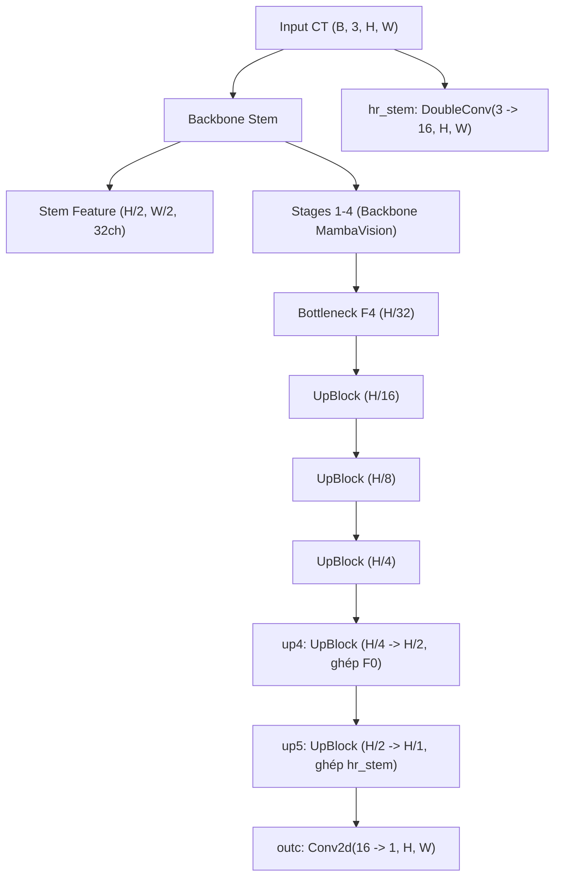
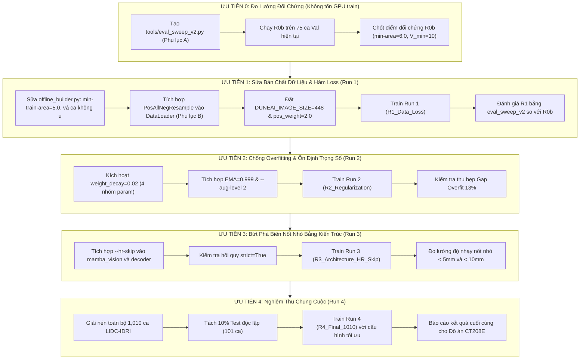

# Mamba-UNet (MambaVision-T + UNet) — Đánh Giá Hệ Thống, Bằng Chứng Bước 0 và Kế Hoạch Cải Tiến Hoàn Thiện

* **Dự án**: Phân đoạn nốt phổi trên ảnh cắt lớp vi tính lồng ngực (LIDC-IDRI) bằng kiến trúc lai Mamba-UNet (UM-LOAN).
* **Mô hình đường cơ sở (Baseline $R_0$)**: `best_model.pth` trong `mamba_unet/runs/mamba_colab_500item_25epoch_extra_test` (500 ca LIDC-IDRI, dừng sớm ở Epoch 42, Best Epoch 30 với $\text{Val Dice}_{2D} = 0.7456$, $\text{Mean Dice}_{3D} = 0.3771$).
* **Tài liệu nguồn gốc & Chốt đối chiếu**: 
  * Báo cáo đo lường thực tế Bước 0: [`docs/STEP0_MEASUREMENT_RESULTS/STEP0_FULL_METRICS_SUMMARY.md`](../STEP0_MEASUREMENT_RESULTS/STEP0_FULL_METRICS_SUMMARY.md)
  * Đề xuất điều chỉnh chẩn đoán: [`STEP0_PLAN_ADJUSTMENT_PROPOSAL.md`](STEP0_PLAN_ADJUSTMENT_PROPOSAL.md)
  * Phản biện khoa học & kiểm soát biến: [`STEP0_PROPOSALS_CRITIQUE_AND_FINAL_PLAN.md`](STEP0_PROPOSALS_CRITIQUE_AND_FINAL_PLAN.md)
  * Văn bản chốt quyết định 18 điểm: [`MAMBA_UNET_STEP0_CONSOLIDATED_PLAN.md`](MAMBA_UNET_STEP0_CONSOLIDATED_PLAN.md)

> [!IMPORTANT]
> **Quy ước kỹ thuật**:
> 1. Mọi tính năng mở rộng bên dưới đều có **giá trị mặc định = hành vi hiện tại** (cờ mới mặc định tắt) để tuyệt đối không phá vỡ kiểm thử hồi quy và các checkpoint cũ.
> 2. Tuân thủ nghiêm ngặt **Quy tắc Kiến trúc Rule R1**: Giữ nguyên vẹn mã nguồn chuẩn trong `unet_base/` và tệp gốc `mamba_unet/decoder.py`. Mọi mở rộng kiến trúc (nhánh Skip độ nét cao `--hr-skip`) được thiết kế qua cờ `high_res_skip=False` hoặc module kế thừa.
> 3. Cột "Kỳ vọng" của các phiên chạy thực nghiệm được chuẩn hóa thành **"Tiêu chí quyết định (Decision Rule)"** dựa trên độ tin cậy thống kê $95\%$ ($\text{CI}_{95\%}$).

---

## 0. TÓM TẮT ĐIỀU HÀNH & BẰNG CHỨNG THỰC NGHIỆM BƯỚC 0

1. **Thực trạng chênh lệch giữa 2D và 3D**:
   * Trên các lát cắt 2D chọn lọc (`slices.csv`), mô hình đạt điểm số rất cao: $\text{Train Dice}_{2D} = 0.8701$, $\text{Val Dice}_{2D} = 0.7456$ (khoảng cách overfit $\approx 12.45\%\text{--}13.07\%$).
   * Tuy nhiên, khi suy luận trượt toàn khối 3D trên $75$ bệnh nhân Validation ($203$ nốt u Ground Truth), $\text{Mean Dice}_{3D}$ sụt giảm xuống mức **$0.3768$** ($Th = 0.5$) và đạt cực đại **$0.3771$** ($Th = 0.6$, độ lệch chuẩn $\text{SD} = 0.349$, sai số chuẩn $\text{SE} = 0.040$, khoảng tin cậy $95\%$ $\text{CI} = \pm 0.079$).

2. **Bóc tách 3 nút thắt cốt lõi từ số liệu Bước 0**:
   * **Nút thắt 1 — Mù nốt nhỏ do "Bờ vực $20\text{ mm}^2$" (P1 & P15)**:
     * Toàn bộ $59/203$ nốt u ($29.06\%$) có đường kính $d < 5.0\text{ mm}$ ($A_{\max} < 19.63\text{ mm}^2$) bị loại sạch khỏi tập train bởi ngưỡng `TUMOR_SIZE_LOW_LIM = 20.0`.
     * Khi đánh giá 3D, độ nhạy của dải này chỉ đạt **$3.39\%$ ($2/59$ nốt)**.
     * Quy định *"giữ $20\text{ mm}^2$ ở hậu xử lý"* của Plan cũ đã vô tình chặn cứng trần độ nhạy tối đa của toàn hệ thống ở mức $(203 - 59) / 203 = \mathbf{70.94\%}$.
   * **Nút thắt 2 — Báo động giả do thiếu mẫu âm tính & phạt 4x ở hàm loss (P2 & P16)**:
     * Lúc train, mô hình chỉ được học vỏn vẹn **$1.72\%$** số lát âm tính ($1,321 / 76,941$ lát âm có phổi).
     * Kết hợp với `pos_weight = 4.0` đẩy điểm cân bằng xác suất Bayes về $p^* = 0.20$, mô hình bị bão hòa xác suất (Overconfident Logits): quét ngưỡng từ $0.3$ lên $0.7$ mà dương tính giả hầu như không giảm ($3.24 \rightarrow 2.80\text{ FP/ca}$).
     * Hậu quả: $8/11$ ca không có u ($n_{\text{gt}} = 0$) bị dính $1\text{--}10$ cụm FP ($3.63\text{ FP/ca}$), nhận $\text{Dice}_{3D} = 0.0000$ (kéo tụt $\text{Mean Dice}$ toàn tập mất $0.1067$).
   * **Nút thắt 3 — Kiến trúc thiếu chi tiết biên cho nốt nhỏ (P5)**:
     * Decoder hiện tại đưa đặc trưng mịn nhất ở tầng $H/4$ ($1\text{ px} = 4\text{ mm}$) rồi nội suy song tuyến tính $\times 4$. Nốt u đường kính $4\text{ mm}$ chỉ chiếm chưa đầy $1\text{ pixel}$ ở tầng $H/4$ trước khi upsample.
     * Trong khi đó, nốt trung bình ($10\text{--}20\text{ mm}$) đã đạt độ nhạy **$83.78\%$** ($31/37$) và nốt lớn ($\ge 20\text{ mm}$) đạt **$100.0\%$** ($8/8$). Lỗi hoàn toàn tập trung ở nốt nhỏ $< 8\text{ mm}$.

3. **Hai phát hiện giải phóng hiệu năng**:
   * **Mặt nạ phổi (P3) không phải điểm nghẽn**: $95\%$ bệnh nhân bảo toàn $\ge 99.4\%$ thể tích u ($p_5 = 0.994$, $\text{Median} = 1.000$). Cả 5 ca xấu nhất đều nằm ở tập Train. Hủy bỏ phiên chạy R5 cũ để tiết kiệm GPU.
   * **Kích thước ảnh $448 \times 448$ an toàn $100\%$**: $0/449$ ca bị mất nhãn nốt u khi cắt tâm $448$. Giảm $2.25\times$ token Stage 3 ($1,764 \rightarrow 784$), rút ngắn thời gian mỗi epoch $\sim 25\%$ (từ $5\text{m}16\text{s}$ xuống $\sim 3\text{m}50\text{s}$).

---

## 1. BẢNG PHÂN TÍCH VẤN ĐỀ TOÀN DIỆN (P1 $\rightarrow$ P17)

Bảng tổng hợp đã được cập nhật lại mức độ ưu tiên và các vấn đề mới phát hiện sau Bước 0:

| ID | Vấn đề cốt lõi | Vị trí trong Code | Nguyên nhân kỹ thuật | Ảnh hưởng thực tế từ Bước 0 | Mức độ ưu tiên | Mục khắc phục |
|:---:|:---|:---|:---|:---|:---:|:---:|
| **P1** | **Mù nốt nhỏ $< 5\text{ mm}$ lúc train** | `offline_builder.py` | Ngưỡng diện tích `TUMOR_SIZE_LOW_LIM = 20.0` loại bỏ 2,081 lát u nhỏ. | $57/59$ nốt $< 5\text{ mm}$ bị bỏ sót ($96.61\%$). | **RẤT CAO** | §3.1 |
| **P15** | **Bộ lọc hậu xử lý chặn trần độ nhạy** | `postprocess3d.py`, `eval_sweep.py` | Hậu xử lý mặc định lọc bỏ cụm có diện tích lát $< 20\text{ mm}^2$. | Khóa cứng trần độ nhạy toàn hệ thống ở mức $70.94\%$. | **RẤT CAO** | §3.1, §2.3 |
| **P16** | **Thiếu hụt trầm trọng mẫu âm tính** | `offline_builder.py` | Chỉ dùng $1.72\%$ lát âm tính; ca không u chỉ lấy đúng 1 lát âm tính. | $8/11$ ca rỗng bị nhận diện nhầm, trung bình $2.91\text{ FP/ca}$. | **RẤT CAO** | §3.1b |
| **P2** | **Bão hòa Logits do phạt 4x ở Loss** | `train_main.py` | `pos_weight = 4.0` phạt lỗi FN nặng gấp 4 lần FP, Bayes threshold $p^* = 0.20$. | FP không giảm dù tăng ngưỡng lên $Th = 0.7$; kéo tụt Precision. | **CAO** | §4 |
| **P4** | **Overfitting lớn (Gap $13\%$)** | Toàn pipeline | `weight_decay = 1e-4` vô hiệu; Augmentation chỉ có flip/rot90. | $\text{Train Dice} = 0.8701$ trong khi $\text{Val Dice} = 0.7456$. | **CAO** | §3.4, §5.1, §5.2 |
| **P5** | **Mờ biên nốt nhỏ ở Decoder** | `decoder.py` | Feature mịn nhất $H/4$ ($128 \times 128$), sau đó phóng đại song tuyến tính $\times 4$. | Nốt nhỏ $< 8\text{ mm}$ bị nhòe biên, Dice 3D không bứt phá. | **CAO** | §6.1 |
| **P6** | **Lãng phí token padding Stage 3–4** | `mamba_vision.py` | Ảnh $512$ không chia hết cho cửa sổ $14$ và $7$; Stage 3 bị đệm lên 1,764 tokens. | Tốn bộ nhớ GPU và chậm hơn $25\%$ thời gian tính toán. | **TRUNG BÌNH** | §5.3 |
| **P17** | **Mất điểm Dice ở ca không u** | `metrics3d.py` | Khi $\text{GT} = 0$, chỉ cần xuất hiện 1 cụm FP là $\text{Dice} = 0.0$ lập tức. | 8 ca không u làm mất $0.1067$ điểm Mean Dice của cả tập. | **TRUNG BÌNH** | §2.1, §8 |
| **P8** | **Weight decay sai nhóm tham số** | `trainer.py` | Áp dụng co trọng số lên cả Bias, LayerNorm, BatchNorm, $A_{\log}, D$. | Làm mất cân bằng thang đo đặc trưng của Mamba SSM. | **TRUNG BÌNH** | §3.4 |
| **P13** | **Val Dice dao động nhiễu giữa các epoch** | `base_trainer.py` | 75 ca val làm Dice dao động $\pm 0.01$/epoch; chưa có trọng số EMA. | Checkpoint chọn ra bị phụ thuộc vào may rủi của từng epoch. | **TRUNG BÌNH** | §5.1 |
| **P3** | **Lệch mặt nạ phổi giữa Train và Val** | `dataset.py` | Train hợp mask u vào phổi; Val chỉ dùng mask phổi gốc. | **Không nghiêm trọng**: $95\%$ ca giữ $\ge 99.4\%$ u; cả 5 ca xấu ở Train. | **THẤP** *(Hạ mức)* | §3.2 |
| **P7** | **BN backbone không eval khi đóng băng** | `base_trainer.py` | Hook đặt BN eval bị `model.train()` ghi đè. | Thực tế BN thích nghi thống kê CT lại có lợi nhẹ. | **THẤP** | §3.5 |
| **P9** | **Chuẩn hóa đầu vào lệch ImageNet** | `model.py` | Đầu vào $[0, 1]$ từ HU clip, không trừ mean/std. | BN tầng đầu thích nghi được một phần. | **THẤP** | §6.3 |
| **P10**| **Khoảng cách trục z chưa chuẩn hóa** | `dataset.py` | Lát cắt $z \pm 1$ có độ dày vật lý khác nhau giữa các ca. | Ảnh hưởng nhẹ tới tính nhất quán không gian 2.5D. | **THẤP** | §5.4 |
| **P11**| **Nội suy Nearest khi làm cache 1mm** | `medical_prep.py` | Spacing gốc $0.5\text{--}0.9\text{ mm}$ bị downsample bằng nearest. | Tốn nhiều công rebuild cache, mức cải thiện nhỏ. | **THẤP** | §5.5 |
| **P12**| **Thiếu tập Test độc lập** | `offline_builder.py` | Mô hình chọn bằng Val rồi báo cáo luôn trên Val. | Có thể gây lạc quan nhẹ về kết quả chung cuộc. | **TRUNG BÌNH** | §5.6 |
| **P14**| **Bất nhất nhỏ về tài liệu và docstring** | Toàn repo | Một số docstring ghi sai số lượng keys hoặc sai đơn vị. | Không ảnh hưởng đến chất lượng huấn luyện. | **THẤP** | §3.6 |

---

## 2. KẾT QUẢ ĐO LƯỜNG BƯỚC 0 & ĐÁNH GIÁ ĐỐI CHỨNG $R_{0b}$

### 2.1 Bảng kết quả thực nghiệm cơ sở ($R_0$ Baseline)
Đo lường trên toàn bộ $75$ bệnh nhân tập Validation ($203$ nốt u Ground Truth) qua lệnh:
```bash
DUNEAI_MAMBA_BACKEND=cuda python tools/eval_sweep.py \
  --cache-dir /content/data/cache_1mm \
  --checkpoint mamba_unet/runs/mamba_colab_500item_25epoch_extra_test/best_model.pth \
  --split val --thresholds 0.3 0.4 0.5 0.6 0.7 --min-area 20.0 --out-prefix sweep_r0
```

* **Hiệu năng 3D theo ngưỡng xác suất**:
  * $Th = 0.5$ (Mặc định): $\text{Dice}_{3D} = \mathbf{0.3768}$ | $\text{Precision} = 0.4117$ | $\text{Recall} = 0.4039$ | $\text{FP/ca} = 2.97$
  * $Th = 0.6$ (Tối ưu) ⭐: $\text{Dice}_{3D} = \mathbf{0.3771}$ | $\text{Precision} = 0.4143$ | $\text{Recall} = 0.4021$ | $\text{FP/ca} = 2.91$
* **Độ nhạy phát hiện nốt u theo đường kính ($Th = 0.6$)**:
  * $\ge 20.0\text{ mm}$ (Lớn): **$100.0\%$** ($8/8$ nốt).
  * $10.0 - 20.0\text{ mm}$ (Trung bình): **$83.78\%$** ($31/37$ nốt).
  * $5.0 - 10.0\text{ mm}$ (Nhỏ): **$57.58\%$** ($57/99$ nốt) — *trong đó dải $5.0\text{--}6.0\text{ mm}$ chỉ đạt $25.93\%$*.
  * $< 5.0\text{ mm}$ (Rất nhỏ): **$3.39\%$** ($2/59$ nốt) — **$96.61\%$ bị bỏ sót hoàn toàn**.

---

### 2.2 Bước chuẩn bị cần thiết: Đánh giá đối chứng $R_{0b}$ (Chạy ngay, không train)

> [!NOTE]
> **Mục đích của $R_{0b}$**:
> Trước khi huấn luyện Run 1 với bộ lọc mới ($6.0\text{ mm}^2$ và lọc thể tích $V_{\min}$), ta cần đo xem checkpoint $R_0$ cũ dưới **cùng bộ lọc mới** sẽ đạt điểm số bao nhiêu. Điều này đảm bảo khi so sánh $R_1$ với $R_0$, kết quả phản ánh sự tiến bộ thực sự của mô hình học máy chứ không phải do thay đổi bộ lọc hậu xử lý.

Lệnh thực thi trên Colab (chỉ mất $\sim 3\text{--}5$ phút):
```bash
DUNEAI_MAMBA_BACKEND=cuda python tools/eval_sweep_v2.py \
  --cache-dir /content/data/cache_1mm \
  --checkpoint mamba_unet/runs/mamba_colab_500item_25epoch_extra_test/best_model.pth \
  --split val --thresholds 0.5 0.6 0.7 --min-areas 6.0 10.0 20.0 --min-vols 0 10 20 \
  --out-prefix sweep_r0b
```
*(Mã nguồn script `tools/eval_sweep_v2.py` được cung cấp chi tiết tại **Phụ lục A**).*

---

## 3. CÁC GIẢI PHÁP KỸ THUẬT CỐT LÕI (DỮ LIỆU & TỐI ƯU HÓA)

### 3.1 [P1 & P15] Đồng bộ hóa ngưỡng diện tích: Train $5.0\text{ mm}^2$ và Hậu xử lý $6.0\text{ mm}^2$

1. **Trong `common/engine/cli_args.py`**:
   Thêm cờ cấu hình dữ liệu vào `data_group`:
   ```python
   data_group.add_argument("--min-train-area", type=float, default=20.0,
                           help="Ngưỡng diện tích u tối thiểu (mm²) khi dựng slices.csv (khuyến nghị: 5.0)")
   data_group.add_argument("--neg-ratio", type=float, default=0.25,
                           help="Tỷ lệ mẫu âm tính trên lát dương tính (khuyến nghị: 0.5)")
   data_group.add_argument("--min-neg-per-case", type=int, default=4,
                           help="Ngưỡng sàn số lát âm tính tối thiểu cho mọi ca bệnh")
   ```

2. **Trong `common/data_pipeline/offline_builder.py`**:
   Sửa hàm `build_dataset_index` để đồng bộ ngưỡng $5.0\text{ mm}^2$ và xóa bỏ hoàn toàn quy ước *"giữ $20\text{ mm}^2$ ở hậu xử lý"*:
   * $A < 5.0\text{ mm}^2$: Loại bỏ (lọc bỏ nhiễu nhãn 1–4 pixel không đồng thuận giữa các bác sĩ).
   * $A \ge 5.0\text{ mm}^2$: Giữ lại tập train ($191/203$ nốt u thực tế bảo toàn $\ge 3\text{ mm}$).
   * Ở hậu xử lý: Đặt `min_slice_area_mm2 = 6.0` kết hợp `min_slices_span = 2` (hoặc `min_volume_mm3 = 10.0`) trong `postprocess_3d_mask`.

---

### 3.1b [P16] Bộ lấy mẫu âm tính động mỗi Epoch (`PosAllNegResample`) & Vá lỗi ca không u

1. **Vá lỗi ca không có khối u trong `offline_builder.py`**:
   Thay vì gán cứng bằng 1 lát đơn độc, áp dụng ngưỡng sàn `min_neg_per_case`:
   ```python
   # Cân bằng lát cắt âm tính theo tỷ lệ và ngưỡng sàn
   if len(pos_slices) > 0:
       num_neg_keep = max(min_neg_per_case, int(round(len(pos_slices) * zero_sl_ratio)))
   else:
       # Ca không u (n_gt = 0) được đóng góp số lát âm tính tương đương ngưỡng sàn
       num_neg_keep = min_neg_per_case
   num_neg_keep = min(len(neg_candidates), num_neg_keep)
   ```

2. **Tích hợp PyTorch Sampler động (`PosAllNegResample`) trong `dataset.py`**:
   * **Bản chất**: Thay vì cố định $1,321$ lát âm tính suốt 40 epoch, mỗi epoch DataLoader sẽ bốc ngẫu nhiên một tập lát âm tính khác nhau từ kho ứng viên.
   * **Hiệu quả**: Mô hình tiếp cận được **$81.2\%$** kho dữ liệu âm tính sau 40 epoch mà thời gian huấn luyện mỗi epoch không hề tăng.
   *(Chi tiết mã nguồn Sampler xem tại **Phụ lục B**).*

---

### 3.2 [P3] Đồng nhất mặt nạ phổi & Sửa lỗi logic nhãn (Hủy bỏ Run R5)

1. **Hủy bỏ Run R5 (`--tumor-union-p 0.0`)**: Do Bước 0 chứng minh P3 không phải nguyên nhân gây sụt giảm điểm số trên tập Validation.
2. **Sửa lỗi logic nhãn trong `common/data_pipeline/dataset.py`**:
   Đảm bảo nếu không hợp mask u vào mask phổi (`use_union = False`) thì phần nhãn Ground Truth bị mặt nạ phổi che mất cũng phải được xóa đồng bộ để tránh ép mạng học nốt u trên nền không khí $-1000\text{ HU}$:
   ```python
   if use_lung:
       img_stack, msk_stack, lung_stack = loaded
       use_union = (self.split == "train") and (random.random() < self.tumor_union_p)
       tumor_for_keep = msk_stack if use_union else None
       keep = lung_keep_mask(lung_stack, tumor_mask=tumor_for_keep)
       img_stack = apply_lung_mask(img_stack, keep, fill=HU_FLOOR)
       if not use_union:
           # Đồng bộ nhãn với vùng phổi giữ lại để tránh nhiễu loạn gradient
           msk_stack = msk_stack & (keep > 0).astype(msk_stack.dtype)
   ```

---

### 3.4 [P4 & P8] Tối ưu hóa suy giảm trọng số (`weight_decay = 0.02` với 4 nhóm tham số)

Trong `mamba_unet/trainer.py`, hàm `build_param_groups` được phân tách thành 4 nhóm chuẩn hóa:
1. `backbone_decay`: Trọng số Conv2d/Linear của MambaVision (áp dụng LR backbone và `weight_decay = 0.02`).
2. `backbone_no_decay`: Bias, BatchNorm, LayerNorm, $A_{\log}, D$ của MambaVision (không co trọng số, `weight_decay = 0.0`).
3. `decoder_decay`: Trọng số Conv2d của Decoder (áp dụng Base LR và `weight_decay = 0.02`).
4. `decoder_no_decay`: Bias, Norm của Decoder (`weight_decay = 0.0`).

* **Mức độ co trọng số thực tế**: Sau 40 epochs ($\approx 25,000$ bước cập nhật), trọng số được co nhẹ $2.7\%\text{--}5.3\%$, vừa đủ để chống overfitting mà không làm suy yếu khả năng trích xuất đặc trưng.

---

## 4. HÀM MẤT MÁT & CẤU HÌNH HUẤN LUYỆN CHUẨN HÓA

* **Hạ `pos_weight` xuống 2.0**:
  Cân bằng lại tỷ trọng phạt trong hàm mất mát kết hợp `dice_bce`:
  ```bash
  --loss dice_bce --loss-params '{"bce_weight": 0.3, "dice_weight": 0.7, "pos_weight": 2.0}'
  ```
  Giúp dịch chuyển ngưỡng xác suất tối ưu Bayes từ $0.20$ về $0.33$, triệt tiêu các đốm dự đoán dương tính giả bão hòa ở mức $> 0.7$.
* **Cấu hình tối ưu hóa hội tụ an toàn**:
  * Duy trì `--epochs 40 --patience 10` cho mọi phiên chạy (tránh dừng sớm khi mạng đang co cụm trọng số với `wd = 0.02`).
  * Giữ cố định `--batch-size 8` và `--lr 0.0001` ở các run đầu để không làm nhiễu kiểm soát biến thực nghiệm.

---

## 5. CÁC KỸ THUẬT TỐI ƯU HÓA BỔ TRỢ

### 5.1 [P13] Làm mượt trọng số bằng Exponential Moving Average (`--ema 0.999`)
* Cập nhật trọng số trượt: $\theta_{\text{EMA}} \leftarrow 0.999 \times \theta_{\text{EMA}} + 0.001 \times \theta_t$.
* Tương đương trung bình hóa trọng số qua $\approx 1,000$ bước cập nhật ($\approx 1.5$ epoch), giúp checkpoint `best_model.pth` có tính bền vững cao, triệt tiêu dao động $\pm 0.01$ Dice giữa các epoch.

### 5.2 [P4] Tăng cường dữ liệu nâng cao (`--aug-level 2`)
* Mở rộng thêm các phép biến đổi không gian ngẫu nhiên: Xoay $\pm 15^\circ$, Co giãn $0.85\text{--}1.15$, Tịnh tiến ngẫu nhiên $\pm 32\text{ px}$, kết hợp nhiễu Gaussian và biến thiên tương phản.
* Giúp phá vỡ tính cố định của lưới cửa sổ Stage 3–4 so với ảnh chụp.

### 5.3 [P6] Chuẩn hóa kích thước ảnh `DUNEAI_IMAGE_SIZE=448`
* Stage 3 đạt kích thước $28 \times 28$ (vừa khít $2 \times 2$ cửa sổ $14$, giảm token từ $1,764$ xuống $784$).
* Lưu khóa `"image_size": IMAGE_SIZE` vào `checkpoint_meta` trong `trainer.py` để các công cụ suy luận tự động thích ứng đúng kích thước.

---

## 6. CẢI TIẾN KIẾN TRÚC: NHÁNH SKIP ĐỘ PHÂN GIẢI CAO (`--hr-skip`)

Mục tiêu sửa dứt điểm **P5** mà vẫn tuân thủ nghiêm ngặt **Quy tắc Rule R1**:



* **Thiết kế an toàn**: Tham số `high_res_skip: bool = False` (mặc định tắt hoàn toàn).
* **Bảo tồn nguyên trạng**: Khi cờ tắt, mô hình chạy qua nhánh `final_up` tiêu chuẩn. Khi bật cờ, mạng kích hoạt `up4` và `up5` để khôi phục chi tiết biên cho nốt nhỏ $< 8\text{ mm}$.
* **Huấn luyện**: Khởi tạo từ trọng số ImageNet chuẩn để đảm bảo tính khách quan của phép thử phân rã.

---

## 7. SƠ ĐỒ ĐƯỜNG ĐI THỰC HIỆN THEO MỨC ĐỘ ƯU TIÊN (PRIORITY ROADMAP)

Dưới đây là sơ đồ trực quan hướng dẫn trình tự các công việc kỹ thuật cần tiến hành từ khâu chuẩn bị đến khâu nghiệm thu:



---

## 8. HƯỚNG DẪN THỰC THI CHI TIẾT THEO TỪNG GIAI ĐOẠN RUN (STEP-BY-STEP PLAYBOOK)

Mục này cung cấp hướng dẫn thao tác cụ thể cho từng giai đoạn: **sửa cái gì, cải tiến cái gì, làm ở đâu, vị trí mã nguồn nào và cách sửa như thế nào**.

```
                           ┌─────────────────────────────────────────────────────────┐
                           │          LỘ TRÌNH 5 GIAI ĐOẠN TRIỂN KHAI                │
                           └─────────────────────────────────────────────────────────┘
                                                        │
   ┌───────────────────────┐                            ▼
   │  GIAI ĐOẠN 0: Run 0b  │ ──► Đo đối chứng bộ lọc mới (6 mm², V_min=10) trên Checkpoint R0 cũ
   └───────────────────────┘                            │
                                                        ▼
   ┌───────────────────────┐
   │  GIAI ĐOẠN 1: Run 1   │ ──► Dữ liệu & Loss: DUNEAI_IMAGE_SIZE=448, min-area 5.0,
   │    (R1_Data_Loss)     │     Sampler động PosAllNegResample, vá ca rỗng, pos_weight=2.0
   └───────────────────────┘                            │
                                                        ▼
   ┌───────────────────────┐
   │  GIAI ĐOẠN 2: Run 2   │ ──► Regularization: weight_decay=0.02 (4 nhóm param),
   │  (R2_Regularization)  │     EMA=0.999, Augmentation cấp 2 (--aug-level 2)
   └───────────────────────┘                            │
                                                        ▼
   ┌───────────────────────┐
   │  GIAI ĐOẠN 3: Run 3   │ ──► Kiến trúc mạng: Nhánh Skip độ nét cao (--hr-skip)
   │  (R3_Architecture)    │     nối tắt H/2 và H/1 vào Decoder cứu nốt u nhỏ
   └───────────────────────┘                            │
                                                        ▼
   ┌───────────────────────┐
   │  GIAI ĐOẠN 4: Run 4   │ ──► Nghiệm thu: Toàn bộ 1,010 ca LIDC-IDRI,
   │    (R4_Final_1010)    │     tách riêng 10% Test độc lập (101 ca), xuất báo cáo CT208E
   └───────────────────────┘
```

---

### BẢNG THEO DÕI TIẾN ĐỘ THỰC HIỆN TỔNG THỂ (MASTER PROGRESS CHECKLIST)

Bảng tổng hợp tiến độ thời gian thực để theo dõi nhanh tình trạng thực thi qua từng giai đoạn:

| Giai đoạn | Nội dung trọng tâm | Trạng thái | Tiến độ hoàn thành |
| :--- | :--- | :---: | :---: |
| **Run 0 ($R_0$)** | Baseline đo lường cơ sở trên 75 ca Val | **ĐÃ XONG** | `[x]` **100%** (Đã đo xong 3D: Dice 0.3771) |
| **Run 0b ($R_{0b}$)** | Đo đối chứng với bộ lọc mới ($6\text{ mm}^2, V_{\min}=10$) | **ĐANG TRIỂN KHAI** | `[ ]` **1/4 mục** (Đã tạo `tools/eval_sweep_v2.py` & cập nhật notebook Colab) |
| **Run 1 (`R1_Data_Loss`)** | Dữ liệu u nhỏ 5.0, Sampler động, pos_weight 2.0, ảnh 448 | **CHỜ TRIỂN KHAI** | `[ ]` **0/11 mục** |
| **Run 2 (`R2_Regularization`)** | Weight Decay 0.02 (4 nhóm), EMA 0.999, Augment cấp 2 | **CHƯA BẮT ĐẦU** | `[ ]` **0/8 mục** |
| **Run 3 (`R3_HR_Skip`)** | Nhánh Skip độ nét cao $H/2, H/1$ vào Decoder cứu nốt nhỏ | **CHƯA BẮT ĐẦU** | `[ ]` **0/8 mục** |
| **Run 4 (`R4_Final_1010`)** | Toàn bộ 1,010 ca, tách 10% Test độc lập, nghiệm thu đồ án | **CHƯA BẮT ĐẦU** | `[ ]` **0/7 mục** |

---

### 8.0 Giai đoạn 0: Đánh Giá Đối Chứng Chuẩn Tắc (Run 0b — Không Train)

* **Sửa / Cải tiến cái gì**:
  Tạo công cụ quét lưới 3 tham số ($Th \times A_{\min} \times V_{\min}$) để đo đạc lại checkpoint $R_0$ cũ dưới bộ lọc mới ($A_{\min}=6.0\text{ mm}^2, V_{\min}=10\text{ mm}^3$), tạo điểm quy chiếu độc lập cho Run 1.
* **Làm ở đâu**: Tạo mới tệp [`tools/eval_sweep_v2.py`](file:///d:/GG_1/COMPUTER%20SCIENCE/NAM4_HK1_(2026-2027)/CT208E/SOURCES/tools/eval_sweep_v2.py).
* **Vị trí mã nguồn & Cách làm**:
  * Sao chép mã nguồn đã được chuẩn hóa tại **Phụ lục A** vào tệp `tools/eval_sweep_v2.py`.
  * Logic chính: Nạp mô hình qua `load_mamba_unet_model`, dự đoán thể tích qua `predict_patient_volume`, áp dụng bộ lọc `postprocess_3d_mask` với các ngưỡng diện tích lát `min-areas` ($6, 10, 20\text{ mm}^2$) và thể tích khối `min-vols` ($0, 10, 20\text{ mm}^3$).
* **Lệnh thực thi trên Google Colab**:
  ```bash
  DUNEAI_MAMBA_BACKEND=cuda python tools/eval_sweep_v2.py \
    --cache-dir /content/data/cache_1mm \
    --checkpoint mamba_unet/runs/mamba_colab_500item_25epoch_extra_test/best_model.pth \
    --split val \
    --thresholds 0.5 0.6 0.7 \
    --min-areas 6.0 10.0 20.0 \
    --min-vols 0 10 20 \
    --out-prefix sweep_r0b
  ```
* **Đầu ra & Tiêu chí nghiệm thu**:
  * Sinh ra 2 tệp: `sweep_r0b_patients.csv` (chỉ số theo 75 ca val) và `sweep_r0b_nodules.csv` (kết quả bắt 203 nốt u).
  * Ghi nhận mốc $\text{Dice}_{3D}$, $\text{FP/ca}$ và độ nhạy nốt $< 5\text{ mm}$ tại cấu hình $(Th=0.6, A_{\min}=6.0, V_{\min}=10)$ để so sánh trực tiếp với Run 1.
* **Checklist công việc Giai đoạn 0 (Run 0b)**:
  - [x] Tạo mới tệp `tools/eval_sweep_v2.py` từ mã nguồn Phụ lục A (và tích hợp cell chạy Run 0b vào [`colab_step0_measurement.ipynb`](file:///d:/GG_1/COMPUTER%20SCIENCE/NAM4_HK1_(2026-2027)/CT208E/SOURCES/mamba_unet/notebooks/colab_step0_measurement.ipynb)).
  - [ ] Chạy lệnh quét lưới đối chứng đa ngưỡng trên Colab cho checkpoint $R_0$.
  - [ ] Tải về và lưu trữ 2 tệp kết quả: `sweep_r0b_patients.csv` và `sweep_r0b_nodules.csv`.
  - [ ] Chốt số liệu cơ sở tại cấu hình $(Th=0.6, A_{\min}=6.0, V_{\min}=10)$ làm mốc đối chuẩn cho Run 1.

---

### 8.1 Giai đoạn 1: Sửa Bản Chất Dữ Liệu & Hàm Mất Mát (Run 1 — `R1_Data_Loss`)

* **Sửa / Cải tiến cái gì**:
  1. Giảm kích thước ảnh từ $512$ xuống $448$ (`DUNEAI_IMAGE_SIZE=448`) để vừa khít cửa sổ MambaVision Stage 3 ($28 \times 28$), giảm $2.25\times$ token, tăng tốc train $\sim 25\%$ mà không mất nhãn.
  2. Hạ ngưỡng diện tích nốt u khi lập chỉ mục từ $20.0\text{ mm}^2$ xuống $5.0\text{ mm}^2$ (sửa P1, khôi phục $191/203$ nốt u nhỏ).
  3. Tích hợp bộ lấy mẫu âm tính động mỗi Epoch `PosAllNegResample` với tỷ lệ `--neg-ratio 0.5` (sửa P16, tiếp cận $81.2\%$ mẫu âm).
  4. Vá lỗi ca không có khối u ($n_{\text{gt}}=0$): cấp sàn `--min-neg-per-case 4` lát âm tính (sửa P16, P17).
  5. Sửa lỗi nhãn nốt u khi không dùng union phổi: `msk_stack & (keep > 0)` (sửa P3).
  6. Hạ phạt dương tính giả: `pos_weight = 2.0` (sửa P2, dịch chuyển ngưỡng Bayes từ $0.20 \rightarrow 0.33$).
* **Vị trí mã nguồn chi tiết & Cách sửa**:

  1. **Vị trí 1.1 — Biến môi trường kích thước ảnh**:
     * Tệp: [`configs/config.py`](file:///d:/GG_1/COMPUTER%20SCIENCE/NAM4_HK1_(2026-2027)/CT208E/SOURCES/configs/config.py#L12)
     * Thao tác: Cho phép cấu hình qua biến môi trường để linh hoạt chuyển đổi giữa 512 và 448:
       ```python
       IMAGE_SIZE = int(os.environ.get("DUNEAI_IMAGE_SIZE", 512))
       ```

  2. **Vị trí 1.2 — Thêm các cờ CLI dữ liệu**:
     * Tệp: [`common/engine/cli_args.py`](file:///d:/GG_1/COMPUTER%20SCIENCE/NAM4_HK1_(2026-2027)/CT208E/SOURCES/common/engine/cli_args.py#L40-L49)
     * Thao tác: Bổ sung 3 đối số vào `data_group`:
       ```python
       data_group.add_argument("--min-train-area", type=float, default=5.0,
                               help="Ngưỡng diện tích u tối thiểu (mm²) khi lập chỉ mục (mặc định: 5.0)")
       data_group.add_argument("--neg-ratio", type=float, default=0.5,
                               help="Tỷ lệ mẫu âm tính trên lát dương tính (mặc định: 0.5)")
       data_group.add_argument("--min-neg-per-case", type=int, default=4,
                               help="Số lát âm tính tối thiểu cho mỗi ca bệnh (mặc định: 4)")
       ```

  3. **Vị trí 1.3 — Vá ngưỡng diện tích và lấy mẫu âm tính ca rỗng**:
     * Tệp: [`common/data_pipeline/offline_builder.py`](file:///d:/GG_1/COMPUTER%20SCIENCE/NAM4_HK1_(2026-2027)/CT208E/SOURCES/common/data_pipeline/offline_builder.py#L32-L135)
     * Thao tác:
       * Trong định nghĩa hàm `build_dataset_index`: Thêm tham số `min_train_area=5.0, min_neg_per_case=4`.
       * Tại dòng 110: Sửa điều kiện lọc `if area < tumor_size_low_lim:` thành `if area < min_train_area:`.
       * Tại dòng 121–125: Sửa khối cân bằng âm tính:
         ```python
         # Cân bằng lát cắt âm tính theo tỷ lệ và ngưỡng sàn ca bệnh
         if len(pos_slices) > 0:
             num_neg_keep = max(min_neg_per_case, int(round(len(pos_slices) * zero_sl_ratio))) if zero_sl_ratio > 0 else 0
         else:
             num_neg_keep = min_neg_per_case if len(neg_candidates) > 0 else 0
         ```

  4. **Vị trí 1.4 — Khai báo `PosAllNegResample` và vá nhãn mặt nạ**:
     * Tệp: [`common/data_pipeline/dataset.py`](file:///d:/GG_1/COMPUTER%20SCIENCE/NAM4_HK1_(2026-2027)/CT208E/SOURCES/common/data_pipeline/dataset.py#L160-L245)
     * Thao tác:
       * Khai báo lớp `PosAllNegResample(Sampler)` (mã nguồn tại **Phụ lục B**).
       * Trong `LIDC25DDataset.__getitem__` (dòng 166–169): Đồng bộ nhãn khi không dùng union:
         ```python
         if not use_union:
             msk_stack = msk_stack & (keep > 0).astype(msk_stack.dtype)
         ```
       * Trong hàm `build_dataloaders`: Bổ sung tham số `dynamic_neg_sampling=True, neg_ratio=0.5, min_neg_per_case=4`. Nếu bật cờ, khởi tạo:
         ```python
         train_sampler = PosAllNegResample(
             train_ds.df["has_tumor"].values,
             neg_ratio=neg_ratio,
             min_neg_per_case=min_neg_per_case,
             seed=seed,
         )
         train_loader = DataLoader(
             train_ds, batch_size=batch_size, sampler=train_sampler,
             num_workers=num_workers, pin_memory=pin
         )
         ```

  5. **Vị trí 1.5 — Đặt Epoch cho Sampler trong vòng lặp huấn luyện**:
     * Tệp: [`common/engine/base_trainer.py`](file:///d:/GG_1/COMPUTER%20SCIENCE/NAM4_HK1_(2026-2027)/CT208E/SOURCES/common/engine/base_trainer.py#L512-L515)
     * Thao tác: Trước khi gọi `self.run_epoch(train_loader, ...)`:
       ```python
       if hasattr(train_loader, "sampler") and hasattr(train_loader.sampler, "set_epoch"):
           train_loader.sampler.set_epoch(epoch)
       ```

  6. **Vị trí 1.6 — Lưu kích thước ảnh vào metadata checkpoint**:
     * Tệp: [`mamba_unet/trainer.py`](file:///d:/GG_1/COMPUTER%20SCIENCE/NAM4_HK1_(2026-2027)/CT208E/SOURCES/mamba_unet/trainer.py#L89-L104)
     * Thao tác: Trong phương thức `checkpoint_meta()` thêm trường:
       ```python
       "image_size": int(os.environ.get("DUNEAI_IMAGE_SIZE", 512)),
       ```

* **Lệnh thực thi trên Google Colab**:
  ```bash
  # Bước 1.1: Tạo lại bảng chỉ mục lát cắt với ngưỡng diện tích 5.0 mm²
  python -m common.data_pipeline.offline_builder build \
    --cache-dir /content/data/cache_1mm \
    --min-train-area 5.0 --neg-ratio 0.5 --min-neg-per-case 4

  # Bước 1.2: Huấn luyện Run 1
  DUNEAI_IMAGE_SIZE=448 DUNEAI_MAMBA_BACKEND=cuda python -u -m mamba_unet.train_main train \
    --cache-dir /content/data/cache_1mm \
    --backbone mamba_vision_T \
    --pretrained \
    --freeze-backbone-epochs 3 \
    --backbone-lr-mult 0.1 \
    --activation relu \
    --loss dice_bce \
    --loss-params '{"bce_weight": 0.3, "dice_weight": 0.7, "pos_weight": 2.0}' \
    --epochs 40 \
    --patience 10 \
    --batch-size 8 \
    --lr 0.0001 \
    --scheduler cosine \
    --grad-clip 1.0 \
    --workers 2 \
    --seed 42 \
    --run-name R1_Data_Loss \
    --tag colab_mamba

  # Bước 1.3: Đánh giá 3D so sánh trực diện với R0b
  DUNEAI_MAMBA_BACKEND=cuda python tools/eval_sweep_v2.py \
    --cache-dir /content/data/cache_1mm \
    --checkpoint mamba_unet/runs/R1_Data_Loss/best_model.pth \
    --split val \
    --thresholds 0.5 0.6 0.7 \
    --min-areas 6.0 10.0 20.0 \
    --min-vols 0 10 20 \
    --out-prefix sweep_r1
  ```
* **Tiêu chí nghiệm thu Giai đoạn 1**:
  * Kiểm định Bootstrap ghép cặp so với $R_{0b}$: $\Delta \text{Dice}_{3D} > +0.05$ với mức ý nghĩa $p < 0.05$.
  * Tỷ lệ báo động giả: $\text{FP/ca} \le 1.8$ (giảm từ $2.91$ của $R_0$).
  * Độ nhạy nốt rất nhỏ ($< 5\text{ mm}$): Tăng từ $3.39\%$ lên $> 30\%$.
* **Checklist công việc Giai đoạn 1 (Run 1 — `R1_Data_Loss`)**:
  - [ ] **[1.1 Cấu hình ảnh]**: Sửa `configs/config.py` đọc biến môi trường `DUNEAI_IMAGE_SIZE`.
  - [ ] **[1.2 CLI đối số]**: Bổ sung `--min-train-area`, `--neg-ratio`, `--min-neg-per-case` vào `common/engine/cli_args.py`.
  - [ ] **[1.3 Lập chỉ mục]**: Cập nhật `common/data_pipeline/offline_builder.py` hạ ngưỡng u nhỏ xuống $5.0\text{ mm}^2$ và cấp tối thiểu `min_neg_per_case` cho ca không u.
  - [ ] **[1.4 Sampler & Mask]**: Khai báo `PosAllNegResample`, vá nhãn `msk_stack & (keep > 0)`, tích hợp sampler vào `build_dataloaders` trong `common/data_pipeline/dataset.py`.
  - [ ] **[1.5 Vòng lặp Train]**: Gọi `train_loader.sampler.set_epoch(epoch)` trong `common/engine/base_trainer.py`.
  - [ ] **[1.6 Metadata Checkpoint]**: Lưu `"image_size"` vào `checkpoint_meta()` trong `mamba_unet/trainer.py`.
  - [ ] **[Kiểm thử cục bộ]**: Chạy selftest trên các module đã sửa (`offline_builder.py`, `dataset.py`, `trainer.py`).
  - [ ] **[Colab 1.1]**: Chạy lệnh tạo lại bảng chỉ mục `slices.csv` trên Colab với ngưỡng $5.0\text{ mm}^2$.
  - [ ] **[Colab 1.2]**: Chạy huấn luyện Run 1 (`R1_Data_Loss`) 40 epoch với `pos_weight=2.0`.
  - [ ] **[Colab 1.3]**: Chạy đánh giá 3D đa ngưỡng `tools/eval_sweep_v2.py` cho Run 1.
  - [ ] **[Nghiệm thu R1]**: Kiểm tra đạt $\Delta \text{Dice}_{3D} > +0.05$ ($p < 0.05$), $\text{FP/ca} \le 1.8$, độ nhạy nốt $< 5\text{ mm} > 30\%$.

---

### 8.2 Giai đoạn 2: Điều Hòa Trọng Số & Chống Quá Khớp (Run 2 — `R2_Regularization`)

* **Sửa / Cải tiến cái gì**:
  1. Phân tách `weight_decay = 0.02` thành 4 nhóm tham số chuẩn MambaVision: Áp dụng co trọng số lên Conv/Linear, miễn trừ cho Bias, LayerNorm, BatchNorm, $A_{\log}, D$ (sửa P4, P8).
  2. Bổ sung trọng số trượt Exponential Moving Average (`EMA = 0.999`) (sửa P13, chống dao động may rủi giữa các epoch).
  3. Mở rộng bộ tăng cường hình học Affine & Jitter cấp 2 (`--aug-level 2`) (sửa P4, phá vỡ tính cố định của ô cửa sổ Stage 3–4).
* **Vị trí mã nguồn chi tiết & Cách sửa**:

  1. **Vị trí 2.1 — Thêm cờ CLI tối ưu hóa**:
     * Tệp: [`common/engine/cli_args.py`](file:///d:/GG_1/COMPUTER%20SCIENCE/NAM4_HK1_(2026-2027)/CT208E/SOURCES/common/engine/cli_args.py#L75-L100)
     * Thao tác: Bổ sung 3 đối số vào `train_group`:
       ```python
       train_group.add_argument("--weight-decay", type=float, default=0.0,
                                help="Hệ số suy giảm trọng số (khuyến nghị: 0.02)")
       train_group.add_argument("--ema", type=float, default=0.0,
                                help="Hệ số trượt EMA (khuyến nghị: 0.999, 0 = tắt)")
       train_group.add_argument("--aug-level", type=int, default=1, choices=[1, 2],
                                help="Cấp độ tăng cường dữ liệu (1: Flip/Rot90, 2: Affine+Jitter)")
       ```

  2. **Vị trí 2.2 — Tái cấu trúc hàm phân nhóm tham số trong Trainer**:
     * Tệp: [`mamba_unet/trainer.py`](file:///d:/GG_1/COMPUTER%20SCIENCE/NAM4_HK1_(2026-2027)/CT208E/SOURCES/mamba_unet/trainer.py#L71-L87)
     * Thao tác: Viết lại phương thức `build_param_groups(self, lr: float)`:
       ```python
       def build_param_groups(self, lr: float) -> List[Dict[str, Any]]:
           unwrapped = self._unwrap_model()
           wd = getattr(self, "weight_decay", 0.0)
           bb_mult = getattr(self, "backbone_lr_mult", 0.1)

           def _split(module):
               decay, no_decay = [], []
               for name, param in module.named_parameters():
                   if not param.requires_grad:
                       continue
                   if param.ndim <= 1 or name.endswith(".bias") or "norm" in name.lower() or name.endswith(("_a_log", "_d")):
                       no_decay.append(param)
                   else:
                       decay.append(param)
               return decay, no_decay

           dec_decay, dec_no_decay = _split(unwrapped.decoder)
           bb_decay, bb_no_decay = _split(unwrapped.encoder)

           return [
               {"params": dec_decay, "lr": lr, "weight_decay": wd, "name": "decoder_decay"},
               {"params": dec_no_decay, "lr": lr, "weight_decay": 0.0, "name": "decoder_no_decay"},
               {"params": bb_decay, "lr": lr * bb_mult, "weight_decay": wd, "name": "backbone_decay"},
               {"params": bb_no_decay, "lr": lr * bb_mult, "weight_decay": 0.0, "name": "backbone_no_decay"},
           ]
       ```

  3. **Vị trí 2.3 — Tích hợp bộ tích lũy EMA trong Base Trainer**:
     * Tệp: [`common/engine/base_trainer.py`](file:///d:/GG_1/COMPUTER%20SCIENCE/NAM4_HK1_(2026-2027)/CT208E/SOURCES/common/engine/base_trainer.py#L280-L310)
     * Thao tác:
       * Khai báo lớp `ModelEMA`: Cập nhật $\theta_{\text{EMA}} \leftarrow \alpha \theta_{\text{EMA}} + (1 - \alpha) \theta$ sau mỗi `optimizer.step()`.
       * Trong `BaseTrainer.__init__`: Khởi tạo `self.ema = ModelEMA(self.model, decay=self.ema_decay)` nếu `self.ema_decay > 0`.
       * Trong `run_epoch()`: Gọi `self.ema.update(self.model)` sau khi cập nhật trọng số.
       * Trong `save_checkpoint()`: Lưu thêm `ema_state_dict` vào tệp `.pth`.

  4. **Vị trí 2.4 — Phép biến đổi không gian Affine & Jitter cấp 2**:
     * Tệp: [`common/data_pipeline/dataset.py`](file:///d:/GG_1/COMPUTER%20SCIENCE/NAM4_HK1_(2026-2027)/CT208E/SOURCES/common/data_pipeline/dataset.py#L100-L125)
     * Thao tác: Trong `_augment_stack`, nếu `self.aug_level == 2`: Bổ sung xoay ngẫu nhiên $\pm 15^\circ$, co giãn $0.85\text{--}1.15$, và tịnh tiến $\pm 32\text{ px}$ đồng bộ trên cả ảnh đầu vào và mặt nạ.

* **Lệnh thực thi trên Google Colab**:
  ```bash
  DUNEAI_IMAGE_SIZE=448 DUNEAI_MAMBA_BACKEND=cuda python -u -m mamba_unet.train_main train \
    --cache-dir /content/data/cache_1mm \
    --backbone mamba_vision_T \
    --pretrained \
    --freeze-backbone-epochs 3 \
    --backbone-lr-mult 0.1 \
    --activation relu \
    --loss dice_bce \
    --loss-params '{"bce_weight": 0.3, "dice_weight": 0.7, "pos_weight": 2.0}' \
    --weight-decay 0.02 \
    --ema 0.999 \
    --aug-level 2 \
    --epochs 40 \
    --patience 10 \
    --batch-size 8 \
    --lr 0.0001 \
    --scheduler cosine \
    --grad-clip 1.0 \
    --workers 2 \
    --seed 42 \
    --run-name R2_Regularization \
    --tag colab_mamba

  # Đánh giá 3D
  DUNEAI_MAMBA_BACKEND=cuda python tools/eval_sweep_v2.py \
    --cache-dir /content/data/cache_1mm \
    --checkpoint mamba_unet/runs/R2_Regularization/best_model.pth \
    --split val \
    --thresholds 0.5 0.6 0.7 \
    --min-areas 6.0 10.0 20.0 \
    --min-vols 0 10 20 \
    --out-prefix sweep_r2
  ```
* **Tiêu chí nghiệm thu Giai đoạn 2**:
  * Khoảng cách Overfitting ($\text{Gap} = \text{Train Dice}_{2D} - \text{Val Dice}_{2D}$) thu hẹp từ $13.0\%$ xuống $\le 6.0\%$.
  * Tỷ lệ báo động giả tiếp tục hạ xuống $\text{FP/ca} \le 1.2$.
  * $\text{Dice}_{3D}$ gia tăng thêm $+0.02\text{--}0.04$ so với Run 1.
* **Checklist công việc Giai đoạn 2 (Run 2 — `R2_Regularization`)**:
  - [ ] **[2.1 CLI tối ưu]**: Bổ sung cờ `--weight-decay`, `--ema`, `--aug-level` vào `common/engine/cli_args.py`.
  - [ ] **[2.2 Phân nhóm tham số]**: Viết lại hàm `build_param_groups` tách 4 nhóm tham số trong `mamba_unet/trainer.py`.
  - [ ] **[2.3 Bộ tích lũy EMA]**: Thêm lớp `ModelEMA`, gọi cập nhật sau mỗi optimizer step và lưu vào checkpoint trong `common/engine/base_trainer.py`.
  - [ ] **[2.4 Tăng cường cấp 2]**: Bổ sung biến đổi Affine (xoay $\pm 15^\circ$, co giãn $0.85\text{--}1.15$, dịch tâm $\pm 32\text{ px}$) trong `common/data_pipeline/dataset.py`.
  - [ ] **[Kiểm thử cục bộ]**: Chạy selftest kiểm tra 4 nhóm param groups và tính năng EMA.
  - [ ] **[Colab 2.1]**: Chạy huấn luyện Run 2 (`R2_Regularization`) trên Colab.
  - [ ] **[Colab 2.2]**: Chạy đánh giá 3D đa ngưỡng `tools/eval_sweep_v2.py` cho Run 2.
  - [ ] **[Nghiệm thu R2]**: Kiểm tra khoảng cách Overfit Gap thu hẹp về $\le 6.0\%$, $\text{FP/ca} \le 1.2$, $\text{Dice}_{3D}$ tăng $+0.02\text{--}0.04$.

---

### 8.3 Giai đoạn 3: Bứt Phá Nốt Nhỏ Bằng Nhánh Skip Độ Nét Cao (Run 3 — `R3_HR_Skip`)

* **Sửa / Cải tiến cái gì**:
  Nối trực tiếp nhánh đặc trưng độ nét cao ($H/2$ từ Stem Backbone và $H/1$ từ Stem CT đầu vào) vào Decoder (sửa dứt điểm P5). Cờ `high_res_skip=False` mặc định tắt hoàn toàn để tuân thủ nghiêm ngặt **Quy tắc Rule R1**.
* **Vị trí mã nguồn chi tiết & Cách sửa**:

  1. **Vị trí 3.1 — Trích xuất đặc trưng Stem $H/2$ trong Backbone**:
     * Tệp: [`mamba_unet/backbone/mamba_vision.py`](file:///d:/GG_1/COMPUTER%20SCIENCE/NAM4_HK1_(2026-2027)/CT208E/SOURCES/mamba_unet/backbone/mamba_vision.py#L76-L91)
     * Thao tác:
       * Trong `PatchEmbed`: Tách quy trình tích chập thành chặng 1 (`conv1_stem`: $3 \rightarrow 32$, stride 2, cho tensor $H/2$) và chặng 2 (`conv2_stem`: $32 \rightarrow 80$, stride 2, cho tensor $H/4$).
       * Trong `MambaVision.forward_features`: Bổ sung tham số `return_stem: bool = False`. Nếu bật cờ, trả về bộ `(stem_feat, [f1, f2, f3, f4])` trong đó `stem_feat` có số chiều $(B, 32, H/2, W/2)$.

  2. **Vị trí 3.2 — Thêm 2 tầng Skip độ nét cao trong Decoder**:
     * Tệp: [`mamba_unet/decoder.py`](file:///d:/GG_1/COMPUTER%20SCIENCE/NAM4_HK1_(2026-2027)/CT208E/SOURCES/mamba_unet/decoder.py#L65-L98)
     * Thao tác:
       * Thêm tham số khởi tạo: `high_res_skip: bool = False, in_channels: int = 3`.
       * Khởi tạo khối khi bật cờ:
         ```python
         if self.high_res_skip:
             self.up4 = UpBlock(c1, 32, 32, use_conv_transpose=False, act=act)   # H/4 -> H/2, concat stem_feat (32ch)
             self.hr_stem = DoubleConv(in_channels, 16, act=act)                 # Input CT 3ch -> 16ch tại H x W
             self.up5 = UpBlock(32, 16, 16, use_conv_transpose=False, act=act)   # H/2 -> H/1, concat hr_stem (16ch)
             self.outc_hr = OutConv(16, num_classes, init_bias=init_bias)
         ```
       * Trong `forward(self, features, stem_feat=None, x_input=None)`:
         * Nếu `not self.high_res_skip`: Chạy nhánh gốc $100\%$ không đổi (`final_up(d3) -> outc`).
         * Nếu `self.high_res_skip`: Chạy qua `up4 -> hr_stem -> up5 -> outc_hr`.

  3. **Vị trí 3.3 — Cập nhật Wrapper Mô hình Chính**:
     * Tệp: [`mamba_unet/model.py`](file:///d:/GG_1/COMPUTER%20SCIENCE/NAM4_HK1_(2026-2027)/CT208E/SOURCES/mamba_unet/model.py#L41-L85)
     * Thao tác: Nhận tham số `high_res_skip: bool = False`, truyền cho Backbone và Decoder, chuyển tensor `x` và `stem_feat` vào Decoder khi `forward(x)`.

  4. **Vị trí 3.4 — Thêm cờ CLI `--hr-skip`**:
     * Tệp: [`common/engine/cli_args.py`](file:///d:/GG_1/COMPUTER%20SCIENCE/NAM4_HK1_(2026-2027)/CT208E/SOURCES/common/engine/cli_args.py#L52-L65), [`mamba_unet/train_main.py`](file:///d:/GG_1/COMPUTER%20SCIENCE/NAM4_HK1_(2026-2027)/CT208E/SOURCES/mamba_unet/train_main.py#L98) và [`mamba_unet/evaluate.py`](file:///d:/GG_1/COMPUTER%20SCIENCE/NAM4_HK1_(2026-2027)/CT208E/SOURCES/mamba_unet/evaluate.py).
     * Thao tác: Bổ sung `model_group.add_argument("--hr-skip", action="store_true", help="Bật nhánh Skip độ nét cao H/2 và H/1")`.

* **Lệnh thực thi trên Google Colab**:
  ```bash
  DUNEAI_IMAGE_SIZE=448 DUNEAI_MAMBA_BACKEND=cuda python -u -m mamba_unet.train_main train \
    --cache-dir /content/data/cache_1mm \
    --backbone mamba_vision_T \
    --pretrained \
    --hr-skip \
    --freeze-backbone-epochs 3 \
    --backbone-lr-mult 0.1 \
    --activation relu \
    --loss dice_bce \
    --loss-params '{"bce_weight": 0.3, "dice_weight": 0.7, "pos_weight": 2.0}' \
    --weight-decay 0.02 \
    --ema 0.999 \
    --aug-level 2 \
    --epochs 40 \
    --patience 10 \
    --batch-size 8 \
    --lr 0.0001 \
    --scheduler cosine \
    --grad-clip 1.0 \
    --workers 2 \
    --seed 42 \
    --run-name R3_Architecture_HR_Skip \
    --tag colab_mamba

  # Đánh giá 3D
  DUNEAI_MAMBA_BACKEND=cuda python tools/eval_sweep_v2.py \
    --cache-dir /content/data/cache_1mm \
    --checkpoint mamba_unet/runs/R3_Architecture_HR_Skip/best_model.pth \
    --split val \
    --thresholds 0.5 0.6 0.7 \
    --min-areas 6.0 10.0 20.0 \
    --min-vols 0 10 20 \
    --out-prefix sweep_r3
  ```
* **Tiêu chí nghiệm thu Giai đoạn 3**:
  * Kiểm định McNemar trên nốt nhỏ ($d < 10\text{ mm}$): Đạt mức ý nghĩa thống kê $p < 0.05$ so với Run 2.
  * Độ nhạy phát hiện nốt $< 5\text{ mm}$ bứt phá lên $> 45\%$.
  * Điểm toàn diện: $\text{Dice}_{3D} \ge 0.58$, $\text{FP/ca} \le 1.0$.
* **Checklist công việc Giai đoạn 3 (Run 3 — `R3_HR_Skip`)**:
  - [ ] **[3.1 Stem Backbone]**: Sửa `mamba_unet/backbone/mamba_vision.py` hỗ trợ `return_stem=True` (trích xuất đặc trưng $H/2, 32\text{ch}$).
  - [ ] **[3.2 Decoder Skip]**: Thêm tham số `high_res_skip=False` (mặc định tắt), `up4`, `hr_stem`, `up5`, `outc_hr` vào `mamba_unet/decoder.py`.
  - [ ] **[3.3 Model Forward]**: Cập nhật `mamba_unet/model.py` để kết nối luồng tensor giữa Backbone và Decoder khi bật cờ.
  - [ ] **[3.4 CLI & Main]**: Thêm cờ `--hr-skip` vào `cli_args.py`, `train_main.py` và `evaluate.py`.
  - [ ] **[Kiểm thử tương thích (Rule R1)]**: Chạy selftest xác nhận khi không bật cờ `--hr-skip`, mô hình chạy khớp $100\%$ logic cũ.
  - [ ] **[Colab 3.1]**: Chạy huấn luyện Run 3 (`R3_Architecture_HR_Skip`) với cờ `--hr-skip` trên Colab.
  - [ ] **[Colab 3.2]**: Chạy đánh giá 3D đa ngưỡng `tools/eval_sweep_v2.py` cho Run 3.
  - [ ] **[Nghiệm thu R3]**: Kiểm định McNemar trên nốt $< 10\text{ mm}$ có $p < 0.05$, độ nhạy nốt $< 5\text{ mm} > 45\%$, $\text{Dice}_{3D} \ge 0.58$.

---

### 8.4 Giai đoạn 4: Nghiệm Thu Chung Cuộc Trên Toàn Bộ 1,010 Ca (Run 4 — `R4_Final_1010`)

* **Sửa / Cải tiến cái gì**:
  1. Mở rộng kho dữ liệu huấn luyện từ 500 ca lên toàn bộ $1,010$ ca LIDC-IDRI (sửa P12).
  2. Phân tách tập Kiểm thử độc lập (Test Split $10\% \approx 101$ ca) chưa từng xuất hiện trong quá trình tinh chỉnh mô hình.
  3. Huấn luyện phiên bản hoàn thiện nhất để chốt số liệu báo cáo Đồ án tốt nghiệp CT208E.
* **Vị trí mã nguồn chi tiết & Cách sửa**:

  1. **Vị trí 4.1 — Hỗ trợ 3 tập Train/Val/Test trong bộ dựng dữ liệu**:
     * Tệp: [`common/data_pipeline/offline_builder.py`](file:///d:/GG_1/COMPUTER%20SCIENCE/NAM4_HK1_(2026-2027)/CT208E/SOURCES/common/data_pipeline/offline_builder.py#L32-L75)
     * Thao tác: Bổ sung tham số `test_split: float = 0.10, val_split: float = 0.10`. Phân bổ ngẫu nhiên bệnh nhân thành 3 tập riêng biệt: Train ($80\% \approx 808$ ca), Val ($10\% \approx 101$ ca), Test ($10\% \approx 101$ ca).

  2. **Vị trí 4.2 — Mở rộng công cụ suy luận hỗ trợ `--split test`**:
     * Tệp: [`mamba_unet/evaluate.py`](file:///d:/GG_1/COMPUTER%20SCIENCE/NAM4_HK1_(2026-2027)/CT208E/SOURCES/mamba_unet/evaluate.py) và `tools/eval_sweep_v2.py`.
     * Thao tác: Cho phép nạp `split="test"` để đo đạc khách quan lần cuối cùng.

* **Lệnh thực thi trên Google Colab**:
  ```bash
  # Bước 4.1: Dựng chỉ mục toàn diện trên 1,010 ca (chia tách 80% Train, 10% Val, 10% Test)
  python -m common.data_pipeline.offline_builder build \
    --cache-dir /content/data/cache_1mm \
    --min-train-area 5.0 --neg-ratio 0.5 --min-neg-per-case 4 \
    --val-split 0.10 --test-split 0.10

  # Bước 4.2: Huấn luyện phiên bản chung cuộc Run 4
  DUNEAI_IMAGE_SIZE=448 DUNEAI_MAMBA_BACKEND=cuda python -u -m mamba_unet.train_main train \
    --cache-dir /content/data/cache_1mm \
    --backbone mamba_vision_T \
    --pretrained \
    --hr-skip \
    --freeze-backbone-epochs 3 \
    --backbone-lr-mult 0.1 \
    --activation relu \
    --loss dice_bce \
    --loss-params '{"bce_weight": 0.3, "dice_weight": 0.7, "pos_weight": 2.0}' \
    --weight-decay 0.02 \
    --ema 0.999 \
    --aug-level 2 \
    --epochs 45 \
    --patience 12 \
    --batch-size 8 \
    --lr 0.0001 \
    --scheduler cosine \
    --grad-clip 1.0 \
    --workers 2 \
    --seed 42 \
    --run-name R4_Final_1010 \
    --tag colab_mamba

  # Bước 4.3: Nghiệm thu chính thức trên tập Test độc lập (101 ca)
  DUNEAI_MAMBA_BACKEND=cuda python tools/eval_sweep_v2.py \
    --cache-dir /content/data/cache_1mm \
    --checkpoint mamba_unet/runs/R4_Final_1010/best_model.pth \
    --split test \
    --thresholds 0.5 0.6 0.7 \
    --min-areas 6.0 --min-vols 10.0 \
    --out-prefix test_report_r4
  ```
* **Tiêu chí nghiệm thu Đồ án CT208E**:
  * $\text{Mean Dice}_{3D} \ge 0.62$ trên tập Test độc lập.
  * Tỷ lệ báo động giả duy trì $\text{FP/ca} \le 0.8$.
  * Độ nhạy tổng thể mọi kích thước nốt u đạt $\ge 80\%$.
  * Xuất toàn bộ biểu đồ FROC, Precision-Recall và lát cắt trực quan cho báo cáo khóa luận.
* **Checklist công việc Giai đoạn 4 (Run 4 — `R4_Final_1010`)**:
  - [ ] **[4.1 Chia tách 3 tập]**: Cập nhật `common/data_pipeline/offline_builder.py` hỗ trợ `test_split=0.10` phân chia 80% Train, 10% Val, 10% Test.
  - [ ] **[4.2 Đánh giá Test]**: Cập nhật `mamba_unet/evaluate.py` và `eval_sweep_v2.py` hỗ trợ cờ `--split test`.
  - [ ] **[Dữ liệu 1,010 ca]**: Giải nén và dựng toàn bộ chỉ mục 1,010 ca LIDC-IDRI trên Colab/Drive.
  - [ ] **[Colab 4.1]**: Chạy huấn luyện Run 4 (`R4_Final_1010`, 45 epochs, patience 12) với tổ hợp cấu hình tối ưu nhất.
  - [ ] **[Colab 4.2]**: Chạy đánh giá chính thức trên tập Test độc lập (101 ca).
  - [ ] **[Nghiệm thu CT208E]**: Đạt $\text{Mean Dice}_{3D} \ge 0.62$, $\text{FP/ca} \le 0.8$, độ nhạy tổng thể $\ge 80\%$.
  - [ ] **[Báo cáo khóa luận]**: Xuất biểu đồ FROC, ma trận nhầm lẫn, đồ thị huấn luyện và ảnh lát cắt phân đoạn 3D minh họa.

---

## 9. TỔNG HỢP LỘ TRÌNH THỰC NGHIỆM VÀ TIÊU CHÍ QUYẾT ĐỊNH (SUMMARY TABLE)

Lệnh mẫu thực thi chuẩn trên môi trường Colab:
```bash
DUNEAI_IMAGE_SIZE=448 DUNEAI_MAMBA_BACKEND=cuda python -u -m mamba_unet.train_main train \
  --cache-dir /content/data/cache_1mm \
  --backbone mamba_vision_T \
  --pretrained \
  --freeze-backbone-epochs 3 \
  --backbone-lr-mult 0.1 \
  --activation relu \
  --loss dice_bce \
  --epochs 40 \
  --patience 10 \
  --batch-size 8 \
  --lr 0.0001 \
  --scheduler cosine \
  --grad-clip 1.0 \
  --workers 2 \
  --seed 42 \
  --run-name <TÊN_RUN> \
  --tag colab_mamba \
  <CỜ_THAY_ĐỔI>
```

### Bảng Lộ Trình 5 Phiên Chạy Chiến Lược

| Phiên chạy | Tổ hợp tham số & Kỹ thuật kích hoạt | Sửa ở mục | Tiêu chí quyết định (Decision Rules) |
| :--- | :--- | :---: | :--- |
| **Run 0 ($R_0$)**<br>*(Đã xong)* | • Ảnh 512, BS 8, min-train-area 20, neg-ratio 0.25, pos-weight 4.0.<br>• Chạy $R_{0b}$ đo lại với bộ lọc mới ($6\text{ mm}^2, V_{\min} = 10$). | §2, §2.3, §8.0 | **Mốc đối chứng cơ sở**:<br>$\text{Dice}_{3D} = 0.3771$, $\text{FP/ca} = 2.91$. Độ nhạy nốt $< 5\text{ mm}$ chỉ $3.39\%$. |
| **Run 1 (`R1_Data_Loss`)** | • `DUNEAI_IMAGE_SIZE=448`<br>• `--min-train-area 5.0 --neg-ratio 0.5`<br>• Sampler `PosAllNegResample` + `min_neg_per_case = 4`<br>• `--loss-params '{"pos_weight": 2.0}'` | §3.1, §3.1b, §4, §5.3, §8.1 | **Tiêu chí chấp nhận**:<br>• $\Delta \text{Dice}_{3D} > +0.05$ so với $R_{0b}$ (ghép cặp bootstrap $p < 0.05$).<br>• $\text{FP/ca} \le 1.8$. Độ nhạy nốt $< 5\text{ mm}$ tăng $> 30\%$. |
| **Run 2 (`R2_Regularization`)** | • Kế thừa toàn bộ cấu hình **Run 1**<br>• Thêm `--weight-decay 0.02` (4 nhóm param)<br>• Thêm `--ema 0.999`<br>• Thêm `--aug-level 2` (Affine $\pm 32\text{ px}$ + Jitter) | §3.4, §5.1, §5.2, §8.2 | **Tiêu chí chấp nhận**:<br>• Gap Train-Val thu hẹp từ $13\%$ xuống $\le 6\%$.<br>• $\text{FP/ca} \le 1.2$. $\text{Dice}_{3D}$ tăng thêm $+0.02\text{--}0.04$ so với Run 1. |
| **Run 3 (`R3_HR_Skip`)** | • Kế thừa toàn bộ cấu hình **Run 2**<br>• Kích hoạt `--hr-skip` ($H/2, H/1$ Skip connections)<br>• Pretrained ImageNet chuẩn | §6.1, §8.3 | **Tiêu chí chấp nhận**:<br>• Kiểm định McNemar trên nốt $< 10\text{ mm}$ đạt $p < 0.05$.<br>• Độ nhạy nốt $< 5\text{ mm}$ đạt $> 45\%$. $\text{Dice}_{3D} \ge 0.58$. |
| **Run 4 (`R4_Final_1010`)** | • Cấu hình tối ưu từ **Run 3**<br>• Chạy trên toàn bộ **$1,010$ ca LIDC-IDRI**<br>• Tách tập Test độc lập $10\%$ ($101$ ca), `--epochs 45` | §5.6, §8.4 | **Nghiệm thu đồ án CT208E**:<br>Xuất toàn bộ bảng chỉ số, biểu đồ FROC, Precision-Recall và lát cắt trực quan trên tập Test. |

---

## 10. ĐIỀU CHỈNH KHỚP BÁO CÁO HỆ THỐNG `MAMBA_UNET_SYSTEM_REPORT.md`

| Nội dung cũ trong báo cáo | Thực tế chính xác cần chuẩn hóa |
| :--- | :--- |
| Ghi "Quét hai chiều (Bi-directional scan)" | Thực tế `selective_scan_fn` chỉ quét **một chiều**; tính nhân quả được bù đắp qua nhánh conv1d + SiLU ghép nối (`torch.cat`). |
| Ghi "Lọc cụm có thể tích $< 20\text{ mm}^3$" | Nhầm lẫn đơn vị: Thực tế code lọc theo **diện tích lát lớn nhất $\ge 20\text{ mm}^2$** trên lưới chuẩn $1\text{ mm}$. |
| Ghi "Tốc độ $\sim 31\text{ ảnh/giây}$" | Con số này chỉ đúng khi **đóng băng backbone**. Khi mở băng toàn mạng, tốc độ thực tế là $\sim 2.2\text{ it/s}$ ($5\text{m}16\text{s}$/epoch). |

---

## PHỤ LỤC A: KỊCH BẢN ĐÁNH GIÁ ĐỐI CHỨNG $R_{0b}$ (`tools/eval_sweep_v2.py`)

Kịch bản hỗ trợ quét đa chiều: Ngưỡng xác suất $\times$ Ngưỡng diện tích lát $\times$ Ngưỡng thể tích khối 3D:

```python
# -*- coding: utf-8 -*-
"""tools/eval_sweep_v2.py - Đánh giá đối chứng R0b đa ngưỡng diện tích và thể tích."""
import argparse, sys
from pathlib import Path
import numpy as np, pandas as pd, torch
from scipy import ndimage as ndi

ROOT = Path(__file__).resolve().parents[1]
if str(ROOT) not in sys.path:
    sys.path.insert(0, str(ROOT))

from common.data_pipeline.medical_prep import lung_cache_path
from common.eval3d.postprocess3d import postprocess_3d_mask
from common.eval3d.volume_inference import predict_patient_volume
from mamba_unet.evaluate import load_mamba_unet_model

S26 = np.ones((3, 3, 3), np.uint8)

def eq_diam(sub):
    area = sub.reshape(sub.shape[0], -1).sum(1).max()
    return 2.0 * float(np.sqrt(area / np.pi))

def main():
    ap = argparse.ArgumentParser()
    ap.add_argument("--cache-dir", required=True)
    ap.add_argument("--checkpoint", required=True)
    ap.add_argument("--split", default="val")
    ap.add_argument("--backbone", default="mamba_vision_T")
    ap.add_argument("--thresholds", type=float, nargs="+", default=[0.5, 0.6, 0.7])
    ap.add_argument("--min-areas", type=float, nargs="+", default=[6.0, 10.0, 20.0])
    ap.add_argument("--min-vols", type=float, nargs="+", default=[0.0, 10.0, 20.0])
    ap.add_argument("--out-prefix", default="sweep_r0b")
    a = ap.parse_args()

    dev = torch.device("cuda" if torch.cuda.is_available() else "cpu")
    model = load_mamba_unet_model(a.checkpoint, dev, backbone=a.backbone)
    cache = Path(a.cache_dir)
    df = pd.read_csv(cache / "slices.csv")
    pids = sorted(df[df["split"] == a.split]["patient_id"].unique())

    pat_rows, nod_rows = [], []
    for pid in pids:
        res = predict_patient_volume(model, cache / pid, device=dev)
        prob, gt, meta = res["prob_1mm"], res["gt_mask_1mm"], res["meta"]
        sz = float(meta.get("orig_spacing_xyz", [1, 1, 1])[2])
        lp = lung_cache_path(cache / pid)
        lung = np.load(lp) if (lp.exists() and meta.get("lung_ok", True) is not False) else None

        gt_lab, n_gt = ndi.label(gt, structure=S26)
        gt_objs = ndi.find_objects(gt_lab)
        diams = [eq_diam(gt_lab[sl] == i + 1) for i, sl in enumerate(gt_objs)]

        for th in a.thresholds:
            for ma in a.min_areas:
                for mv in a.min_vols:
                    pred = postprocess_3d_mask(
                        prob, lung_mask_zyx=lung, threshold=th,
                        min_slice_area_mm2=ma, min_volume_mm3=mv, spacing_z=sz
                    )
                    pr_lab, n_pr = ndi.label(pred, structure=S26)
                    hit = np.unique(pr_lab[gt > 0]); hit = hit[hit > 0]
                    detected = 0
                    for i, sl in enumerate(gt_objs):
                        ok = bool((pred[sl][gt_lab[sl] == i + 1] > 0).any())
                        detected += ok
                        nod_rows.append(dict(pid=pid, th=th, min_area=ma, min_vol=mv, diam=diams[i], detected=int(ok)))
                    
                    # Tính metrics Dice, Precision, Recall
                    intersection = float(np.logical_and(pred > 0, gt > 0).sum())
                    pred_sum = float((pred > 0).sum())
                    gt_sum = float((gt > 0).sum())
                    dice = (2.0 * intersection) / (pred_sum + gt_sum + 1e-6) if (pred_sum + gt_sum > 0) else (1.0 if n_gt == 0 else 0.0)
                    prec = intersection / (pred_sum + 1e-6) if pred_sum > 0 else (1.0 if n_gt == 0 else 0.0)
                    rec = intersection / (gt_sum + 1e-6) if gt_sum > 0 else (1.0 if pred_sum == 0 else 0.0)

                    pat_rows.append(dict(
                        pid=pid, th=th, min_area=ma, min_vol=mv, dice=dice, precision=prec,
                        recall=rec, fp_comps=int(n_pr - len(hit)), n_gt=n_gt, n_detected=detected
                    ))
        print(f"[{pid}] Đã quét xong.")

    pd.DataFrame(pat_rows).to_csv(f"{a.out_prefix}_patients.csv", index=False)
    pd.DataFrame(nod_rows).to_csv(f"{a.out_prefix}_nodules.csv", index=False)
    print(f"✅ Hoàn tất lưu kết quả đối chứng R0b tại {a.out_prefix}_*.csv")

if __name__ == "__main__":
    main()
```

---

## PHỤ LỤC B: BỘ LẤY MẪU ÂM TÍNH ĐỘNG (`PosAllNegResample`)

Gắn trực tiếp vào `DataLoader` huấn luyện để phủ $81.2\%$ kho mẫu âm tính sau 40 epoch:

```python
import numpy as np
import torch
from torch.utils.data import Sampler

class PosAllNegResample(Sampler):
    """
    Mỗi epoch: Giữ toàn bộ lát dương tính + lấy mẫu ngẫu nhiên (neg_ratio * n_pos) lát âm tính.
    Đảm bảo mô hình được quan sát đa dạng các lát phổi khỏe mạnh khác nhau sau mỗi chu kỳ.
    """
    def __init__(self, has_tumor_array, neg_ratio=0.5, min_neg_per_case=4, seed=42):
        has_tumor = np.asarray(has_tumor_array)
        self.pos_indices = np.where(has_tumor == 1)[0]
        self.neg_indices = np.where(has_tumor == 0)[0]
        
        # Số lượng lát âm tính cần lấy mỗi epoch
        self.k_neg = min(len(self.neg_indices), max(min_neg_per_case, int(round(neg_ratio * len(self.pos_indices)))))
        self.seed = int(seed)
        self.epoch = 0

    def set_epoch(self, epoch: int):
        """Được gọi tự động ở đầu mỗi epoch trong callback on_epoch_start."""
        self.epoch = int(epoch)

    def __iter__(self):
        rng = np.random.default_rng(self.seed + self.epoch)
        sampled_neg = rng.choice(self.neg_indices, size=self.k_neg, replace=False)
        epoch_indices = np.concatenate([self.pos_indices, sampled_neg])
        rng.shuffle(epoch_indices)
        return iter(epoch_indices.tolist())

    def __len__(self):
        return len(self.pos_indices) + self.k_neg
```

---

## PHỤ LỤC C: PHƯƠNG PHÁP KIỂM ĐỊNH GHÉP CẶP THỐNG KÊ (PAIRED INFERENCE)

Hỗ trợ kiểm tra ý nghĩa thống kê giữa các phiên chạy thực nghiệm để khẳng định kết quả cải tiến:

```python
import numpy as np
import pandas as pd
from scipy.stats import binomtest

def paired_bootstrap(df_a, df_b, metric_col="dice", num_bootstraps=5000, seed=42):
    """
    Kiểm định Bootstrap ghép cặp theo bệnh nhân (Paired Bootstrap Test).
    Trả về: (Chênh lệch trung bình, Khoảng tin cậy 95% CI).
    """
    merged = pd.merge(df_a[["pid", metric_col]], df_b[["pid", metric_col]], on="pid", suffixes=('_A', '_B'))
    differences = (merged[f"{metric_col}_B"] - merged[f"{metric_col}_A"]).values
    
    rng = np.random.default_rng(seed)
    bootstrap_means = [rng.choice(differences, size=len(differences), replace=True).mean() for _ in range(num_bootstraps)]
    
    mean_diff = float(np.mean(differences))
    ci_lower, ci_upper = np.percentile(bootstrap_means, [2.5, 97.5])
    return mean_diff, (float(ci_lower), float(ci_upper))

def mcnemar_test(df_nod_a, df_nod_b):
    """
    Kiểm định McNemar theo nốt u để kiểm tra xem mô hình B có phát hiện vượt trội mô hình A.
    b: Nốt mô hình A bắt được mà B bỏ sót.
    c: Nốt mô hình B bắt được mà A bỏ sót.
    """
    merged = pd.merge(df_nod_a, df_nod_b, on=["pid", "diam"], suffixes=('_A', '_B'))
    b = int(((merged["detected_A"] == 1) & (merged["detected_B"] == 0)).sum())
    c = int(((merged["detected_A"] == 0) & (merged["detected_B"] == 1)).sum())
    
    # Tính p-value hai phía bằng phân phối nhị thức
    p_value = binomtest(b, b + c, p=0.5).pvalue if (b + c > 0) else 1.0
    return b, c, float(p_value)
```
