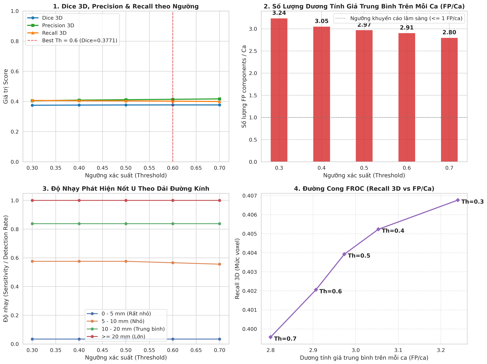

# 📋 BẢNG TỔNG HỢP TOÀN BỘ CHỈ SỐ & KẾT QUẢ ĐO LƯỜNG BƯỚC 0 (STEP 0 FULL METRICS)

*Tệp tổng hợp duy nhất chứa toàn bộ số liệu, cấu hình, thông số y tế và bảng kết quả đo lường trích xuất từ notebook `colab_step0_measurement.ipynb`.*

---

## 1. Thông Tin Phiên Chạy & Môi Trường Đo Lường
- **Checkpoint đánh giá**: `mamba_colab_500item_25epoch_extra_test/best_model.pth`
- **Mã nguồn mô hình**: `mamba_unet` (Backbone: `mamba_vision_T`, Activation: `relu`)
- **Tập kiểm tra (Split)**: `val` (Validation set)
- **Tổng số bệnh nhân đánh giá**: **75 bệnh nhân** (phân chia cố định với `SEED = 42`)
- **Tổng số nốt u Ground Truth (GT)**: **203 nốt u**
- **Quy chuẩn hậu xử lý**:
  - Loại bỏ thành phần liên thông 3D < 20.0 mm² (`min_slice_area_mm2 = 20.0`)
  - Khoảng cách lát cắt: spacing_z = 1.0 mm
  - Cấu trúc liên thông 3D: 26-connectivity (3 x 3 x 3)
- **Phần cứng**: NVIDIA Tesla T4 16GB, PyTorch 2.6.0+cu126, Triton 3.3.1, CUDA native `selective_scan`

---

## 2. Thống Kê Chỉ Mục Dữ Liệu Huấn Luyện & Kiểm Tra (Offline Builder)
Số liệu phân chia dữ liệu thực tế từ `offline_builder` trên 500 bệnh nhân:
- **Tổng số bệnh nhân**: 500 bệnh nhân
  - Tập Train: **425 bệnh nhân** (85%)
  - Tập Validation: **75 bệnh nhân** (15%)
- **Tổng số lát cắt giữ lại**: **6,116 lát cắt**
  - Lát cắt tập Train: **5,186 lát cắt**
  - Lát cắt tập Val: **930 lát cắt**
  - Lát cắt dương tính (có u >= 20.0 mm²): **4,795 lát cắt**
  - Lát cắt âm tính (không u, có nhu mô phổi): **1,321 lát cắt**
- **Thống kê các lát cắt đã loại bỏ**:
  - Lát cắt không chứa nhu mô phổi: **22,133 lát cắt**
  - Lát cắt có khối u quá nhỏ (< 20.0 mm²): **2,081 lát cắt**
  - Lát cắt âm tính dư thừa (vượt tỷ lệ ZERO_SL_RATIO = 0.25): **75,620 lát cắt**

---

## 3. Kết Quả Kiểm Tra Cache & Trường Quan Sát FOV (`check_cache.py`)

### 3.1 Tỷ lệ nốt u nằm trong mặt nạ phổi (`mask_in_lung_fraction`)
- Tổng số ca kiểm tra có mặt nạ phổi: n = 449 bệnh nhân
- Giá trị trung vị (Median): **1.000** | Phân vị 5% (p5): **0.994**
- Số ca có tỷ lệ < 0.90: **8 ca bệnh**
- Số ca có tỷ lệ < 0.70: **4 ca bệnh**
- **Danh sách 5 ca bệnh có tỷ lệ nốt u trong phổi thấp nhất**:
  1. `LIDC-IDRI-0339`: **0.00%** (Toàn bộ nốt u nằm ngoài mặt nạ phổi)
  2. `LIDC-IDRI-0067`: **20.46%**
  3. `LIDC-IDRI-0454`: **27.64%**
  4. `LIDC-IDRI-0259`: **67.31%**
  5. `LIDC-IDRI-0074`: **82.90%**

### 3.2 Khảo sát giới hạn FOV khi thay đổi `IMAGE_SIZE`
- **Với `IMAGE_SIZE = 512`** (kích thước hiện tại):
  - Số ca có FOV > 512: **0 ca**
  - Số ca mất nhãn nốt u do crop: **0 ca (0.0%)**
- **Với `IMAGE_SIZE = 448`** (kích thước khảo sát):
  - Số ca có FOV > 448: **21 ca**
  - Số ca mất nhãn nốt u do crop: **0 ca (0.0%)**
  - 5 ca có FOV lớn nhất (`LIDC-IDRI-0360`, `0289`, `0248`, `0191`, `0170`): Tỷ lệ mất nhãn đều là **0.0%**

---

## 4. Kết Quả Quét Ngưỡng 3D Mức Bệnh Nhân (`eval_sweep.py`)

Bảng số liệu trung bình trên toàn bộ 75 bệnh nhân tập Validation theo từng ngưỡng xác suất:

| Ngưỡng (Th) | Dice 3D | Precision 3D | Recall 3D | FP / Ca (fp_comps) |
| --- | --- | --- | --- | --- |
| 0.3000 | 0.3749 | 0.4049 | 0.4068 | 3.2400 |
| 0.4000 | 0.3761 | 0.4088 | 0.4052 | 3.0533 |
| 0.5000 | 0.3768 | 0.4117 | 0.4039 | 2.9733 |
| 0.6000 | 0.3771 | 0.4143 | 0.4021 | 2.9067 |
| 0.7000 | 0.3770 | 0.4171 | 0.3996 | 2.8000 |

- **Ngưỡng đạt Dice 3D cao nhất**: **Th = 0.6** (Dice 3D = **0.3771**)
- **Ngưỡng đạt Precision 3D cao nhất**: **Th = 0.7** (Precision 3D = **0.4171**)
- **Ngưỡng đạt Recall 3D cao nhất**: **Th = 0.3** (Recall 3D = **0.4068**)
- **Mức dương tính giả thấp nhất**: **Th = 0.7** (**2.80 FP/ca**)

---

## 5. Bảng Độ Nhạy Phát Hiện Theo Kích Thước Nốt U

Phân tích trên tổng số 203 nốt u Ground Truth theo đường kính tương đương d = 2 * sqrt(A_max / pi):

| Dải kích thước (mm) | Số nốt GT | Th=0.3 | Th=0.4 | Th=0.5 | Th=0.6 | Th=0.7 | Số nốt phát hiện (Th=0.6) |
| --- | --- | --- | --- | --- | --- | --- | --- |
| 0 - 5 mm (Rất nhỏ) | 59 | 0.0339 | 0.0339 | 0.0339 | 0.0339 | 0.0339 | 2 / 59 |
| 5 - 10 mm (Nhỏ) | 99 | 0.5758 | 0.5758 | 0.5758 | 0.5657 | 0.5556 | 56 / 99 |
| 10 - 20 mm (Trung bình) | 37 | 0.8378 | 0.8378 | 0.8378 | 0.8378 | 0.8378 | 31 / 37 |
| >= 20 mm (Lớn) | 8 | 1.0000 | 1.0000 | 1.0000 | 1.0000 | 1.0000 | 8 / 8 |

- **Dải >= 20 mm (Lớn)**: Phát hiện **8 / 8 nốt (100.0%)**
- **Dải 10 - 20 mm (Trung bình)**: Phát hiện **31 / 37 nốt (83.78%)**
- **Dải 5 - 10 mm (Nhỏ)**: Phát hiện **57 / 99 nốt (57.58%)**
- **Dải 0 - 5 mm (Rất nhỏ)**: Phát hiện **2 / 59 nốt (3.39%)**

---

## 6. Thống Kê Mô Tả Phân Bố Metric Của 75 Bệnh Nhân (Tại Ngưỡng Tối Ưu Th = 0.6)

| Thống kê | Dice 3D | Precision 3D | Recall 3D | FP / Ca | Số nốt GT | Số nốt phát hiện |
| --- | --- | --- | --- | --- | --- | --- |
| count | 75.0000 | 75.0000 | 75.0000 | 75.0000 | 75.0000 | 75.0000 |
| mean | 0.3771 | 0.4143 | 0.4021 | 2.9067 | 2.7067 | 1.2933 |
| std | 0.3490 | 0.3739 | 0.3615 | 2.7419 | 2.6852 | 1.5920 |
| min | 0.0000 | 0.0000 | 0.0000 | 0.0000 | 0.0000 | 0.0000 |
| 25% | 0.0000 | 0.0000 | 0.0000 | 1.0000 | 1.0000 | 0.0000 |
| 50% | 0.3128 | 0.3701 | 0.3695 | 2.0000 | 2.0000 | 1.0000 |
| 75% | 0.6882 | 0.7744 | 0.7715 | 4.0000 | 3.5000 | 2.0000 |
| max | 1.0000 | 1.0000 | 1.0000 | 11.0000 | 12.0000 | 8.0000 |

---

## 7. Bảng Chi Tiết Toàn Bộ 75 Bệnh Nhân Tập Validation (Tại Ngưỡng Tối Ưu Th = 0.6)

| Mã bệnh nhân (PID) | Dice 3D | Precision 3D | Recall 3D | FP (fp_comps) | Số nốt GT | Số nốt phát hiện |
| --- | --- | --- | --- | --- | --- | --- |
| LIDC-IDRI-0005 | 0.5571 | 0.8971 | 0.4040 | 0 | 3 | 1 |
| LIDC-IDRI-0008 | 0.0253 | 0.0129 | 0.5814 | 5 | 2 | 2 |
| LIDC-IDRI-0022 | 0.4417 | 0.6882 | 0.3252 | 4 | 1 | 1 |
| LIDC-IDRI-0038 | 0.0000 | 0.0000 | 0.0000 | 3 | 1 | 0 |
| LIDC-IDRI-0042 | 0.4959 | 0.7538 | 0.3695 | 0 | 10 | 5 |
| LIDC-IDRI-0046 | 0.4329 | 0.4474 | 0.4193 | 2 | 7 | 3 |
| LIDC-IDRI-0051 | 0.8462 | 0.8261 | 0.8675 | 2 | 3 | 3 |
| LIDC-IDRI-0054 | 0.7863 | 0.6964 | 0.9028 | 2 | 1 | 1 |
| LIDC-IDRI-0060 | 0.6797 | 0.5821 | 0.8167 | 11 | 6 | 5 |
| LIDC-IDRI-0069 | 0.7415 | 0.8738 | 0.6441 | 1 | 3 | 2 |
| LIDC-IDRI-0073 | 0.2571 | 0.2605 | 0.2537 | 5 | 3 | 2 |
| LIDC-IDRI-0075 | 0.8597 | 0.8739 | 0.8459 | 3 | 4 | 3 |
| LIDC-IDRI-0089 | 0.9228 | 0.9094 | 0.9366 | 0 | 1 | 1 |
| LIDC-IDRI-0093 | 0.0000 | 0.0000 | 0.0000 | 0 | 2 | 0 |
| LIDC-IDRI-0094 | 0.8759 | 0.9188 | 0.8369 | 1 | 1 | 1 |
| LIDC-IDRI-0095 | 0.5117 | 0.8567 | 0.3648 | 4 | 3 | 2 |
| LIDC-IDRI-0097 | 0.0732 | 0.0499 | 0.1371 | 6 | 2 | 1 |
| LIDC-IDRI-0121 | 0.1967 | 0.5851 | 0.1182 | 3 | 2 | 2 |
| LIDC-IDRI-0130 | 0.1529 | 1.0000 | 0.0828 | 0 | 3 | 1 |
| LIDC-IDRI-0132 | 0.6966 | 0.6344 | 0.7724 | 4 | 7 | 3 |
| LIDC-IDRI-0140 | 0.5598 | 0.4103 | 0.8808 | 9 | 1 | 1 |
| LIDC-IDRI-0142 | 0.4761 | 0.5168 | 0.4414 | 1 | 4 | 1 |
| LIDC-IDRI-0152 | 0.6476 | 0.6151 | 0.6837 | 1 | 1 | 1 |
| LIDC-IDRI-0155 | 0.1133 | 0.0671 | 0.3636 | 11 | 1 | 1 |
| LIDC-IDRI-0157 | 0.1780 | 0.1031 | 0.6522 | 1 | 1 | 1 |
| LIDC-IDRI-0161 | 0.4133 | 0.6828 | 0.2963 | 2 | 4 | 3 |
| LIDC-IDRI-0163 | 0.7540 | 0.9328 | 0.6327 | 0 | 1 | 1 |
| LIDC-IDRI-0164 | 0.7191 | 0.7116 | 0.7267 | 2 | 12 | 8 |
| LIDC-IDRI-0165 | 0.0000 | 0.0000 | 0.0000 | 6 | 1 | 0 |
| LIDC-IDRI-0171 | 0.8273 | 0.7816 | 0.8786 | 1 | 7 | 4 |
| LIDC-IDRI-0176 | 0.1094 | 0.1953 | 0.0760 | 2 | 3 | 1 |
| LIDC-IDRI-0178 | 0.0000 | 0.0000 | 0.0000 | 0 | 1 | 0 |
| LIDC-IDRI-0181 | 0.6588 | 0.5753 | 0.7706 | 8 | 8 | 6 |
| LIDC-IDRI-0189 | 0.0000 | 0.0000 | 0.0000 | 1 | 0 | 0 |
| LIDC-IDRI-0200 | 0.0000 | 0.0000 | 0.0000 | 0 | 2 | 0 |
| LIDC-IDRI-0210 | 0.6742 | 0.5633 | 0.8396 | 1 | 1 | 1 |
| LIDC-IDRI-0211 | 0.7979 | 0.7673 | 0.8310 | 7 | 2 | 1 |
| LIDC-IDRI-0212 | 0.0000 | 0.0000 | 0.0000 | 2 | 1 | 0 |
| LIDC-IDRI-0216 | 0.2919 | 0.1976 | 0.5583 | 4 | 2 | 1 |
| LIDC-IDRI-0218 | 0.0000 | 0.0000 | 0.0000 | 10 | 0 | 0 |
| LIDC-IDRI-0224 | 1.0000 | 1.0000 | 1.0000 | 0 | 0 | 0 |
| LIDC-IDRI-0228 | 0.8446 | 0.8117 | 0.8803 | 1 | 1 | 1 |
| LIDC-IDRI-0229 | 0.8773 | 0.8985 | 0.8570 | 0 | 7 | 5 |
| LIDC-IDRI-0247 | 0.0000 | 0.0000 | 0.0000 | 1 | 1 | 0 |
| LIDC-IDRI-0251 | 0.3128 | 0.2230 | 0.5238 | 3 | 1 | 1 |
| LIDC-IDRI-0253 | 0.0000 | 0.0000 | 0.0000 | 2 | 0 | 0 |
| LIDC-IDRI-0280 | 0.0000 | 0.0000 | 0.0000 | 7 | 1 | 0 |
| LIDC-IDRI-0291 | 0.0000 | 0.0000 | 0.0000 | 6 | 1 | 0 |
| LIDC-IDRI-0294 | 0.5517 | 0.9281 | 0.3925 | 0 | 2 | 1 |
| LIDC-IDRI-0299 | 0.2869 | 0.3056 | 0.2704 | 7 | 5 | 1 |
| LIDC-IDRI-0305 | 0.0967 | 0.3615 | 0.0558 | 3 | 10 | 1 |
| LIDC-IDRI-0306 | 0.0000 | 0.0000 | 0.0000 | 1 | 0 | 0 |
| LIDC-IDRI-0317 | 0.0000 | 0.0000 | 0.0000 | 0 | 1 | 0 |
| LIDC-IDRI-0322 | 0.0000 | 0.0000 | 0.0000 | 4 | 0 | 0 |
| LIDC-IDRI-0328 | 0.0000 | 0.0000 | 0.0000 | 2 | 2 | 0 |
| LIDC-IDRI-0335 | 0.1836 | 0.1560 | 0.2231 | 3 | 5 | 1 |
| LIDC-IDRI-0342 | 1.0000 | 1.0000 | 1.0000 | 0 | 0 | 0 |
| LIDC-IDRI-0360 | 0.6751 | 0.6775 | 0.6727 | 3 | 5 | 3 |
| LIDC-IDRI-0370 | 0.0000 | 0.0000 | 0.0000 | 3 | 2 | 0 |
| LIDC-IDRI-0371 | 0.0000 | 0.0000 | 0.0000 | 3 | 1 | 0 |
| LIDC-IDRI-0372 | 0.4107 | 0.2939 | 0.6814 | 1 | 2 | 1 |
| LIDC-IDRI-0376 | 0.0000 | 0.0000 | 0.0000 | 4 | 2 | 0 |
| LIDC-IDRI-0385 | 0.4528 | 0.3701 | 0.5830 | 3 | 5 | 1 |
| LIDC-IDRI-0391 | 0.0000 | 0.0000 | 0.0000 | 3 | 0 | 0 |
| LIDC-IDRI-0399 | 0.0000 | 0.0000 | 0.0000 | 1 | 2 | 0 |
| LIDC-IDRI-0405 | 0.0000 | 0.0000 | 0.0000 | 7 | 4 | 0 |
| LIDC-IDRI-0409 | 0.2403 | 0.2852 | 0.2077 | 5 | 6 | 2 |
| LIDC-IDRI-0417 | 0.0000 | 0.0000 | 0.0000 | 2 | 0 | 0 |
| LIDC-IDRI-0436 | 0.9129 | 0.9275 | 0.8988 | 3 | 2 | 2 |
| LIDC-IDRI-0441 | 0.0000 | 0.0000 | 0.0000 | 6 | 0 | 0 |
| LIDC-IDRI-0445 | 0.5404 | 0.5337 | 0.5472 | 1 | 3 | 1 |
| LIDC-IDRI-0455 | 1.0000 | 1.0000 | 1.0000 | 0 | 0 | 0 |
| LIDC-IDRI-0464 | 0.7893 | 0.7932 | 0.7854 | 2 | 3 | 1 |
| LIDC-IDRI-0470 | 0.8298 | 0.7862 | 0.8785 | 5 | 2 | 2 |
| LIDC-IDRI-0481 | 0.5070 | 0.7367 | 0.3865 | 1 | 9 | 3 |

---

## 8. Bảng Đối Chiếu Giá Trị Dice 3D Của 75 Bệnh Nhân Qua 5 Ngưỡng

| Mã bệnh nhân | Dice (Th=0.3) | Dice (Th=0.4) | Dice (Th=0.5) | Dice (Th=0.6) | Dice (Th=0.7) |
| --- | --- | --- | --- | --- | --- |
| LIDC-IDRI-0005 | 0.5545 | 0.5545 | 0.5545 | 0.5571 | 0.5505 |
| LIDC-IDRI-0008 | 0.0252 | 0.0252 | 0.0251 | 0.0253 | 0.0249 |
| LIDC-IDRI-0022 | 0.4468 | 0.4460 | 0.4443 | 0.4417 | 0.4392 |
| LIDC-IDRI-0038 | 0.0000 | 0.0000 | 0.0000 | 0.0000 | 0.0000 |
| LIDC-IDRI-0042 | 0.5049 | 0.5057 | 0.4950 | 0.4959 | 0.4875 |
| LIDC-IDRI-0046 | 0.4119 | 0.4290 | 0.4318 | 0.4329 | 0.4425 |
| LIDC-IDRI-0051 | 0.8368 | 0.8442 | 0.8451 | 0.8462 | 0.8452 |
| LIDC-IDRI-0054 | 0.7674 | 0.7725 | 0.7817 | 0.7863 | 0.7866 |
| LIDC-IDRI-0060 | 0.6754 | 0.6762 | 0.6787 | 0.6797 | 0.6850 |
| LIDC-IDRI-0069 | 0.7430 | 0.7435 | 0.7429 | 0.7415 | 0.7406 |
| LIDC-IDRI-0073 | 0.2553 | 0.2563 | 0.2563 | 0.2571 | 0.2437 |
| LIDC-IDRI-0075 | 0.8597 | 0.8600 | 0.8602 | 0.8597 | 0.8599 |
| LIDC-IDRI-0089 | 0.9216 | 0.9222 | 0.9224 | 0.9228 | 0.9235 |
| LIDC-IDRI-0093 | 0.0000 | 0.0000 | 0.0000 | 0.0000 | 0.0000 |
| LIDC-IDRI-0094 | 0.8782 | 0.8778 | 0.8768 | 0.8759 | 0.8749 |
| LIDC-IDRI-0095 | 0.5191 | 0.5160 | 0.5141 | 0.5117 | 0.5084 |
| LIDC-IDRI-0097 | 0.0696 | 0.0694 | 0.0712 | 0.0732 | 0.0725 |
| LIDC-IDRI-0121 | 0.1961 | 0.1966 | 0.1971 | 0.1967 | 0.1979 |
| LIDC-IDRI-0130 | 0.1669 | 0.1657 | 0.1576 | 0.1529 | 0.1470 |
| LIDC-IDRI-0132 | 0.6825 | 0.6835 | 0.6858 | 0.6966 | 0.6990 |
| LIDC-IDRI-0140 | 0.5447 | 0.5476 | 0.5548 | 0.5598 | 0.5607 |
| LIDC-IDRI-0142 | 0.4750 | 0.4745 | 0.4755 | 0.4761 | 0.4768 |
| LIDC-IDRI-0152 | 0.6258 | 0.6336 | 0.6447 | 0.6476 | 0.6443 |
| LIDC-IDRI-0155 | 0.1107 | 0.1121 | 0.1146 | 0.1133 | 0.1168 |
| LIDC-IDRI-0157 | 0.1754 | 0.1754 | 0.1770 | 0.1780 | 0.1780 |
| LIDC-IDRI-0161 | 0.4775 | 0.4623 | 0.4605 | 0.4133 | 0.4118 |
| LIDC-IDRI-0163 | 0.7563 | 0.7553 | 0.7540 | 0.7540 | 0.7538 |
| LIDC-IDRI-0164 | 0.7122 | 0.7125 | 0.7141 | 0.7191 | 0.7190 |
| LIDC-IDRI-0165 | 0.0000 | 0.0000 | 0.0000 | 0.0000 | 0.0000 |
| LIDC-IDRI-0171 | 0.8067 | 0.8201 | 0.8269 | 0.8273 | 0.8284 |
| LIDC-IDRI-0176 | 0.1059 | 0.1066 | 0.1082 | 0.1094 | 0.1062 |
| LIDC-IDRI-0178 | 0.0000 | 0.0000 | 0.0000 | 0.0000 | 0.0000 |
| LIDC-IDRI-0181 | 0.6550 | 0.6566 | 0.6576 | 0.6588 | 0.6642 |
| LIDC-IDRI-0189 | 0.0000 | 0.0000 | 0.0000 | 0.0000 | 0.0000 |
| LIDC-IDRI-0200 | 0.0000 | 0.0000 | 0.0000 | 0.0000 | 0.0000 |
| LIDC-IDRI-0210 | 0.6520 | 0.6617 | 0.6667 | 0.6742 | 0.6667 |
| LIDC-IDRI-0211 | 0.7890 | 0.7941 | 0.7956 | 0.7979 | 0.7991 |
| LIDC-IDRI-0212 | 0.0000 | 0.0000 | 0.0000 | 0.0000 | 0.0000 |
| LIDC-IDRI-0216 | 0.2524 | 0.2572 | 0.2617 | 0.2919 | 0.2914 |
| LIDC-IDRI-0218 | 0.0000 | 0.0000 | 0.0000 | 0.0000 | 0.0000 |
| LIDC-IDRI-0224 | 1.0000 | 1.0000 | 1.0000 | 1.0000 | 1.0000 |
| LIDC-IDRI-0228 | 0.8367 | 0.8409 | 0.8451 | 0.8446 | 0.8469 |
| LIDC-IDRI-0229 | 0.8779 | 0.8776 | 0.8780 | 0.8773 | 0.8769 |
| LIDC-IDRI-0247 | 0.0000 | 0.0000 | 0.0000 | 0.0000 | 0.0000 |
| LIDC-IDRI-0251 | 0.3041 | 0.3063 | 0.3084 | 0.3128 | 0.3150 |
| LIDC-IDRI-0253 | 0.0000 | 0.0000 | 0.0000 | 0.0000 | 0.0000 |
| LIDC-IDRI-0280 | 0.0000 | 0.0000 | 0.0000 | 0.0000 | 0.0000 |
| LIDC-IDRI-0291 | 0.0000 | 0.0000 | 0.0000 | 0.0000 | 0.0000 |
| LIDC-IDRI-0294 | 0.5610 | 0.5583 | 0.5529 | 0.5517 | 0.5490 |
| LIDC-IDRI-0299 | 0.2826 | 0.2855 | 0.2846 | 0.2869 | 0.2929 |
| LIDC-IDRI-0305 | 0.0999 | 0.0987 | 0.0970 | 0.0967 | 0.0964 |
| LIDC-IDRI-0306 | 0.0000 | 0.0000 | 0.0000 | 0.0000 | 0.0000 |
| LIDC-IDRI-0317 | 0.0000 | 0.0000 | 0.0000 | 0.0000 | 0.0000 |
| LIDC-IDRI-0322 | 0.0000 | 0.0000 | 0.0000 | 0.0000 | 0.0000 |
| LIDC-IDRI-0328 | 0.0000 | 0.0000 | 0.0000 | 0.0000 | 0.0000 |
| LIDC-IDRI-0335 | 0.1827 | 0.1853 | 0.1874 | 0.1836 | 0.1848 |
| LIDC-IDRI-0342 | 1.0000 | 1.0000 | 1.0000 | 1.0000 | 1.0000 |
| LIDC-IDRI-0360 | 0.6752 | 0.6734 | 0.6715 | 0.6751 | 0.6762 |
| LIDC-IDRI-0370 | 0.0000 | 0.0000 | 0.0000 | 0.0000 | 0.0000 |
| LIDC-IDRI-0371 | 0.0000 | 0.0000 | 0.0000 | 0.0000 | 0.0000 |
| LIDC-IDRI-0372 | 0.4021 | 0.4074 | 0.4085 | 0.4107 | 0.4118 |
| LIDC-IDRI-0376 | 0.0000 | 0.0000 | 0.0000 | 0.0000 | 0.0000 |
| LIDC-IDRI-0385 | 0.4456 | 0.4487 | 0.4502 | 0.4528 | 0.4554 |
| LIDC-IDRI-0391 | 0.0000 | 0.0000 | 0.0000 | 0.0000 | 0.0000 |
| LIDC-IDRI-0399 | 0.0000 | 0.0000 | 0.0000 | 0.0000 | 0.0000 |
| LIDC-IDRI-0405 | 0.0000 | 0.0000 | 0.0000 | 0.0000 | 0.0000 |
| LIDC-IDRI-0409 | 0.2449 | 0.2422 | 0.2440 | 0.2403 | 0.2424 |
| LIDC-IDRI-0417 | 0.0000 | 0.0000 | 0.0000 | 0.0000 | 0.0000 |
| LIDC-IDRI-0436 | 0.9130 | 0.9125 | 0.9128 | 0.9129 | 0.9136 |
| LIDC-IDRI-0441 | 0.0000 | 0.0000 | 0.0000 | 0.0000 | 0.0000 |
| LIDC-IDRI-0445 | 0.5305 | 0.5337 | 0.5404 | 0.5404 | 0.5438 |
| LIDC-IDRI-0455 | 1.0000 | 1.0000 | 1.0000 | 1.0000 | 1.0000 |
| LIDC-IDRI-0464 | 0.7821 | 0.7858 | 0.7880 | 0.7893 | 0.7898 |
| LIDC-IDRI-0470 | 0.8280 | 0.8282 | 0.8295 | 0.8298 | 0.8308 |
| LIDC-IDRI-0481 | 0.4986 | 0.5072 | 0.5077 | 0.5070 | 0.5040 |

---

## 9. Đồ Thị Trực Quan Hóa Đính Kèm
Tệp hình ảnh biểu đồ phân tích 4 chiều đã được lưu trữ tại:

---
*Dữ liệu được trích xuất nguyên bản từ phiên đo lường thực tế `colab_step0_measurement.ipynb`.*