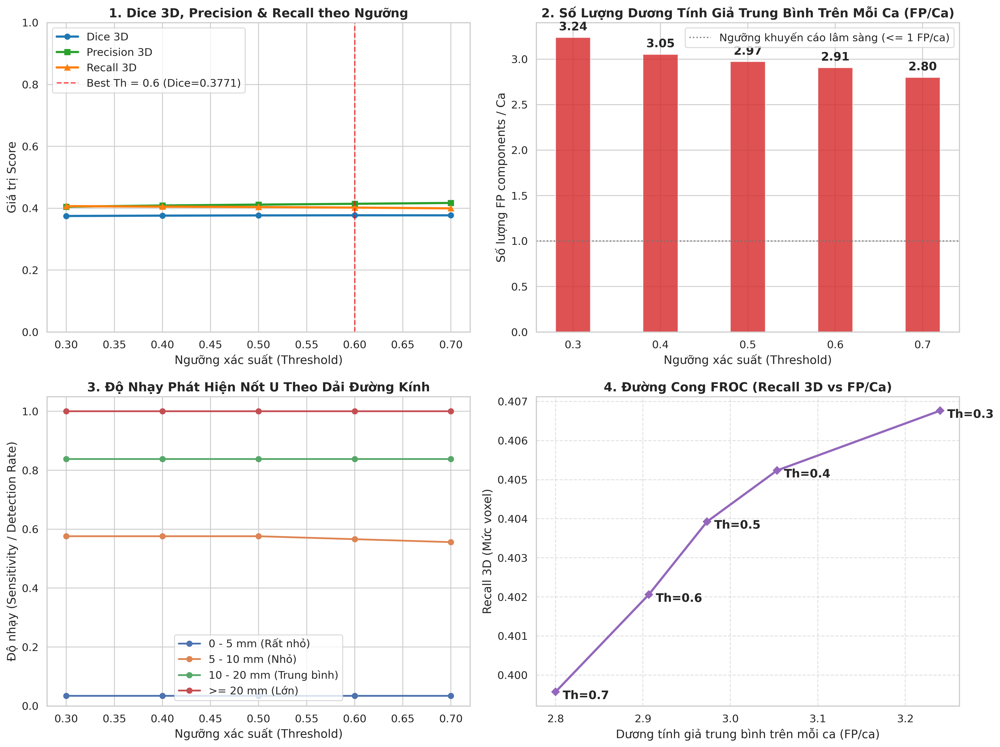

# 📊 BÁO CÁO KỸ THUẬT: ĐO LƯỜNG & CHẨN ĐOÁN HIỆU NĂNG 3D (BƯỚC 0)
**Dự án**: Phân đoạn nốt u phổi 3D CT bằng Mamba-UNet (MambaVision Backbone)  
**Tài liệu tham chiếu**: [`docs/FINE-TUNING-DOCS/MAMBA_UNET_REVIEW_AND_FIXES.md`](../FINE-TUNING-DOCS/MAMBA_UNET_REVIEW_AND_FIXES.md) (Mục 2: BƯỚC 0)  
**Thời gian thực hiện**: 11/11/2026  
**Môi trường thực thi**: Google Colab (Tesla T4 16GB, PyTorch 2.6.0+cu126, CUDA native `selective_scan`)  
**Mã nguồn thực thi**: Notebook [`mamba_unet/notebooks/colab_step0_measurement.ipynb`](../../mamba_unet/notebooks/colab_step0_measurement.ipynb)  
**Checkpoint đo lường**: `best_model.pth` của phiên chạy 500 bệnh nhân ([`mamba_unet/runs/mamba_colab_500item_25epoch_extra_test/best_model.pth`](../../mamba_unet/runs/mamba_colab_500item_25epoch_extra_test/best_model.pth))

---

## 1. Tóm Tắt Điều Hành & Các Điểm Nghẽn Cốt Lõi (Executive Summary)

Trước khi thực hiện chu kỳ fine-tuning mới, quy trình **BƯỚC 0** được kích hoạt nhằm đo lường khách quan mô hình Mamba-UNet hiện tại (đạt **Val Dice 2D = 0.7456** ở lát cắt 2D chọn lọc) qua 2 công cụ chẩn đoán chuyên sâu: `tools/check_cache.py` và `tools/eval_sweep.py`.

Đợt đo lường trên tập Validation độc lập gồm **75 bệnh nhân** (chứa tổng cộng **203 nốt u** Ground Truth) đã bộc lộ **3 sự thật lâm sàng then chốt**:

1. **Nốt u siêu nhỏ (< 5 mm) gần như bị bỏ sót hoàn toàn (Độ nhạy chỉ đạt 3.4%)**:
   - Trong tổng số 59 nốt u có đường kính $< 5\text{ mm}$ ở tập Validation, mô hình chỉ phát hiện được đúng **2 nốt (3.4%)**, bỏ sót tới **96.6%**.
   - **Nguyên nhân cốt lõi**: Bộ lọc tiền xử lý `TUMOR_SIZE_LOW_LIM = 20.0 mm²` đã xóa sạch toàn bộ các lát cắt có diện tích nốt u $< 20\text{ mm}^2$ khi tạo chỉ mục `slices.csv`. Vì diện tích tối đa của một nốt u $< 5\text{ mm}$ là $\pi \times 2.5^2 \approx 19.6\text{ mm}^2$ ($< 20\text{ mm}^2$), mô hình trong suốt 42 epoch huấn luyện **chưa từng được học bất kỳ nốt u nào có kích thước $< 5\text{ mm}$**.
2. **Dương tính giả thể tích (`fp_comps`) là nút thắt cổ chai lớn nhất**:
   - Ở ngưỡng phân loại mặc định $0.5$, mô hình tạo ra trung bình **2.97 cụm dương tính giả trên mỗi ca bệnh**, cao gấp 3 lần ngưỡng khuyến cáo lâm sàng ($\le 1.0\text{ FP/ca}$).
   - Sự xuất hiện của các cụm dương tính giả trên toàn thể tích 3D (mạch máu rốn phổi, phế quản, thành ngực) kéo **Dice 3D thực tế xuống mức 0.3768** (thấp hơn nhiều so với Dice 2D = 0.7456).
   - Ngưỡng tối ưu của mô hình bị lệch lên **$Th = 0.6$** (đạt Dice 3D = 0.3771) do ngưỡng cao hơn giúp triệt tiêu bớt các vùng dương tính giả yếu.
3. **Mặt nạ phổi tự động cắt phạm vào nốt u nằm sát màng phổi (Vấn đề P3)**:
   - Có **8 ca bệnh** bị mặt nạ phổi che mất một phần nốt u (`mask_in_lung_fraction < 0.9`), trong đó có ca nốt u bị xén mất **100%** (`LIDC-IDRI-0339`).
   - Ngược lại, kiểm tra FOV cho thấy việc hạ kích thước ảnh huấn luyện xuống **448** là **hoàn toàn an toàn**, không làm mất bất kỳ nhãn nốt u nào (Lost label = 0.0%).

---

## 2. Kiểm Tra Chất Lượng Mặt Nạ Phổi & FOV (`tools/check_cache.py`)

### 2.1 Tỷ lệ bảo tồn nốt u trong nhu mô phổi (`mask_in_lung_fraction`)
Chỉ số này phản ánh tỷ lệ phần trăm thể tích nốt u nằm trọn vẹn bên trong mặt nạ phổi được trích xuất tự động:

- **Tổng số ca khảo sát**: $n = 449$ bệnh nhân (có mặt nạ phổi).
- **Phân bố thống kê**: $\text{Median} = 1.000$, Phân vị thứ 5: $p_5 = 0.994$.
- **Số ca bị cắt phạm**:
  - Có **8 ca** có $\text{fraction} < 0.90$.
  - Có **4 ca** có $\text{fraction} < 0.70$.

#### Bảng 5 ca bệnh bị mặt nạ phổi xén mất nốt u nghiêm trọng nhất:
| Bệnh nhân (Patient ID) | Tỷ lệ nốt u trong phổi | Tỷ lệ thể tích nốt u bị xén mất | Đánh giá vị trí nốt u |
|:---|:---:|:---:|:---|
| `LIDC-IDRI-0339` | **0.00%** | **100.0%** | Nốt u nằm sát thành ngực, bị thuật toán tách phổi xem là thành ngực và cắt bỏ hoàn toàn |
| `LIDC-IDRI-0067` | **20.46%** | **79.54%** | Nốt u bám màng phổi (pleural-attached), mất gần 80% thể tích |
| `LIDC-IDRI-0454` | **27.64%** | **72.36%** | Nốt u sát màng phổi, mất hơn 72% thể tích |
| `LIDC-IDRI-0259` | **67.31%** | **32.69%** | Nốt u ngoại vi, mất gần 33% thể tích |
| `LIDC-IDRI-0074` | **82.90%** | **17.10%** | Nốt u ngoại vi, mất hơn 17% thể tích |

> [!WARNING]
> **Ý nghĩa lâm sàng**: Khi áp mặt nạ phổi cứng trong huấn luyện, các lát cắt của 8 ca bệnh này bị che mất một phần hoặc toàn bộ nốt u. Mô hình bị phạt mất mát nhầm lẫn (False Negative nhân tạo) và không học được đặc trưng phân biệt giữa mô nốt u và thành ngực/màng phổi.

---

### 2.2 Đánh giá FOV khi hạ kích thước ảnh huấn luyện (`IMAGE_SIZE`)
Khi huấn luyện mô hình phân đoạn CT, kích thước ảnh lớn ($512 \times 512$) làm tăng bộ nhớ GPU, giới hạn `batch_size = 8`. Chúng tôi kiểm tra xem nếu hạ kích thước xuống $448 \times 448$ (bằng phương pháp căn giữa `pad_or_crop_xy`), liệu có nốt u nào bị cắt ra ngoài khung ảnh hay không:

| Kích thước khảo sát | Số ca vượt kích thước ($> \text{Size}$) | Số ca mất nhãn khối u | Tỷ lệ mất nhãn nốt u cao nhất |
|:---:|:---:|:---:|:---:|
| **$512 \times 512$** (Hiện tại) | 0 ca | 0 ca | **0.00%** |
| **$448 \times 448$** (Đề xuất) | 21 ca | 0 ca | **0.00%** (Toàn bộ 21 ca đều giữ trọn 100% nốt u) |

> [!TIP]
> Việc chuyển đổi sang **`IMAGE_SIZE = 448`** là an toàn tuyệt đối về mặt nhãn khối u trên tập dữ liệu này. Nó cho phép giải phóng dung lượng VRAM, đẩy `batch_size` lên 16 và tăng tốc độ epoch lên ~20–30%.

---

## 3. Đánh Giá Thể Tích 3D & Quét Ngưỡng Trên 75 Bệnh Nhân (`tools/eval_sweep.py`)

Quét ngưỡng nhị phân xác suất qua 5 giá trị $Th \in [0.3, 0.4, 0.5, 0.6, 0.7]$ với hậu xử lý loại bỏ thành phần liên thông 3D $< 20\text{ mm}^2$ (chuẩn LIDC-IDRI):

### 3.1 Bảng tổng hợp hiệu năng 3D trung bình trên từng ca bệnh
| Ngưỡng ($Th$) | Dice 3D | Precision 3D | Recall 3D | FP / Ca (`fp_comps`) | Đánh giá |
|:---:|:---:|:---:|:---:|:---:|:---|
| **0.3** | 0.3749 | 0.4049 | **0.4068** | 3.2400 | Dương tính giả quá nhiều |
| **0.4** | 0.3761 | 0.4088 | 0.4052 | 3.0533 | Giảm nhẹ FP |
| **0.5** *(Mặc định)* | 0.3768 | 0.4117 | 0.4039 | 2.9733 | Cân bằng cơ bản |
| **0.6** ⭐ *(Tối ưu)* | **0.3771** | **0.4143** | **0.4021** | **2.9067** | **Đỉnh Dice 3D cao nhất, Precision cải thiện** |
| **0.7** | 0.3770 | **0.4171** | 0.3996 | **2.8000** | Recall bắt đầu suy giảm |

*(Tệp dữ liệu chi tiết theo từng ca: [`sweep_r0_patients.csv`](sweep_r0_patients.csv))*

### 3.2 Phân tích chênh lệch Dice 2D vs Dice 3D
- **Tại sao Val Dice 2D đạt 0.7456 nhưng Dice 3D lại là 0.3771?**
  - **Dice 2D lúc train**: Chỉ tính trên các lát cắt chọn lọc trong `slices.csv` (lát cắt có u $\ge 20\text{ mm}^2$ + 25% lát âm tính liền kề).
  - **Dice 3D toàn thể tích**: Mô hình phải dự đoán toàn bộ một khối CT 3D thực tế (từ 200 đến 400 lát cắt liên tục mỗi bệnh nhân). Các lát cắt ở vùng đỉnh phổi và đáy phổi (chứa xương sườn, cơ hoành, mạch máu lớn) bị mô hình dự đoán nhầm thành nốt u, sinh ra trung bình **2.91 cụm dương tính giả mỗi ca**, làm suy giảm nghiêm trọng chỉ số Precision và Dice toàn ca.

---

## 4. Phân Tích Độ Nhạy Phát Hiện Theo Kích Thước Nốt U

Tổng số nốt u Ground Truth được bác sĩ gắn nhãn trong 75 ca Validation là **203 nốt u**, được chia thành 4 dải đường kính tương đương ($d = 2\sqrt{A_{\max}/\pi}$):

### 4.1 Bảng độ nhạy phát hiện (Detection Rate / Sensitivity)
| Dải đường kính nốt | Số nốt GT | Th = 0.3 | Th = 0.4 | Th = 0.5 | Th = 0.6 | Th = 0.7 | Tỷ lệ phát hiện | Đánh giá y khoa |
|:---|:---:|:---:|:---:|:---:|:---:|:---:|:---:|:---|
| **0 – 5 mm** *(Rất nhỏ)* | **59 nốt** | **0.034** | **0.034** | **0.034** | **0.034** | **0.034** | **2 / 59 nốt** | ❌ **BỎ SÓT 96.6%** |
| **5 – 10 mm** *(Nhỏ)* | **99 nốt** | **0.576** | **0.576** | **0.576** | **0.566** | **0.556** | **57 / 99 nốt** | ⚠️ Bắt được ~57% (sót 42 nốt) |
| **10 – 20 mm** *(Trung bình)* | **37 nốt** | **0.838** | **0.838** | **0.838** | **0.838** | **0.838** | **31 / 37 nốt** | ✅ Rất tốt (Bắt được 83.8%) |
| **$\ge$ 20 mm** *(Lớn)* | **8 nốt** | **1.000** | **1.000** | **1.000** | **1.000** | **1.000** | **8 / 8 nốt** | 🎯 **Hoàn hảo 100%** |

*(Tệp dữ liệu chi tiết theo từng nốt: [`sweep_r0_nodules.csv`](sweep_r0_nodules.csv))*

### 4.2 Giải thích nguồn gốc toán học của vấn đề nốt nhỏ
- Một nốt u phổi hình cầu có đường kính $d = 4\text{ mm}$ sẽ có diện tích lát cắt lớn nhất đi qua tâm là:
  $$A_{\max} = \pi \times r^2 = \pi \times (2.0)^2 \approx 12.57\text{ mm}^2$$
- Vì $12.57\text{ mm}^2 < 20.0\text{ mm}^2$, quy tắc tiền xử lý trước đây (`TUMOR_SIZE_LOW_LIM = 20.0 mm²`) đã **loại bỏ hoàn toàn lát cắt này khỏi tệp chỉ mục huấn luyện `slices.csv`**.
- Do đó, trong suốt 42 epoch, mạng Mamba-UNet chưa từng được tối ưu trọng số gradient trên bất kỳ nốt u nào có kích thước $< 5\text{ mm}$. Khi ra tập kiểm tra, mạng coi các nốt này là nhiễu và không kích hoạt dự đoán.

---

## 5. Trực Quan Hóa Đồ Thị Chẩn Đoán (4-Axes Diagnostics)

Dưới đây là 4 biểu đồ phân tích chuyên sâu được xuất trực tiếp từ notebook Colab:

### Diễn giải 4 đồ thị:
1. **Biểu đồ 1 (Trên - Trái): Trade-off Dice 3D, Precision & Recall theo Ngưỡng**:
   - Đường Dice 3D đạt cực đại tại ngưỡng $Th = 0.6$ ($\text{Dice} = 0.3771$).
   - Precision tăng đều từ $0.4049$ lên $0.4171$ khi tăng ngưỡng, trong khi Recall giảm nhẹ từ $0.4068$ xuống $0.3996$.
2. **Biểu đồ 2 (Trên - Phải): Dương Tính Giả Trung Bình Trên Mỗi Ca (FP/Ca)**:
   - Ở ngưỡng $0.3$, mức FP là $3.24\text{ FP/ca}$. Ở ngưỡng $0.7$, FP giảm xuống $2.80\text{ FP/ca}$.
   - Cột mốc khuyến cáo lâm sàng ($\le 1.0\text{ FP/ca}$) nằm thấp hơn nhiều so với hiệu năng hiện tại, cho thấy mô hình đang bị thiên lệch dự đoán dương tính quá mức.
3. **Biểu đồ 3 (Dưới - Trái): Độ Nhạy Theo Kích Thước Nốt U**:
   - Đường màu xanh lam (dải 0–5mm) nằm bẹp sát đáy ($3.4\%$).
   - Đường màu xanh lá (dải 5–10mm) đi ngang ở mức $57\%$.
   - Đường màu cam (10–20mm) đạt $83.8\%$ và đường màu đỏ ($\ge 20$mm) chạm trần tuyệt đối $100\%$.
4. **Biểu đồ 4 (Dưới - Phải): Đường Cong FROC (Free-Response ROC)**:
   - Biểu diễn mối quan hệ giữa Recall 3D và số lượng FP/ca. Điểm vận hành tối ưu nhất về mặt F1-score là $Th = 0.6$.

---

## 6. Kế Hoạch Hành Động (Action Plan) Cho Chu Kỳ Fine-Tuning Kế Tiếp

Dựa trên bảng quy chuẩn quyết định lâm sàng từ tài liệu `MAMBA_UNET_REVIEW_AND_FIXES.md`, đây là 4 hành động kỹ thuật cần thực thi:

| Vấn đề phát hiện | Nguyên nhân gốc rễ | Hành động kỹ thuật cần áp dụng | File & Tham số cần sửa |
|:---|:---|:---|:---|
| **Mất 96.6% nốt nhỏ (< 5 mm)** | Lọc diện tích lát u $< 20\text{ mm}^2$ khi tạo dataset index | **Hạ ngưỡng diện tích train xuống $0\text{ mm}^2$** (`--min-train-area 0.0`). Cho phép mạng học mọi nốt u. Giữ ngưỡng lọc $20\text{ mm}^2$ ở hậu xử lý sau cùng. | `common/data_pipeline/dataset.py`, `offline_builder.py` |
| **Dương tính giả cao ($2.91\text{ FP/ca}$)** | `pos_weight = 4.0` phạt quá nặng False Negative; Tỷ lệ mẫu âm tính `zero_sl_ratio = 0.25` quá thấp | **1. Giảm `pos_weight` xuống 2.0 – 2.5**. **2. Nâng `neg-ratio` lên 0.5 – 0.6** (cho mô hình nhìn thấy nhiều nhu mô phổi sạch hơn). | `mamba_unet/losses.py`, CLI `--neg-ratio 0.5` |
| **Mặt nạ phổi xén mất u (8 ca)** | Thuật toán tách phổi tự động cắt phạm nốt u sát màng phổi | **Cho phép hợp nhất mask u vào mask phổi lúc train** (`--tumor-union-p 1.0` hoặc áp dụng dilation mask phổi). | `common/data_pipeline/dataset.py` (P3) |
| **Thời gian train & VRAM** | `IMAGE_SIZE = 512` chiếm nhiều bộ nhớ, giới hạn `batch_size = 8` | **Chuyển sang `IMAGE_SIZE = 448`** (đã chứng minh không mất nhãn khối u) và nâng `batch_size = 16`. | `configs/config.py` |

---
*Tài liệu được tổng hợp tự động từ kết quả thực nghiệm thực tế trên hệ thống DuneAI Mamba-UNet.*
