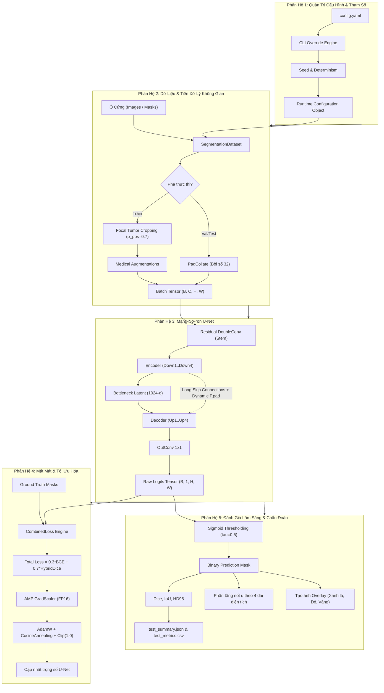
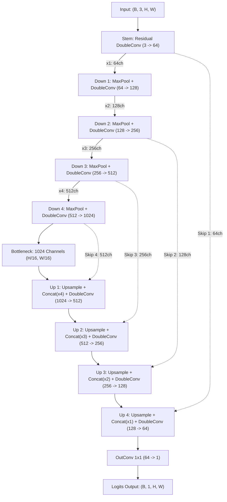
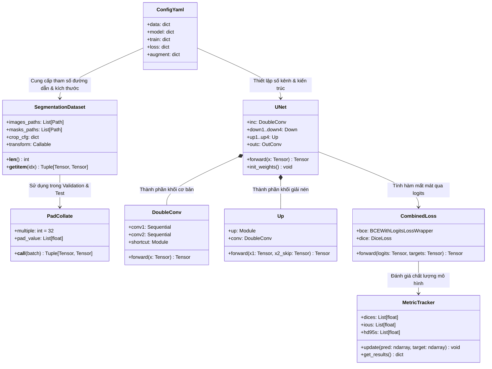

# 🏛️ Kiến Trúc Hệ Thống, Cơ Cấu và Cơ Chế Hoạt Động: U-Net Baseline

> **Thư mục gốc của toàn bộ nguồn:** `SOURCES/`  
> **Dự án mạng:** `SOURCES/unet_baseline/`  
> **Kiến trúc cốt lõi:** U-Net Chuẩn (Ronneberger et al., 2015) với cải tiến Residual DoubleConv & Native Spatial Pipeline  
> **Ứng dụng:** Phân đoạn nốt u phổi tự động trên ảnh cắt lớp vi tính CT (LIDC-IDRI Dataset)  
> **Tài liệu đặc tả:** Cơ cấu chi tiết 5 phân hệ, các khối module, cơ chế hoạt động, toán học, Input/Output và **chú thích vị trí tệp nguồn tương đối so với thư mục gốc `SOURCES/`**.

---

## 📌 BẢNG TRA CỨU NHANH TỌA ĐỘ FILE NGUỒN CÁC MODULE (TƯƠNG ĐỐI SO VỚI `SOURCES/`)

| Phân hệ | Tên Khối / Module | Vị trí file tương đối so với `SOURCES/` | Thành phần lớp / hàm phụ trách |
| :--- | :--- | :--- | :--- |
| **Phân hệ 1: Cấu hình** | Module Cấu Hình Tập Trung | [`SOURCES/unet_baseline/configs/config.yaml`](file:///D:/GG_1/COMPUTER%20SCIENCE/NAM4_HK1_(2026-2027)/CT208E/SOURCES/unet_baseline/configs/config.yaml) | Cấu hình tham số YAML |
| **Phân hệ 1: Cấu hình** | Phân Tích & Ghi Đè Dòng Lệnh | [`SOURCES/unet_baseline/train.py`](file:///D:/GG_1/COMPUTER%20SCIENCE/NAM4_HK1_(2026-2027)/CT208E/SOURCES/unet_baseline/train.py#L62-L115) | Hàm `parse_cli_overrides()` |
| **Phân hệ 1: Cấu hình** | Khống Chế Tính Tái Lập (Seed) | [`SOURCES/unet_baseline/train.py`](file:///D:/GG_1/COMPUTER%20SCIENCE/NAM4_HK1_(2026-2027)/CT208E/SOURCES/unet_baseline/train.py#L38-L48) | Hàm `set_seed()` |
| **Phân hệ 2: Dữ liệu** | Quản Lý Dữ Liệu LIDC-IDRI | [`SOURCES/unet_baseline/utils/dataset.py`](file:///D:/GG_1/COMPUTER%20SCIENCE/NAM4_HK1_(2026-2027)/CT208E/SOURCES/unet_baseline/utils/dataset.py#L55-L165) | Lớp `SegmentationDataset` |
| **Phân hệ 2: Dữ liệu** | Cắt Vùng Trọng Tâm Nốt U | [`SOURCES/unet_baseline/utils/native_ops.py`](file:///D:/GG_1/COMPUTER%20SCIENCE/NAM4_HK1_(2026-2027)/CT208E/SOURCES/unet_baseline/utils/native_ops.py) | Hàm `sample_crop()` |
| **Phân hệ 2: Dữ liệu** | Đệm Batch Không Gian Động | [`SOURCES/unet_baseline/utils/dataset.py`](file:///D:/GG_1/COMPUTER%20SCIENCE/NAM4_HK1_(2026-2027)/CT208E/SOURCES/unet_baseline/utils/dataset.py#L33-L53) | Lớp `PadCollate` |
| **Phân hệ 2: Dữ liệu** | Tăng Cường Dữ Liệu Giải Phẫu | [`SOURCES/unet_baseline/utils/transforms.py`](file:///D:/GG_1/COMPUTER%20SCIENCE/NAM4_HK1_(2026-2027)/CT208E/SOURCES/unet_baseline/utils/transforms.py) | Hàm `get_train_transforms()`, `get_val_transforms()` |
| **Phân hệ 3: Mạng U-Net** | Tích Chập Phần Dư Kép | [`SOURCES/unet_baseline/models/unet_parts.py`](file:///D:/GG_1/COMPUTER%20SCIENCE/NAM4_HK1_(2026-2027)/CT208E/SOURCES/unet_baseline/models/unet_parts.py#L17-L56) | Lớp `DoubleConv` (Residual) |
| **Phân hệ 3: Mạng U-Net** | Khối Co Rút Không Gian (Encoder) | [`SOURCES/unet_baseline/models/unet_parts.py`](file:///D:/GG_1/COMPUTER%20SCIENCE/NAM4_HK1_(2026-2027)/CT208E/SOURCES/unet_baseline/models/unet_parts.py#L58-L73) | Lớp `Down` |
| **Phân hệ 3: Mạng U-Net** | Khối Mở Rộng & Đệm Shape Động | [`SOURCES/unet_baseline/models/unet_parts.py`](file:///D:/GG_1/COMPUTER%20SCIENCE/NAM4_HK1_(2026-2027)/CT208E/SOURCES/unet_baseline/models/unet_parts.py#L75-L127) | Lớp `Up` (Dynamic `F.pad`) |
| **Phân hệ 3: Mạng U-Net** | Khối Dự Đoán Đầu Ra | [`SOURCES/unet_baseline/models/unet_parts.py`](file:///D:/GG_1/COMPUTER%20SCIENCE/NAM4_HK1_(2026-2027)/CT208E/SOURCES/unet_baseline/models/unet_parts.py#L129-L140) | Lớp `OutConv` |
| **Phân hệ 3: Mạng U-Net** | Kiến Trúc U-Net Master Điều Phối | [`SOURCES/unet_baseline/models/unet_model.py`](file:///D:/GG_1/COMPUTER%20SCIENCE/NAM4_HK1_(2026-2027)/CT208E/SOURCES/unet_baseline/models/unet_model.py) | Lớp `UNet`, hàm `build_model()` |
| **Phân hệ 4: Mất mát** | Mất Mát Phạt Nền BCE Logits | [`SOURCES/unet_baseline/utils/losses.py`](file:///D:/GG_1/COMPUTER%20SCIENCE/NAM4_HK1_(2026-2027)/CT208E/SOURCES/unet_baseline/utils/losses.py#L59-L85) | Lớp `BCEWithLogitsLossWrapper` |
| **Phân hệ 4: Mất mát** | Mất Mát Trùng Khớp Lai Hybrid | [`SOURCES/unet_baseline/utils/losses.py`](file:///D:/GG_1/COMPUTER%20SCIENCE/NAM4_HK1_(2026-2027)/CT208E/SOURCES/unet_baseline/utils/losses.py#L19-L57) | Lớp `DiceLoss` (Sample + Batch) |
| **Phân hệ 4: Mất mát** | Mất Mát Tổng Hợp Tuyến Tính | [`SOURCES/unet_baseline/utils/losses.py`](file:///D:/GG_1/COMPUTER%20SCIENCE/NAM4_HK1_(2026-2027)/CT208E/SOURCES/unet_baseline/utils/losses.py#L143-L177) | Lớp `CombinedLoss`, hàm `build_loss()` |
| **Phân hệ 4: Tối ưu** | Động Cơ Cập Nhật Trọng Số & AMP | [`SOURCES/unet_baseline/train.py`](file:///D:/GG_1/COMPUTER%20SCIENCE/NAM4_HK1_(2026-2027)/CT208E/SOURCES/unet_baseline/train.py#L180-L245) | Vòng lặp `train_one_epoch()`, AdamW, Cosine |
| **Phân hệ 5: Đánh giá** | Đo Lường Diện Tích Dice & IoU | [`SOURCES/unet_baseline/utils/metrics.py`](file:///D:/GG_1/COMPUTER%20SCIENCE/NAM4_HK1_(2026-2027)/CT208E/SOURCES/unet_baseline/utils/metrics.py#L17-L70) | Hàm `calculate_dice()`, `calculate_iou()` |
| **Phân hệ 5: Đánh giá** | Đo Khoảng Cách Biên Viền HD95 | [`SOURCES/unet_baseline/utils/metrics.py`](file:///D:/GG_1/COMPUTER%20SCIENCE/NAM4_HK1_(2026-2027)/CT208E/SOURCES/unet_baseline/utils/metrics.py#L72-L115) | Hàm `calculate_hd95()` |
| **Phân hệ 5: Đánh giá** | Phân Tầng Nốt U Theo Kích Thước | [`SOURCES/unet_baseline/evaluate.py`](file:///D:/GG_1/COMPUTER%20SCIENCE/NAM4_HK1_(2026-2027)/CT208E/SOURCES/unet_baseline/evaluate.py) | Hàm `evaluate_dataset()`, lớp `MetricTracker` |
| **Phân hệ 5: Chẩn đoán** | Trực Quan Hóa Đè Lớp Y Khoa | [`SOURCES/unet_baseline/predict.py`](file:///D:/GG_1/COMPUTER%20SCIENCE/NAM4_HK1_(2026-2027)/CT208E/SOURCES/unet_baseline/predict.py), [`SOURCES/unet_baseline/diagnose.py`](file:///D:/GG_1/COMPUTER%20SCIENCE/NAM4_HK1_(2026-2027)/CT208E/SOURCES/unet_baseline/diagnose.py) | Hàm `save_prediction_overlay()`, `predict_image()` |

---

## 📑 MỤC LỤC TOÀN DIỆN

1. [Sơ Đồ Kiến Trúc Toàn Hệ Thống](#1-sơ-đồ-kiến-trúc-toàn-hệ-thống)
2. [Phân Hệ 1: Quản Trị Cấu Hình & Tham Số (Configuration Subsystem)](#2-phân-hệ-1-quản-trị-cấu-hình--tham-số-configuration-subsystem)
   - [2.1 Module Cấu Hình Tập Trung (`ConfigYaml`)](#21-module-cấu-hình-tập-trung-configyaml)
   - [2.2 Module Phân Tích & Ghi Đè Dòng Lệnh (`CLI Override Engine`)](#22-module-phân-tích--ghi-đè-dòng-lệnh-cli-override-engine)
   - [2.3 Module Khống Chế Tính Tái Lập (`Seed & Determinism Controller`)](#23-module-khống-chế-tính-tái-lập-seed--determinism-controller)
3. [Phân Hệ 2: Dữ Liệu & Tiền Xử Lý Không Gian (Data Pipeline Subsystem)](#3-phân-hệ-2-dữ-liệu--tiền-xử-lý-không-gian-data-pipeline-subsystem)
   - [3.1 Module Quản Lý Dữ Liệu LIDC (`SegmentationDataset`)](#31-module-quản-lý-dữ-liệu-lidc-segmentationdataset)
   - [3.2 Module Cắt Lấy Vùng Nốt U Trọng Tâm (`Focal Tumor Cropping`)](#32-module-cắt-lấy-vùng-nốt-u-trọng-tâm-focal-tumor-cropping)
   - [3.3 Module Đệm Batch Không Gian Động (`PadCollate Engine`)](#33-module-đệm-batch-không-gian-động-padcollate-engine)
   - [3.4 Module Tăng Cường Dữ Liệu Bảo Toàn Giải Phẫu (`Transforms Engine`)](#34-module-tăng-cường-dữ-liệu-bảo-toàn-giải-phẫu-transforms-engine)
4. [Phân Hệ 3: Mạng Nơ-ron U-Net (Neural Network Subsystem)](#4-phân-hệ-3-mạng-nơ-ron-u-net-neural-network-subsystem)
   - [4.1 Khối Tích Chập Phần Dư Kép (`Residual DoubleConv`)](#41-khối-tích-chập-phần-dư-kép-residual-doubleconv)
   - [4.2 Khối Nén Không Gian / Trích Xuất Đặc Trưng (`Downscaling Block`)](#42-khối-nén-không-gian--trích-xuất-đặc-trưng-downscaling-block)
   - [4.3 Khối Giải Nén & Căn Chỉnh Shape Động (`Upscaling & Dynamic F.pad Block`)](#43-khối-giải-nén--căn-chỉnh-shape-động-upscaling--dynamic-fpad-block)
   - [4.4 Khối Dự Đoán Đầu Ra (`OutConv Head`)](#44-khối-dự-đoán-đầu-ra-outconv-head)
   - [4.5 Khối Điều Phối Mạng U-Net Trung Tâm (`UNet Master Architecture`)](#45-khối-điều-phối-mạng-u-net-trung-tâm-unet-master-architecture)
   - [4.6 Bảng Kích Thước Tensor Chi Tiết Qua Từng Tầng](#46-bảng-kích-thước-tensor-chi-tiết-qua-từng-tầng)
5. [Phân Hệ 4: Hàm Mất Mát & Động Cơ Tối Ưu Hóa (Loss & Optimization Subsystem)](#5-phân-hệ-4-hàm-mất-mát--động-cơ-tối-ưu-hóa-loss--optimization-subsystem)
   - [5.1 Module Mất Mát Điểm Ảnh Phạt Nền (`BCEWithLogitsLossWrapper`)](#51-module-mất-mát-điểm-ảnh-phạt-nền-bcewithlogitslosswrapper)
   - [5.2 Module Mất Mát Trùng Khớp Lai (`Hybrid DiceLoss`)](#52-module-mất-mát-trùng-khớp-lai-hybrid-diceloss)
   - [5.3 Module Mất Mát Tổng Hợp Đa Mục Tiêu (`CombinedLoss Engine`)](#53-module-mất-mát-tổng-hợp-đa-mục-tiêu-combinedloss-engine)
   - [5.4 Động Cơ Cập Nhật Trọng Số & Tối Ưu Phần Cứng (`Optimization Engine`)](#54-động-cơ-cập-nhật-trọng-số--tối-ưu-phần-cứng-optimization-engine)
6. [Phân Hệ 5: Đánh Giá Lâm Sàng & Chẩn Đoán (Evaluation & Diagnostics Subsystem)](#6-phân-hệ-5-đánh-giá-lâm-sàng--chẩn-đoán-evaluation--diagnostics-subsystem)
   - [6.1 Module Đo Lường Diện Tích & Trùng Khớp (`Dice & IoU Evaluator`)](#61-module-đo-lường-diện-tích--trùng-khớp-dice--iou-evaluator)
   - [6.2 Module Đo Khoảng Cách Biên Viền Y Tế (`HD95 Evaluator`)](#62-module-đo-khoảng-cách-biên-viền-y-tế-hd95-evaluator)
   - [6.3 Module Phân Tầng Kích Thước Nốt U (`Stratified Metric Analyzer`)](#63-module-phân-tầng-kích-thước-nốt-u-stratified-metric-analyzer)
   - [6.4 Module Trực Quan Hóa Đè Lớp Y Khoa (`Visual Diagnostics & Overlay Engine`)](#64-module-trực-quan-hóa-đè-lớp-y-khoa-visual-diagnostics--overlay-engine)
7. [Bản Đồ Quan Hệ Đối Tượng Toàn Dự Án](#7-bản-đồ-quan-hệ-đối-tượng-toàn-dự-án)

---

## 1. SƠ ĐỒ KIẾN TRÚC TOÀN HỆ THỐNG

Dự án `unet_baseline` được cấu trúc thành 5 phân hệ độc lập, hoạt động tuần tự và phối hợp nhịp nhàng theo biểu đồ luồng sau:

---

## 2. PHÂN HỆ 1: QUẢN TRỊ CẤU HÌNH & THAM SỐ (CONFIGURATION SUBSYSTEM)

Phân hệ này đảm nhận tính **linh hoạt, tái lập (reproducibility)** và quản lý tập trung toàn bộ siêu tham số của hệ thống mà không cần chỉnh sửa trực tiếp vào mã nguồn.

### 2.1 Module Cấu Hình Tập Trung (`ConfigYaml`)
- **Vị trí tệp nguồn (tương đối so với `SOURCES/`):** [`SOURCES/unet_baseline/configs/config.yaml`](file:///D:/GG_1/COMPUTER%20SCIENCE/NAM4_HK1_(2026-2027)/CT208E/SOURCES/unet_baseline/configs/config.yaml)
- **Thành phần phụ trách:** Tệp cấu hình phân cấp YAML
- **Mục đích:** Lưu trữ toàn bộ siêu tham số của dự án dưới dạng cây phân cấp (hierarchy): `data`, `model`, `train`, `loss`, `augment`, `checkpoint`, `logging`.
- **Cơ chế hoạt động:** Sử dụng định dạng YAML tiêu chuẩn. Khi khởi động, tệp được tải vào bộ nhớ thông qua thư viện `PyYAML` thành đối tượng `Dict[str, Any]` của Python, giúp truy cập tham số theo kiểu từ điển.
- **Input:** Tệp văn bản tĩnh `SOURCES/unet_baseline/configs/config.yaml`.
- **Output:** Đối tượng cấu hình `cfg` kiểu `dict` lồng nhau.

### 2.2 Module Phân Tích & Ghi Đè Dòng Lệnh (`CLI Override Engine`)
- **Vị trí tệp nguồn (tương đối so với `SOURCES/`):** [`SOURCES/unet_baseline/train.py`](file:///D:/GG_1/COMPUTER%20SCIENCE/NAM4_HK1_(2026-2027)/CT208E/SOURCES/unet_baseline/train.py#L62-L115)
- **Thành phần phụ trách:** Hàm `parse_cli_overrides()` và `argparse.ArgumentParser`
- **Mục đích:** Cho phép người dùng ghi đè bất kỳ siêu tham số nào trong `config.yaml` trực tiếp qua câu lệnh Terminal/Colab mà không cần sửa file.
- **Cơ chế hoạt động:** 
  1. Module duyệt qua danh sách đối số chưa định danh (`parser.parse_known_args()`).
  2. Bóc tách cú pháp dạng `--key.subkey=value` (ví dụ: `--train.batch_size=8`, `--train.lr=0.0001`).
  3. Tự động ép kiểu dữ liệu thông minh (int, float, bool, chuỗi, hoặc null).
  4. Cập nhật đè lên nút tương ứng trong cây từ điển `cfg`.
- **Input:**
  - `args`: Chuỗi dòng lệnh từ shell (ví dụ: `--config configs/config.yaml --train.epochs=50`).
  - `cfg`: Dict cấu hình gốc từ `config.yaml`.
- **Output:** `cfg` đã được cập nhật giá trị mới.

### 2.3 Module Khống Chế Tính Tái Lập (`Seed & Determinism Controller`)
- **Vị trí tệp nguồn (tương đối so với `SOURCES/`):** [`SOURCES/unet_baseline/train.py`](file:///D:/GG_1/COMPUTER%20SCIENCE/NAM4_HK1_(2026-2027)/CT208E/SOURCES/unet_baseline/train.py#L38-L48)
- **Thành phần phụ trách:** Hàm `set_seed()`
- **Mục đích:** Đảm bảo toàn bộ kết quả phân đoạn, khởi tạo trọng số và xáo trộn dữ liệu (shuffle) có thể lặp lại chính xác 100% trong các lần thực nghiệm khác nhau.
- **Cơ chế hoạt động:** 
  1. Cố định hạt giống ngẫu nhiên cho `random.seed(seed)` và `np.random.seed(seed)`.
  2. Cố định cho PyTorch CPU: `torch.manual_seed(seed)`.
  3. Cố định cho PyTorch GPU: `torch.cuda.manual_seed_all(seed)`.
  4. Thiết lập cờ `cudnn.deterministic = False` và `cudnn.benchmark = True` để tối ưu tốc độ thuật toán convolution trên GPU mà vẫn giữ phân phối chuẩn.
- **Input:** Số nguyên `seed` (mặc định: `42`).
- **Output:** Trạng thái hạt giống của hệ điều hành và PyTorch runtime được khóa cố định.

---

## 3. PHÂN HỆ 2: DỮ LIỆU & TIỀN XỬ LÝ KHÔNG GIAN (DATA PIPELINE SUBSYSTEM)

Phân hệ giải quyết bài toán cốt lõi: **định dạng dữ liệu y tế không đồng nhất** và **sự mất cân bằng cực đoan giữa thể tích nốt u với lồng ngực**.

### 3.1 Module Quản Lý Dữ Liệu LIDC (`SegmentationDataset`)
- **Vị trí tệp nguồn (tương đối so với `SOURCES/`):** [`SOURCES/unet_baseline/utils/dataset.py`](file:///D:/GG_1/COMPUTER%20SCIENCE/NAM4_HK1_(2026-2027)/CT208E/SOURCES/unet_baseline/utils/dataset.py#L55-L165)
- **Thành phần phụ trách:** Lớp `SegmentationDataset(torch.utils.data.Dataset)`
- **Mục đích:** Quản lý tập dữ liệu lát cắt ảnh CT và mặt nạ nốt u, ghép cặp theo tên file (stem), đọc file đa định dạng (`.png`, `.npy`, `.tif`).
- **Cơ chế hoạt động:**
  1. Quét thư mục ảnh `root/split/images` và mask `root/split/masks`.
  2. Ghép cặp `(image_path, mask_path)` dựa trên tên tệp gốc (stem), đảm bảo không nhầm lẫn giữa các ca chụp.
  3. Hỗ trợ giới hạn số lượng mẫu (`limit_samples`) cho chế độ chạy thử nghiệm nhanh.
  4. Đọc ảnh thô, ép kiểu mảng NumPy sang dải giá trị $[0, 1]$ dạng `float32`.
- **Input:**
  - Đường dẫn thư mục `root` (ví dụ: `../data/segmented_slices_ge6mm`).
  - Phân tách `split`: `"train"`, `"val"`, hoặc `"test"`.
- **Output (tại mỗi bước `__getitem__`):**
  - `image`: Tensor ảnh CT shape $(C, H, W)$, kiểu `torch.float32`.
  - `mask`: Tensor mặt nạ nhị phân shape $(1, H, W)$, giá trị $\{0.0, 1.0\}$.

---

### 3.2 Module Cắt Lấy Vùng Nốt U Trọng Tâm (`Focal Tumor Cropping`)
- **Vị trí tệp nguồn (tương đối so với `SOURCES/`):** [`SOURCES/unet_baseline/utils/native_ops.py`](file:///D:/GG_1/COMPUTER%20SCIENCE/NAM4_HK1_(2026-2027)/CT208E/SOURCES/unet_baseline/utils/native_ops.py) (kết nối trực tiếp tại [`SOURCES/unet_baseline/utils/dataset.py`](file:///D:/GG_1/COMPUTER%20SCIENCE/NAM4_HK1_(2026-2027)/CT208E/SOURCES/unet_baseline/utils/dataset.py#L110-L135))
- **Thành phần phụ trách:** Hàm `sample_crop()`
- **Mục đích:** Xóa bỏ sự mất cân bằng dữ liệu cực đoan trong pha huấn luyện.
- **Cơ chế hoạt động:**
  - Trên toàn ảnh CT $512 \times 512$, nốt u chỉ chiếm $\sim 0.05\% - 0.1\%$ diện tích. Nếu đưa nguyên ảnh vào, 99.9% pixel là nền làm triệt tiêu gradient của nốt u.
  - Thuật toán `sample_crop` can thiệp với xác suất $p_{\text{pos}} = 0.7$ (70%):
    1. Quét tìm tất cả tọa độ $(y, x)$ có $\text{mask}[y, x] > 0.5$.
    2. Chọn ngẫu nhiên một pixel dương làm điểm neo (anchor center).
    3. Thêm độ lệch ngẫu nhiên (jitter) và cắt cửa sổ kích thước $\text{crop\_size} \times \text{crop\_size}$ (mặc định $192 \times 192$).
  - Với xác suất $1 - p_{\text{pos}} = 0.3$ (30%):
    - Cắt ngẫu nhiên tại các vùng mô phổi bình thường hoặc thành ngực (Hard Negative Mining), dạy mô hình phân biệt mô lành và không báo động giả.
- **Toán học tọa độ:**
  $$y_1 = \text{clamp}(y_{\text{center}} - \text{crop\_size}//2 + \delta_y, 0, H - \text{crop\_size})$$
  $$x_1 = \text{clamp}(x_{\text{center}} - \text{crop\_size}//2 + \delta_x, 0, W - \text{crop\_size})$$
- **Input:**
  - `image`: Ảnh thô độ phân giải gốc shape $(C, H, W)$.
  - `mask`: Mặt nạ thô shape $(1, H, W)$.
  - `crop_size`: Kích thước cắt (192 hoặc 128).
  - `p_pos`: Xác suất ưu tiên nốt u (0.7).
- **Output:**
  - `cropped_image`: Mảng shape $(C, \text{crop\_size}, \text{crop\_size})$.
  - `cropped_mask`: Mảng shape $(1, \text{crop\_size}, \text{crop\_size})$.

---

### 3.3 Module Đệm Batch Không Gian Động (`PadCollate Engine`)
- **Vị trí tệp nguồn (tương đối so với `SOURCES/`):** [`SOURCES/unet_baseline/utils/dataset.py`](file:///D:/GG_1/COMPUTER%20SCIENCE/NAM4_HK1_(2026-2027)/CT208E/SOURCES/unet_baseline/utils/dataset.py#L33-L53)
- **Thành phần phụ trách:** Lớp `PadCollate`
- **Mục đích:** Gom nhóm các ảnh có kích thước vật lý khác nhau (do máy chụp CT của từng bệnh nhân) thành một Tensor Batch vuông vức trong tập Validation và Test mà **không làm méo tỷ lệ vật lý (aspect ratio)** của nốt u.
- **Cơ chế hoạt động:**
  1. Khi DataLoader bốc $B$ ảnh từ các bệnh nhân khác nhau (ví dụ: ảnh 1 là $450 \times 450$, ảnh 2 là $525 \times 525$).
  2. `PadCollate` quét tìm kích thước tối đa trong batch:
     $$H_{\text{max}} = \max_{i=1..B}(H_i), \quad W_{\text{max}} = \max_{i=1..B}(W_i)$$
  3. Làm tròn lên bội số gần nhất của 32 để tương thích 4 tầng pooling của U-Net:
     $$H_{\text{target}} = \text{round\_up}(H_{\text{max}}, 32), \quad W_{\text{target}} = \text{round\_up}(W_{\text{max}}, 32)$$
  4. Cấp phát Tensor nền đen chứa giá trị `pad_value`, sau đó đặt ảnh gốc vào góc trên bên trái (`[..., :H_i, :W_i]`).
- **Input:** Danh sách $B$ cặp tuple `[(img_1, msk_1), ..., (img_B, msk_B)]` có kích thước $(H_i, W_i)$ biến thiên.
- **Output:**
  - `batched_images`: Tensor shape $(B, C, H_{\text{target}}, W_{\text{target}})$.
  - `batched_masks`: Tensor shape $(B, 1, H_{\text{target}}, W_{\text{target}})$.

---

### 3.4 Module Tăng Cường Dữ Liệu Bảo Toàn Giải Phẫu (`Transforms Engine`)
- **Vị trí tệp nguồn (tương đối so với `SOURCES/`):** [`SOURCES/unet_baseline/utils/transforms.py`](file:///D:/GG_1/COMPUTER%20SCIENCE/NAM4_HK1_(2026-2027)/CT208E/SOURCES/unet_baseline/utils/transforms.py)
- **Thành phần phụ trách:** Hàm `get_train_transforms()`, `get_val_transforms()`
- **Mục đích:** Tăng độ phong phú dữ liệu nhưng tuyệt đối tuân thủ quy luật giải phẫu học lồng ngực.
- **Cơ chế hoạt động:**
  - Áp dụng các phép biến đổi hình học và màu sắc ngẫu nhiên thông qua `Albumentations`:
    - `HorizontalFlip(p=0.5)`: Lật ngang đối xứng (phổi trái $\leftrightarrow$ phổi phải).
    - `ShiftScaleRotate(p=0.5)`: Co giãn nhẹ $\pm 10\%$, dịch chuyển $\pm 6\%$ và xoay nhỏ $\pm 15^\circ$.
    - `RandomBrightnessContrast(p=0.2)`: Biến thiên độ cản quang tia X giữa các hãng máy chụp.
  - **Khóa bảo vệ y tế:** TẮT hoàn toàn `VerticalFlip` và `Rotate90` vì đảo lộn đầu-chân làm sai lệch quy luật trọng lực và phân bố giải phẫu của nốt u.
- **Input:** Mảng NumPy `image` $(H, W, C)$ và `mask` $(H, W)$.
- **Output:** Từ điển `{"image": Tensor(C, H, W), "mask": Tensor(1, H, W)}` đã chuẩn hóa ImageNet mean/std.

---

## 4. PHÂN HỆ 3: MẠNG NƠ-RON U-NET (NEURAL NETWORK SUBSYSTEM)

Phân hệ chứa toàn bộ cấu trúc biểu diễn hình học và học đặc trưng sâu của mạng U-Net.

---

### 4.1 Khối Tích Chập Phần Dư Kép (`Residual DoubleConv`)
- **Vị trí tệp nguồn (tương đối so với `SOURCES/`):** [`SOURCES/unet_baseline/models/unet_parts.py`](file:///D:/GG_1/COMPUTER%20SCIENCE/NAM4_HK1_(2026-2027)/CT208E/SOURCES/unet_baseline/models/unet_parts.py#L17-L56)
- **Thành phần phụ trách:** Lớp `DoubleConv(nn.Module)`
- **Mục đích:** Trích xuất đặc trưng không gian ở từng cấp độ phân giải, đồng thời giữ đường dẫn truyền gradient không bị nghẽn (vanishing gradient).
- **Cấu tạo chi tiết:**
  - Nhánh chính:
    $$\text{Conv1} = \text{Conv2d}(C_{\text{in}}, C_{\text{mid}}, 3\times 3, \text{padding}=1, \text{bias}=\text{False}) \to \text{BatchNorm2d} \to \text{ReLU}$$
    $$\text{Conv2} = \text{Conv2d}(C_{\text{mid}}, C_{\text{out}}, 3\times 3, \text{padding}=1, \text{bias}=\text{False}) \to \text{BatchNorm2d}$$
  - Nhánh tắt (Shortcut Path):
    $$\text{Shortcut}(X) = \begin{cases} \text{Conv2d}(C_{\text{in}}, C_{\text{out}}, 1\times 1) \to \text{BatchNorm2d}, & \text{nếu } C_{\text{in}} \ne C_{\text{out}} \\ X, & \text{nếu } C_{\text{in}} = C_{\text{out}} \end{cases}$$
  - Phép gộp:
    $$\text{Output} = \text{ReLU}(\text{Conv2}(\text{Conv1}(X)) + \text{Shortcut}(X))$$
- **Input:** Tensor đặc trưng $X$ shape $(B, C_{\text{in}}, H, W)$.
- **Output:** Tensor đặc trưng $Y$ shape $(B, C_{\text{out}}, H, W)$.

---

### 4.2 Khối Nén Không Gian / Trích Xuất Đặc Trưng (`Downscaling Block`)
- **Vị trí tệp nguồn (tương đối so với `SOURCES/`):** [`SOURCES/unet_baseline/models/unet_parts.py`](file:///D:/GG_1/COMPUTER%20SCIENCE/NAM4_HK1_(2026-2027)/CT208E/SOURCES/unet_baseline/models/unet_parts.py#L58-L73)
- **Thành phần phụ trách:** Lớp `Down(nn.Module)`
- **Mục đích:** Giảm một nửa kích thước không gian để mở rộng trường nhìn (Receptive Field) của mạng và tăng gấp đôi số kênh biểu diễn ngữ nghĩa.
- **Cấu tạo:** 
  $$\text{Down}(X) = \text{ResidualDoubleConv}(\text{MaxPool2d}(X, \text{kernel}=2, \text{stride}=2))$$
- **Input:** Tensor shape $(B, C_{\text{in}}, H, W)$.
- **Output:** Tensor shape $(B, C_{\text{out}}, H/2, W/2)$.

---

### 4.3 Khối Giải Nén & Căn Chỉnh Shape Động (`Upscaling & Dynamic F.pad Block`)
- **Vị trí tệp nguồn (tương đối so với `SOURCES/`):** [`SOURCES/unet_baseline/models/unet_parts.py`](file:///D:/GG_1/COMPUTER%20SCIENCE/NAM4_HK1_(2026-2027)/CT208E/SOURCES/unet_baseline/models/unet_parts.py#L75-L127)
- **Thành phần phụ trách:** Lớp `Up(nn.Module)`
- **Mục đích:** Phóng đại bản đồ đặc trưng trở lại độ phân giải ban đầu, ghép nối thông tin vị trí chính xác từ nhánh Encoder sang Decoder.
- **Cơ chế hoạt động:**
  1. Phóng đại tensor tầng sâu $x_1$ bằng `ConvTranspose2d(stride=2)` hoặc `Bilinear Upsample(2x)`.
  2. So sánh kích thước với tensor Skip $x_2$:
     $$\Delta H = H_{x_2} - H_{x_1}, \quad \Delta W = W_{x_2} - W_{x_1}$$
  3. Áp dụng đệm phản xạ/zero thông qua `F.pad`:
     $$x_1^{\text{pad}} = \text{F.pad}(x_1, [\Delta W // 2, \Delta W - \Delta W // 2, \Delta H // 2, \Delta H - \Delta H // 2])$$
  4. Ghép đặc trưng theo chiều sâu kênh:
     $$X_{\text{cat}} = \text{torch.cat}([x_2, x_1^{\text{pad}}], \text{dim}=1)$$
  5. Đưa qua khối `ResidualDoubleConv` để hòa trộn đặc trưng ngữ nghĩa và không gian.
- **Input:**
  - $x_1$ (tầng dưới): Tensor shape $(B, C_1, H_1, W_1)$.
  - $x_2$ (tầng skip): Tensor shape $(B, C_2, H_2, W_2)$.
- **Output:** Tensor đặc trưng phục hồi shape $(B, C_{\text{out}}, H_2, W_2)$.

---

### 4.4 Khối Dự Đoán Đầu Ra (`OutConv Head`)
- **Vị trí tệp nguồn (tương đối so với `SOURCES/`):** [`SOURCES/unet_baseline/models/unet_parts.py`](file:///D:/GG_1/COMPUTER%20SCIENCE/NAM4_HK1_(2026-2027)/CT208E/SOURCES/unet_baseline/models/unet_parts.py#L129-L140)
- **Thành phần phụ trách:** Lớp `OutConv(nn.Module)`
- **Mục đích:** Ánh xạ từ không gian đặc trưng cuối cùng về không gian xác suất nhị phân.
- **Cấu tạo:** Phép chiếu $\text{Conv2d}(\text{base\_channels}, n_{\text{classes}}, \text{kernel}=1)$. Không sử dụng hàm kích hoạt phi tuyến (xuất thẳng **Raw Logits**) để bảo toàn tính ổn định số học cho hàm `BCEWithLogitsLoss`.
- **Input:** Tensor decoder cuối cùng shape $(B, 64, H, W)$.
- **Output:** Tensor Logits thô shape $(B, 1, H, W)$.

---

### 4.5 Khối Điều Phối Mạng U-Net Trung Tâm (`UNet Master Architecture`)
- **Vị trí tệp nguồn (tương đối so với `SOURCES/`):** [`SOURCES/unet_baseline/models/unet_model.py`](file:///D:/GG_1/COMPUTER%20SCIENCE/NAM4_HK1_(2026-2027)/CT208E/SOURCES/unet_baseline/models/unet_model.py)
- **Thành phần phụ trách:** Lớp `UNet(nn.Module)` và hàm factory `build_model(cfg)`
- **Mục đích:** Ráp nối toàn bộ các khối module thành một hệ thống U-Net hoàn chỉnh 4 cấp.
- **Cơ chế vận hành:**
  1. **Khởi tạo trọng số (Kaiming Normal):**  
     $$\mathcal{W} \sim \mathcal{N}\left(0, \sqrt{2 / \text{fan\_out}}\right)$$
     Giúp gradient không bị bão hòa ngay từ epoch đầu tiên khi sử dụng kích hoạt ReLU.
  2. **Gradient Checkpointing Tùy Chọn (`use_checkpoint`):**  
     Khi kích hoạt, PyTorch không lưu lại activations trung gian trong forward pass mà tính toán lại trong backward pass, giúp **tiết kiệm tới 60% VRAM GPU**.
- **Input:** Mini-batch ảnh Tensor $X \in \mathbb{R}^{B \times 3 \times H \times W}$.
- **Output:** Tensor Logits dự đoán $\hat{Y} \in \mathbb{R}^{B \times 1 \times H \times W}$.

---

### 4.6 Bảng Kích Thước Tensor Chi Tiết Qua Từng Tầng
Giả định mini-batch có kích thước chuẩn $B \times 3 \times 256 \times 256$:

| STT | Tên Tầng / Module | Tensor Đầu Vào | Tensor Đầu Ra | Số Tham Số (Params) | Chức Năng Cốt Lõi |
| :---: | :--- | :--- | :--- | :---: | :--- |
| **0** | `Input` | - | $(B, 3, 256, 256)$ | $0$ | Ảnh CT nạp vào |
| **1** | `inc` (DoubleConv) | $(B, 3, 256, 256)$ | $(B, 64, 256, 256)$ | $\sim 37\text{K}$ | Trích xuất biên cạnh cơ sở |
| **2** | `down1` (Down) | $(B, 64, 256, 256)$ | $(B, 128, 128, 128)$ | $\sim 221\text{K}$ | Hạ độ phân giải cấp 1 |
| **3** | `down2` (Down) | $(B, 128, 128, 128)$ | $(B, 256, 64, 64)$ | $\sim 885\text{K}$ | Hạ độ phân giải cấp 2 |
| **4** | `down3` (Down) | $(B, 256, 64, 64)$ | $(B, 512, 32, 32)$ | $\sim 3.5\text{M}$ | Hạ độ phân giải cấp 3 |
| **5** | `down4` (Bottleneck) | $(B, 512, 32, 32)$ | $(B, 1024, 16, 16)$ | $\sim 14.1\text{M}$ | Biểu diễn ngữ nghĩa tiềm ẩn cao cấp |
| **6** | `up1` (Up) | $(B, 1024, 16, 16) + \text{skip}_4$ | $(B, 512, 32, 32)$ | $\sim 11.8\text{M}$ | Phục hồi độ phân giải cấp 3 |
| **7** | `up2` (Up) | $(B, 512, 32, 32) + \text{skip}_3$ | $(B, 256, 64, 64)$ | $\sim 2.9\text{M}$ | Phục hồi độ phân giải cấp 2 |
| **8** | `up3` (Up) | $(B, 256, 64, 64) + \text{skip}_2$ | $(B, 128, 128, 128)$ | $\sim 737\text{K}$ | Phục hồi độ phân giải cấp 1 |
| **9** | `up4` (Up) | $(B, 128, 128, 128) + \text{skip}_1$ | $(B, 64, 256, 256)$ | $\sim 184\text{K}$ | Phục hồi kích thước nguyên bản |
| **10**| `outc` (OutConv) | $(B, 64, 256, 256)$ | $(B, 1, 256, 256)$ | $65$ | Xuất ma trận Logits nhị phân |
| **Tổng**| **Toàn bộ Mạng U-Net** | $(B, 3, 256, 256)$ | $(B, 1, 256, 256)$ | **$\sim 31.03\text{M}$** | **Bộ tham số huấn luyện** |

---

## 5. PHÂN HỆ 4: HÀM MẤT MÁT & ĐỘNG CƠ TỐI ƯU HÓA (LOSS & OPTIMIZATION SUBSYSTEM)

Phân hệ dẫn đường gradient hội tụ, giải quyết tình trạng nốt u phổi bị "nuốt chửng" bởi vùng nền rộng lớn.

### 5.1 Module Mất Mát Điểm Ảnh Phạt Nền (`BCEWithLogitsLossWrapper`)
- **Vị trí tệp nguồn (tương đối so với `SOURCES/`):** [`SOURCES/unet_baseline/utils/losses.py`](file:///D:/GG_1/COMPUTER%20SCIENCE/NAM4_HK1_(2026-2027)/CT208E/SOURCES/unet_baseline/utils/losses.py#L59-L85)
- **Thành phần phụ trách:** Lớp `BCEWithLogitsLossWrapper(nn.Module)`
- **Mục đích:** Đo sai số phân loại độc lập tại từng điểm pixel, hỗ trợ gán trọng số ưu tiên nốt u (`pos_weight`).
- **Toán học:**
  $$\mathcal{L}_{\text{BCE}}(p, y) = - \left[ w_{\text{pos}} \cdot y \log(\sigma(p)) + (1 - y) \log(1 - \sigma(p)) \right]$$
  Trong đó $\sigma(p) = \frac{1}{1 + e^{-p}}$ là hàm Sigmoid, $y \in \{0, 1\}$ là nhãn thực tế.
- **Input:**
  - `logits`: Tensor raw logits $(B, 1, H, W)$.
  - `targets`: Tensor nhãn thực tế $(B, 1, H, W)$.
- **Output:** Đại lượng vô hướng Scalar Loss ($\ge 0$).

---

### 5.2 Module Mất Mát Trùng Khớp Lai (`Hybrid DiceLoss`)
- **Vị trí tệp nguồn (tương đối so với `SOURCES/`):** [`SOURCES/unet_baseline/utils/losses.py`](file:///D:/GG_1/COMPUTER%20SCIENCE/NAM4_HK1_(2026-2027)/CT208E/SOURCES/unet_baseline/utils/losses.py#L19-L57)
- **Thành phần phụ trách:** Lớp `DiceLoss(nn.Module)`
- **Mục đích:** Tối ưu hóa trực tiếp độ trùng khớp hình dạng hình học (Intersection over Union), ngăn chặn hiện tượng mạng dự đoán toàn bộ là màu đen.
- **Cơ chế hoạt động:** Kết hợp hai mức độ đo lường:
  1. **Sample-level Dice:** Tính điểm Dice riêng rẽ trên từng bức ảnh rồi lấy trung bình:
     $$\text{Dice}_{\text{sample}} = \frac{1}{B} \sum_{i=1}^B \frac{2 \sum (P_i \cdot Y_i) + \epsilon}{\sum P_i + \sum Y_i + \epsilon}$$
  2. **Batch-level Dice:** Gộp toàn bộ pixel của $B$ ảnh trong batch thành một thể tích duy nhất trước khi tính:
     $$\text{Dice}_{\text{batch}} = \frac{2 \sum_{B} (P \cdot Y) + \epsilon}{\sum_{B} P + \sum_{B} Y + \epsilon}$$
  3. **Hàm mất mát lai ghép (Hybrid Combination):**
     $$\mathcal{L}_{\text{Dice}} = 1 - \left[ (1 - \lambda) \cdot \text{Dice}_{\text{sample}} + \lambda \cdot \text{Dice}_{\text{batch}} \right] \quad (\text{với } \lambda = 0.5)$$
  *Ý nghĩa:* Giúp triệt tiêu hiện tượng gradient dao động cực mạnh khi gặp các lát cắt không có nốt u hoặc nốt u siêu nhỏ ($\le 5$ pixel).
- **Input:** `logits` $(B, 1, H, W)$ và `targets` $(B, 1, H, W)$.
- **Output:** Đại lượng vô hướng Scalar Loss trong khoảng $[0.0, 1.0]$.

---

### 5.3 Module Mất Mát Tổng Hợp Đa Mục Tiêu (`CombinedLoss Engine`)
- **Vị trí tệp nguồn (tương đối so với `SOURCES/`):** [`SOURCES/unet_baseline/utils/losses.py`](file:///D:/GG_1/COMPUTER%20SCIENCE/NAM4_HK1_(2026-2027)/CT208E/SOURCES/unet_baseline/utils/losses.py#L143-L177)
- **Thành phần phụ trách:** Lớp `CombinedLoss(nn.Module)` và hàm `build_loss(cfg)`
- **Mục đích:** Kết hợp hài hòa giữa tính ổn định cục bộ của BCE và tính nhận diện cấu trúc toàn cục của Dice:
  $$\mathcal{L}_{\text{total}} = 0.3 \cdot \mathcal{L}_{\text{BCE}} + 0.7 \cdot \mathcal{L}_{\text{Dice}}$$
- **Input:** Cặp tensor dự đoán `logits` và nhãn `targets`.
- **Output:** Tensor mất mát tổng hợp duy nhất để gọi hàm `loss.backward()`.

---

### 5.4 Động Cơ Cập Nhật Trọng Số & Tối Ưu Phần Cứng (`Optimization Engine`)
- **Vị trí tệp nguồn (tương đối so với `SOURCES/`):** [`SOURCES/unet_baseline/train.py`](file:///D:/GG_1/COMPUTER%20SCIENCE/NAM4_HK1_(2026-2027)/CT208E/SOURCES/unet_baseline/train.py#L180-L245)
- **Thành phần phụ trách:** Vòng lặp `train_one_epoch()`, đối tượng `optim.AdamW`, `lr_scheduler.CosineAnnealingLR`
- **Mục đích:** Điều khiển tốc độ học, kẹp gradient và tăng tốc tính toán trên nhân Tensor Cores GPU.
- **Cơ chế hoạt động:**
  - **Optimizer `AdamW`:** Phạt trọng số phân rã $\ell_2$ trực tiếp trên tham số (`weight_decay = 1e-4`), ngăn ngừa bùng nổ trọng số khi học nốt u nhỏ.
  - **Scheduler `CosineAnnealingLR`:** Hạ dần tốc độ học theo hàm Cosine:
    $$\eta_t = \eta_{\text{min}} + \frac{1}{2}(\eta_{\text{max}} - \eta_{\text{min}})\left(1 + \cos\left(\frac{t}{T_{\text{max}}}\pi\right)\right)$$
    Hạ từ $5 \times 10^{-4}$ về $5 \times 10^{-6}$, giúp mô hình thoát khỏi các hố yên ngựa (saddle points) và tiến vào đáy cực tiểu phẳng.
  - **Gradient Clipping:** Giới hạn $\|\mathbf{g}\|_2 \le 1.0$, triệt tiêu lỗi nổ gradient (NaN loss).
  - **Automatic Mixed Precision (AMP FP16):** Nhân chập và activations chạy ở số thực 16-bit, kèm module `GradScaler` nhân hệ số phóng đại loss để không bị tràn số dưới (underflow).
- **Input:** Gradient của hàm mất mát đối với trọng số mạng $\nabla_\Theta \mathcal{L}$.
- **Output:** Bộ trọng số mô hình mới $\Theta_{t+1}$ được cập nhật.

---

## 6. PHÂN HỆ 5: ĐÁNH GIÁ LÂM SÀNG & CHẨN ĐOÁN (EVALUATION & DIAGNOSTICS SUBSYSTEM)

Phân hệ đo đạc độc lập, chuẩn xác và trực quan hóa năng lực phát hiện nốt u phục vụ thẩm định y khoa.

### 6.1 Module Đo Lường Diện Tích & Trùng Khớp (`Dice & IoU Evaluator`)
- **Vị trí tệp nguồn (tương đối so với `SOURCES/`):** [`SOURCES/unet_baseline/utils/metrics.py`](file:///D:/GG_1/COMPUTER%20SCIENCE/NAM4_HK1_(2026-2027)/CT208E/SOURCES/unet_baseline/utils/metrics.py#L17-L70)
- **Thành phần phụ trách:** Hàm `calculate_dice()` và `calculate_iou()`
- **Mục đích:** Đo tỷ lệ phần trăm thể tích trùng khớp giữa AI và bác sĩ X-quang.
- **Toán học:**
  $$\text{Dice} = \frac{2 |A \cap B|}{|A| + |B|}, \qquad \text{IoU} = \frac{|A \cap B|}{|A \cup B|}$$
  - **Xử lý biên an toàn y tế:** Nếu cả AI và Bác sĩ đều đồng thuận lát cắt không có nốt u ($|A|=0, |B|=0$), trả về $\text{Dice} = 1.0$ (chẩn đoán âm tính đúng). Nếu một bên có nốt u còn bên kia rỗng, trả về $\text{Dice} = 0.0$.
- **Input:** Mảng nhị phân dự đoán $\text{pred} \in \{0, 1\}^{H \times W}$ và nhãn $\text{target} \in \{0, 1\}^{H \times W}$.
- **Output:** Điểm số thực dấu phẩy động trong đoạn $[0.0, 1.0]$.

---

### 6.2 Module Đo Khoảng Cách Biên Viền Y Tế (`HD95 Evaluator`)
- **Vị trí tệp nguồn (tương đối so với `SOURCES/`):** [`SOURCES/unet_baseline/utils/metrics.py`](file:///D:/GG_1/COMPUTER%20SCIENCE/NAM4_HK1_(2026-2027)/CT208E/SOURCES/unet_baseline/utils/metrics.py#L72-L115)
- **Thành phần phụ trách:** Hàm `calculate_hd95()`
- **Mục đích:** Đo độ lệch hình học lớn nhất giữa đường bao nốt u do AI vẽ so với đường bao giải phẫu học thực tế.
- **Cơ chế hoạt động:**
  1. Trích xuất đường biên $\partial A$ và $\partial B$ bằng phép ăn mòn hình thái học (`scipy.ndimage.binary_erosion`):
     $$\partial A = A \setminus \text{Erode}(A)$$
  2. Tính toán ma trận khoảng cách Euclid đa điểm giữa mọi cặp điểm biên:
     $$D_{ij} = \|x_i - y_j\|_2, \quad x_i \in \partial A, y_j \in \partial B$$
  3. Lấy bách phân vị thứ 95 (loại bỏ 5% điểm nhiễu ngoại lai do bác sĩ vẽ lệch tay):
     $$\text{HD}_{95}(A, B) = \max \left( P_{95}\left(\min_{y \in \partial B} \|x - y\|\right), P_{95}\left(\min_{x \in \partial A} \|x - y\|\right) \right)$$
- **Input:** Hai mảng mặt nạ nhị phân $\text{pred}$ và $\text{target}$.
- **Output:** Khoảng cách sai số biên (đơn vị: pixels). Giá trị càng nhỏ càng tiệm cận đường viền thực tế.

---

### 6.3 Module Phân Tầng Kích Thước Nốt U (`Stratified Metric Analyzer`)
- **Vị trí tệp nguồn (tương đối so với `SOURCES/`):** [`SOURCES/unet_baseline/evaluate.py`](file:///D:/GG_1/COMPUTER%20SCIENCE/NAM4_HK1_(2026-2027)/CT208E/SOURCES/unet_baseline/evaluate.py) (kết nối trực tiếp với [`SOURCES/unet_baseline/utils/metrics.py`](file:///D:/GG_1/COMPUTER%20SCIENCE/NAM4_HK1_(2026-2027)/CT208E/SOURCES/unet_baseline/utils/metrics.py#L117-L155))
- **Thành phần phụ trách:** Hàm `evaluate_dataset()` và lớp `MetricTracker`
- **Mục đích:** Bóc tách sai số của AI theo từng mức độ nghiêm trọng lâm sàng, tránh việc điểm số nốt lớn che giấu khuyết điểm ở nốt nhỏ.
- **Cơ chế phân nhóm:**
  - **Nhóm 1 ($\le 24$ pixels):** Nốt vi điểm (rất khó phát hiện).
  - **Nhóm 2 ($25 - 57$ pixels):** Nốt nhỏ.
  - **Nhóm 3 ($58 - 177$ pixels):** Nốt trung bình.
  - **Nhóm 4 ($> 177$ pixels):** Nốt u phổi lớn / tổn thương khối.
- **Input:** Danh sách kết quả `Dice`, `IoU`, `HD95` và diện tích nốt u của toàn bộ tập Test.
- **Output:** Báo cáo định dạng JSON (`test_summary.json`) và bảng CSV (`test_metrics.csv`) thống kê Mean, Std và số ca bỏ sót (`pred_empty_count`) cho từng nhóm.

---

### 6.4 Module Trực Quan Hóa Đè Lớp Y Khoa (`Visual Diagnostics & Overlay Engine`)
- **Vị trí tệp nguồn (tương đối so với `SOURCES/`):** [`SOURCES/unet_baseline/predict.py`](file:///D:/GG_1/COMPUTER%20SCIENCE/NAM4_HK1_(2026-2027)/CT208E/SOURCES/unet_baseline/predict.py), [`SOURCES/unet_baseline/diagnose.py`](file:///D:/GG_1/COMPUTER%20SCIENCE/NAM4_HK1_(2026-2027)/CT208E/SOURCES/unet_baseline/diagnose.py)
- **Thành phần phụ trách:** Hàm `save_prediction_overlay()`, `predict_image()`
- **Mục đích:** Tạo hình ảnh trực quan 4 cột minh bạch giúp bác sĩ thẩm định kết quả dự đoán của AI trong nháy mắt.
- **Quy tắc phối màu:**
  - 🟩 **Màu Xanh Lá Cây (`RGB: [0, 255, 0]`):** Vùng nốt u do Bác sĩ X-quang khoanh vùng (Ground Truth).
  - 🟥 **Màu Đỏ (`RGB: [0, 0, 255]`):** Vùng nốt u do AI phát hiện (Prediction).
  - 🟨 **Màu Vàng (`RGB: [0, 255, 255]`):** Vùng **trùng khớp hoàn hảo 100%** giữa Bác sĩ và AI (Intersection).
  - Hòa trộn lớp ảnh phủ (Alpha Blending):
    $$I_{\text{overlay}} = 0.65 \cdot I_{\text{CT}} + 0.35 \cdot I_{\text{color\_mask}}$$
- **Input:** Ảnh CT gốc, Mặt nạ bác sĩ, Mặt nạ AI.
- **Output:** Ảnh màu trực quan định dạng PNG lưu tại `predictions/overlays/` hoặc hiển thị trực tiếp trên giao diện Colab.

---

## 7. BẢN ĐỒ QUAN HỆ ĐỐI TƯỢNG TOÀN DỰ ÁN

Sơ đồ lớp UML biểu diễn mối quan hệ phụ thuộc và luồng dữ liệu giữa các module mã nguồn:

---
*Tài liệu đặc tả kỹ thuật chi tiết - Xuất bản tự động tại `SOURCES/unet_baseline/ARCHITECTURE_AND_MECHANISMS.md`.*
